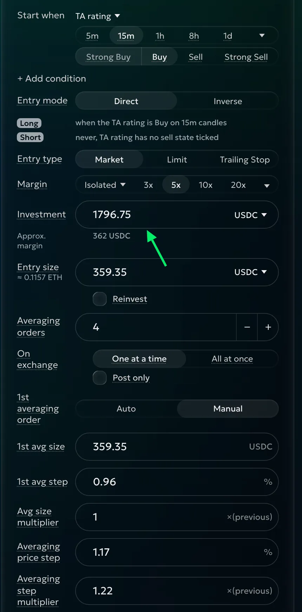
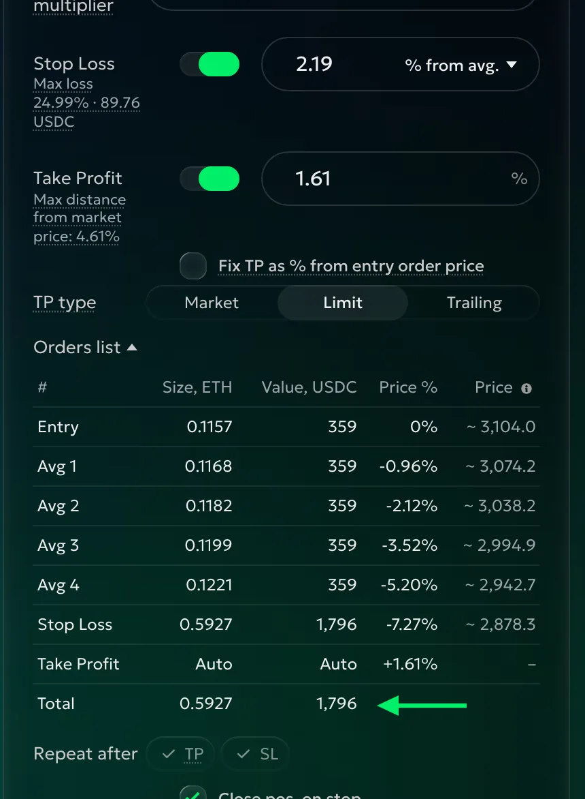

# AI agents

Connect Claude Desktop, Claude Code, Codex, Cursor or any other MCP app to goodcryptoX; a program uses the [API](api.md). Your goodcryptoX is a private installation on your computer, NAS or server. Its API and MCP tools connect to that installation; we run no public trading API or MCP server for you to connect to.

Our relay is the default way to reach your installation from another device. It cannot read your access key, requests or replies. A computer can instead use an [SSH tunnel](#use-an-ssh-tunnel-instead), bypassing the relay; a [phone](../phone.md) connects through the relay.

## What an agent can do

These actions are available through both MCP and the API. See the [tool reference](../reference/runtime/api.md#mcp-tools) for details. The key sets what goodcryptoX allows; the AI agent's own rules may allow less.

With any key, it can:

- **Accounts and holdings**: read your accounts, balances, positions, open orders and bots, plus account and goodcryptoX status.
- **Orders and history**: read order details and finished orders.
- **Bot details**: read plans, orders, results and funding payments.
- **Markets**: read available markets, their trading rules, and candle prices and volumes.
- **Previews and reports**: preview orders and bots without trading, and investigate what happened.

With a **Trade** key, it can also:

- **Orders**: place orders with take-profit and stop-loss, change its own orders and cancel non-bot orders on permitted accounts.
- **Leverage**: set leverage and margin mode.
- **Bots**: create and launch bots; change, stop or close bots it created.
- **Bulk actions**: cancel non-bot orders, stop its own bots or close positions matching a filter, including yours. Bot holdings stay unless it also stops its own bots with their positions closed.

Trading follows your [accounts, markets and limits](#keys-and-limits); cancellations reach non-bot orders on permitted accounts regardless of market. You pause and resume its bots through the key's **Suspend** and **Resume** in goodcryptoX; the agent cannot do that directly.

A **Propose** or **Trade** key can prepare orders and bots for you to review and launch in goodcryptoX. [Proposals](#proposals) do not trade until you launch them. It can take back a proposal of its own while it waits.

No key can withdraw or transfer funds, add or remove isolated margin, change your settings or create another key. A Trade key modifies only its own orders and bots, but can cancel any non-bot order on permitted accounts. It cannot cancel bot orders directly, even after the bot stops.

A key's **Order proposal** and **Bot proposal**, and the moment it is **at its limit**, reach you in Telegram, named after the key. **Order accepted**, **Cancel accepted** and **Bot created** come too unless you turn off **Notify me in Telegram** in the key's details; it starts on. What you do yourself in the panel sends none. The key's details in **Settings › MCP & API** keep its activity under **What it did**.

## Connect any MCP app or program

Open **Settings › MCP & API**. Press **Create key**, give it a name and choose what it may do:

- **Read** reads your orders, positions and bots. It changes nothing.
- **Propose** reads and proposes orders and bots for you to launch in the panel. Nothing trades without you.
- **Trade** reads, places and cancels orders and runs its own bots within your [accounts, markets and limits](#keys-and-limits).

Press **Create key** again, then **Copy** and **Done**. To see the key again later, open its row: **Key** shows it hidden, with **Show** and **Copy**. Give each app or program its own key so you can revoke one independently.

<!-- Picture placeholder: ../pictures/agents/01-mcp-api.webp — the keys, then the connect block: AI agents | API with the key at the right, the four app rows. -->

Under the keys, the connect block has two sides, **AI agents** and **API**, and at its top right the key it fills in: the key you made last is already chosen; pick another from the list. Each app has one row that says where its setup goes: copy it and paste it there. Your key, your installation's address and the way to reach it from another computer are already inside, so there is nothing to fill in. The same line works on the computer running goodcryptoX and on any other ([From another computer](#from-another-computer)). The lines are for the system of the browser you copy them in: copy them on the computer where the app runs.

Claude Code, Codex and Cursor start the connector with Node.js 18 or newer on the computer where they run; Claude Desktop brings its own. If your app says it cannot find `npx`, install Node.js for your system from [nodejs.org](https://nodejs.org/) and start the app again. The first start fetches the connector, which can take a few seconds.

### Claude Desktop

On Mac and Windows.

1. Press **Download** beside **Claude Desktop** and open the file, named after your key (double-click it). Claude Desktop opens its install window.
   <!-- Picture placeholder: ../pictures/agents/claude-desktop-1-install.webp — the install card with goodcryptoX's icon and Install. -->
2. Press **Install**. Claude Desktop shows this for every connector outside its directory. Ours talks only to goodcryptoX, with the key you give it, and reads nothing else on your computer.
   <!-- Picture placeholder: ../pictures/agents/claude-desktop-2-confirm.webp — the warning and its Install. -->
3. Claude Desktop asks for your **goodcryptoX access key**. Press **Copy** beside **Download** in goodcryptoX, paste the key and press **Save**.
   <!-- Picture placeholder: ../pictures/agents/claude-desktop-3-key.webp — Configure with the masked key field and Save. -->
4. Enable the extension: Claude Desktop installs it disabled until its key is saved.
   <!-- Picture placeholder: ../pictures/agents/claude-desktop-4-switch.webp — the extension's Disabled / Enabled switch. -->
5. Every goodcryptoX tool starts as **Ask**: Claude Desktop asks you before it uses one. On goodcryptoX's row press **Configure**, then set the tools you want it to use without asking from **Ask** to **Allow**; at least the read tools (the ones titled **Read …**), so it can look without asking every time.
   <!-- Picture placeholder: ../pictures/agents/claude-desktop-5-permissions.webp — Configure, the tools with Ask / Allow. -->
6. Ask “What orders do I have open?”. Your key sets the most the agent can do in goodcryptoX; Claude Desktop's permissions decide what it asks you about.

### Claude Code

In the terminal, the IDE and the Code tab.

1. Press **Copy** beside **Claude Code**.
2. Open a terminal on the computer where you use Claude Code (Terminal on Mac and Linux, PowerShell on Windows; the terminal inside your IDE works too), paste the line and press Return. Claude Code answers `Added stdio MCP server gcx … to user config`. Once is enough: its terminal, IDE and Code tab all use it. To replace it later (another key, a new line), first run `claude mcp remove <name>` with the name that follows `--scope user` in the line: Claude Code refuses a second line with the same name.
   <!-- Picture placeholder: ../pictures/agents/claude-code-1-added.webp — the pasted line and Claude Code's answer. -->
3. Run `claude mcp list`: goodcryptoX's entry reads `✓ Connected`. In a Claude Code session, `/mcp` lists it with its tools.
   <!-- Picture placeholder: ../pictures/agents/claude-code-2-connected.webp — claude mcp list with ✓ Connected. -->
4. Ask about your orders. Claude Code asks before it uses a tool the first time: answer **Yes**, or **Yes, and don't ask again** for that tool; `/permissions` shows and changes what it may use without asking.

### Codex

1. Press **Copy** beside **Codex**.
2. The easy way: paste the lines into Codex and ask it to add them to its config. Codex does it and tells you to restart; start it again.
   <!-- Picture placeholder: ../pictures/agents/codex-1-chat.webp — the lines pasted into Codex and its answer. -->
3. Or add them yourself: open Codex's config file in any text editor, and create it if it is not there: `~/.codex/config.toml` on Mac and Linux, `%USERPROFILE%\.codex\config.toml` on Windows. Its folder, `.codex`, is hidden: in the editor's **Open** dialog, on Mac press Cmd+Shift+G and type `~/.codex`; on Windows type the path above in the file name field. Paste the lines at the end, keeping what is already there, and save. Then start Codex again: a new `codex` in the terminal, or quit and reopen the Codex app.
4. `codex mcp list` shows goodcryptoX as `enabled`; in a session, `/mcp` lists its tools.
   <!-- Picture placeholder: ../pictures/agents/codex-2-list.webp — codex mcp list with goodcryptoX enabled. -->
5. Ask about your orders. Whether Codex asks before a tool depends on its approval setting (`/approvals` in a session).

### Cursor and other apps

1. Press **Copy** beside **Cursor and other apps**.
2. The easy way: paste the lines into Cursor's chat and ask it to add them to its MCP settings.
3. Or add them yourself: in Cursor, open **Cursor Settings** (Cmd+Shift+J on Mac, Ctrl+Shift+J on Windows and Linux), then **Tools & MCPs**, and press **Add Custom MCP**: Cursor opens its `mcp.json`. If the file is empty, paste the lines; if it already lists servers, paste only goodcryptoX's entry inside its `"mcpServers"`. Save.
   <!-- Picture placeholder: ../pictures/agents/cursor-1-mcp-json.webp — mcp.json with the pasted entry. -->
4. Back in **Tools & MCPs**, goodcryptoX is listed with its tools and a switch that turns it on or off.
   <!-- Picture placeholder: ../pictures/agents/cursor-2-tools.webp — Tools & MCPs with goodcryptoX switched on. -->
5. Ask the agent about your orders. Cursor asks before it runs a tool unless you let it run tools by itself in its settings.

Any other app that runs MCP servers over standard input and output takes the same entry: its command, its arguments and its environment. The connector is not a web address for a hosted chat service.

## From another computer

The same line works from any computer. When goodcryptoX does not run on the computer where your app runs, the connector reaches your installation through our relay, which cannot read your access key, requests or replies. Open goodcryptoX from that computer (through our relay or any way you reach it), copy your app's line and paste it as above.

The first time an app starts the connector, it pairs that computer with your installation, with a one-use code the line carries. The code works until it is used, for a day at most, whether or not goodcryptoX's page stays open; restarting goodcryptoX also ends it. From then on every app on that computer connects by itself. The computer appears in **Settings › Devices** as **Programs on …**, with **Remove**.

If your app says **This connector has expired. Download it again from goodcryptoX**, its line was not used within the day: copy the line again (or download Claude Desktop's file again) and replace the old one; in Claude Code, `claude mcp remove` the old one first.

Keep the copied lines private: they hold your key and, for a day, the code that pairs a computer. Claude Desktop's file holds the code but not the key: Claude Desktop asks for it. The code alone reads and trades nothing; an access key is still needed.

A running connector reconnects after sleep or a network interruption; your installation keeps trading while it runs and is connected to the exchange. To connect without our relay, use [an SSH tunnel](#use-an-ssh-tunnel-instead).

## Use an SSH tunnel instead

Instead of the relay you can use an SSH tunnel; if you do not know what that is, you do not need it. This alternative connects your computer directly to the computer running goodcryptoX.

<details>
<summary>Connect through SSH</summary>

1. On your computer, open Terminal (PowerShell on Windows) and forward a local port to goodcryptoX's port on the other computer. For example, if goodcryptoX uses port 8128:

   ```sh
   ssh -N -L 8128:127.0.0.1:8128 <user>@<server-address>
   ```

   Use your SSH user and address, adding `-i <private-key-file>` if needed. Use goodcryptoX’s actual port on both sides of the line and in the address below. Keep this command running.
2. Open `http://127.0.0.1:8128/gcx` through the tunnel, using goodcryptoX’s port. To sign in, run `gcx open --print` on the installation (`docker exec gcx gcx open --print` in Docker) and open its link within 60 seconds. See the [server](../install/server.md#sign-in) or [NAS](../install/nas.md#sign-in) guide for sign-in details.
3. In **Settings › MCP & API**, copy your app's line as above. While the tunnel runs, the connector finds goodcryptoX at that local address and talks to it directly.

Programs use that same local address and their own key. Closing the SSH command ends access from this computer; bots and orders keep running at the installation.

</details>

## Devices and removal

<!-- Picture placeholder: ../pictures/agents/05-program-devices.webp — separate browser and Programs on … rows, Rename and Remove. -->

**Settings › Devices** lists paired browsers and computers. Each **Programs on …** row covers the apps and programs sharing one computer login; you can rename or **Remove** it. Browser connections have separate rows.

**Remove** ends that computer's program connections, not its access keys. Pair it again to reconnect. Other computers remain connected. Orders already sent may finish; removal does not cancel orders, stop bots or close positions. Revoke a key separately to take away its access everywhere it is used.

## Keys and limits

Each key's row in **Settings › MCP & API** shows its open orders and bots, trading volume and PnL; open the row to see its limits and press **Edit** to change what it may do or its limits. Its proposals wait in the Trade page's **Proposals** tab ([Proposals](#proposals)).

<!-- Picture placeholder: ../pictures/agents/02-trade-key.webp — Trade scope, accounts, markets and the limits. -->

For a **Trade** key, choose **Accounts** and **Markets** (**All**, **Spot**, **Perps**, or **Custom**: a search and the markets you tick from its matches), then the limits you want. **All**, **Spot** and **Perps** include markets listed later. Accounts and markets restrict what it trades on; reading and proposing are not restricted. With no accounts or markets set, it cannot trade.

Every money limit starts off and reads **No limit**: turn on the ones you want and type their value. Limits are in USD, the app's base currency; a market quoted in a stablecoin counts one to one. A limit bounds the size of what the agent trades, its value, never the margin it uses: at 5x, a 1,000 USD order uses about 200 USD of margin.

| Section | Limit | What you allow |
|---|---|---|
| **Orders** | **Max per order** | The value of one order the agent places, including after a change. Exits from its own trades are not counted. |
| | **Max 24h volume** | Its orders in the last 24 hours, filled or still open. Exits from its own trades and its bots' orders are not counted. |
| **Bots** | **May run bots** | On (the default): all kinds of bots, or only the kinds you tick. Off: orders only. |
| | **Max per bot** | One bot's money: a DCA bot's entry and all its averaging orders, a Grid bot's total investment. |
| | **Max 24h volume** | The money of the bots it started in the last 24 hours. A DCA cycle counts when it starts; a Grid bot when launched and when its investment grows. |
| **Perps** | **Max per position** | The value of its position on one market after the order. Shown when its markets include perpetuals. |
| | **Max total positions** | The value of all its positions together after the order. |
| | **Margin** | **Isolated only** (the default) or **Any**. Isolated only keeps each position's loss to its own margin; cross margin can lose the whole account. |
| | **Highest leverage** | Starts at 5x: the most leverage it may set or use. For bots, checked at launch and when the key changes them. Shown, with Margin, when its markets include perpetuals. |

An order that makes a position smaller is always allowed, whatever the position limits say. The same key shares its limits across all apps and devices using it.

For the agent in this guide, Max 24h volume for orders is 10,000 USD and 9,800 USD is already used. Another 400 would take it to 10,200, so goodcryptoX refuses that order. Choose limits for the trading you intend, then copy the key and [connect your agent or program](#connect-any-mcp-app-or-program).

Treat the key like a password: anyone holding it can use its permissions wherever they can reach your installation.

- **Suspend** stops the key from trading and cancels its resting orders that would open or add to a position. Its bots pause: entry and averaging orders or Grid opening orders are cancelled, and no new cycle starts. Existing exits and positions remain, with take-profits and stop-losses still working. The key can still read.
- **Resume** lets it trade again and continues its bots, restoring the opening or averaging orders cancelled by the pause. Cancelled standalone orders stay canceled; no new key or pairing is needed. Review the market and the bot before resuming.
- **Revoke** stops the key working for good, including reads, and applies the same pause and cancellations. Its bots remain paused until you stop them. Make a new key to give access again. A revoked key that never did anything (no order, no bot, no proposal) is deleted; one with a record stays under **Revoked** with its history; **Active** lists the keys in use.

### What a trading key can do

It can place market, limit, stop and trailing orders, with take-profit and stop-loss, on its allowed accounts and markets. A change to one of its orders must fit its limits at the changed value.

It can cancel non-bot orders on its allowed accounts: yours, another key's and orders placed outside goodcryptoX as well as its own. The key uses the permitted commands on its own bots; you can cancel a stopped bot's leftover order yourself.

It may sell coins you already own or trade against your position within its limits. If this agent sells 0.1 ETH against your 1 ETH long on an account where positions are combined, your long becomes 0.9 ETH. Keep unrelated trading on another account if you want to avoid this.

### What the limits do not bound

These limits bound exposure, not loss. They do not cap losses on positions built over several days, prevent a badly timed trade or stop a key from moving or cancelling its own stop-loss. Several keys sharing an account add their exposure together.

Use a separate sub-account with only the funds you are prepared to risk. This separates the funds available to the agent from your other trading; it does not make its strategy safe.

### Its bots

A bot is bounded by its own limits, never by the order limits: its entry, averaging and grid orders are its plan. **Max per bot** is checked when the agent launches or changes a bot, and again when each DCA cycle starts. A launch over it is refused and no bot is created.

The bots' **Max 24h volume** counts each DCA cycle's money when the cycle starts, and a Grid bot's investment when it is launched and whenever it grows. If this agent launches three DCA bots with an entry of 500 USD and four averaging orders of 300 USD each, every cycle is 1,700 USD. Under a 5,000 USD limit the first two start; the third is created and waits, and you receive a Telegram message. It starts by itself once the first start is 24 hours old. Existing take-profits and stop-losses keep working meanwhile.

The key can change only bots it created directly. Use a strategy sheet (the example at the end of this page) to prepare and review a complete plan before allowing it to launch.

A key made before these limits keeps its old rule until you save its limits again: each bot order must fit its largest order, and each cycle counts up front against the one 24-hour allowance it shares with its orders.

### When a key meets a limit

The Dashboard shows **At its limit**, and Telegram names the agent and the limit reached. Open the key in **Settings › MCP & API** and review its activity and usage. Reduce the request, wait for allowance to free up, or change the limits yourself; the agent cannot raise them. Lowering them does not close existing exposure. Review **Orders → Open**, **Positions** and **Bots** when you need to reduce what is already running.

### Checking an order first

Ask for a preview before placing an order. It shows the proposed size, price, value and warnings without sending anything. The key's limits are checked on placement. A preview is a check of the plan, not approval of the trade.

A trading key's orders go through with the form's warnings; the exchange may still refuse them. Ask the agent to explain those warnings before trading. A Propose key keeps that decision in your hands.

## Proposals

A proposal is an order or a bot that a **Propose** or **Trade** key prepared for you. It waits until you launch or discard it; nothing trades before, and only you can launch it.

It reaches you in Telegram, with an **Open** link once you have paired a device, and waits at the top of the Dashboard in **Needs your attention**. To act on it:

1. Press **Open** in the Telegram message, or on the Dashboard row. The Trade page opens on its **Proposals** tab (it also lists every proposal waiting).
2. The order or bot form is filled with what the agent proposed, with a note saying who proposed it. Change what you like.
3. Launch it with the button the note names, or press **Discard** (also on the Dashboard row).

A proposal launches once. What you launch is yours: the key cannot change it. A key set to **Read** discards its waiting proposals, and so does revoking it.

A program can also take back a proposal of its own while it waits, with the `withdraw_proposal` tool or [the API](api.md#withdrawing-a-proposal). It leaves your list and **Needs your attention** at once and nothing is sent to you; the key's card lists it as withdrawn. It cannot withdraw another key's proposal, or one you have launched.

<details>
<summary>Example: a strategy sheet turned into a DCA bot</summary>

Here an AI agent turns a strategy sheet, a description of the bots you want to run, into a DCA bot in goodcryptoX.

1. **Choose how to approve.** Make a **Propose** key to review and launch each bot in goodcryptoX. Choose **Trade** to let the agent create bots itself, with the accounts, markets and limits you allow. Start with Propose if you want to check how it reads your sheet.
2. **Connect it** using [Connect any MCP app or program](#connect-any-mcp-app-or-program). For goodcryptoX on another computer, use [From another computer](#from-another-computer) to pair through the relay; an SSH tunnel is an alternative.
3. **Give it the sheet and your choice.** Start with one profile: “Prepare this ETH profile on my trading sub-account. Show me the settings before creating it.” Say which profiles you want; several profiles on the same market add their exposure.
4. **Compare the preview with the sheet.** Ask for goodcryptoX's bot preview. Check the entry, every averaging order, total investment, exits and repeat choices. With Propose, [open the proposal](#proposals) and check the filled form before **Launch**. With Trade, tell the agent when to create it.
5. **Check the result.** Open **Bots** and the bot's details. Review what the key did in **Settings › MCP & API**.

Here is one ETH DCA profile. Its entry and four averaging orders are each 359.35 USDC: five orders total 1,796.75 USDC for one cycle. The Take Profit is 1.61% above the average entry price. That target does not guarantee a profit after every cost or a fill at the target price.

| Sheet setting | What to check in goodcryptoX |
|---|---|
| Buy signal, 15-minute candles | **Entry condition: Signal**; under **Start when**, TA rating Buy on 15m; Buy includes Strong Buy |
| Long, following the signal | **Entry mode: Direct** |
| Market entry | **Entry type: Market** |
| 359.35 USDC per order | **Entry size: 359.35**, in USDC |
| Four equal averaging orders | **Averaging orders: 4**, **1st averaging order: Manual**, **1st avg size: 359.35**, **Avg size multiplier: 1** |
| First gap 0.96%; subsequent gap 1.1712%, multiplied by 1.22 | **1st avg step: 0.96%**, **Averaging price step: 1.1712%**, **Averaging step multiplier: 1.22** |
| Activate each averaging order when price reaches the preceding planned level. | **On exchange: One at a time**, **Post only** off |
| Take Profit 1.61% from average entry | **Take Profit** on at 1.61%, **TP type: Limit**, **Fix TP as % from entry order price** off |
| Stop 2.197609% below the last planned averaging order | **Stop Loss** on at 2.197609%; **Stop Loss as: From last avg. order, %**. |
| One cycle | **Repeat after:** both **TP** and **SL** off |

A sheet's decimal comma means the same number: 0,96% becomes 0.96%. Compare the preview's prices and amounts with the sheet. With these settings, the averaging orders are about 0.960%, 2.120%, 3.519% and 5.200% below the entry. Choose leverage and margin deliberately before launch.





Ask the agent to flag unsupported rules. Another platform's indicator settings, a modelled loss bound, a breakeven stop move or a time limit from the first fill may have no matching setting. It should explain the difference before you trade.

[Permissions](#keys-and-limits) decide whether the agent reads, proposes or trades; it cannot withdraw funds or raise its own allowance. For a direct **Trade** launch, the key's [bot limits](#its-bots) cover the bot's whole money: this profile's 1,796.75 USDC cycle is over a 1,000 USD **Max per bot**, so the bot is not created; revise the profile or the limit yourself. A proposal can still be prepared for you to review and launch.

</details>
