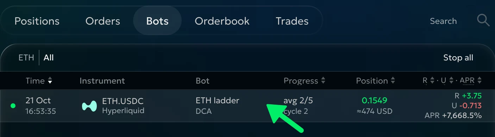
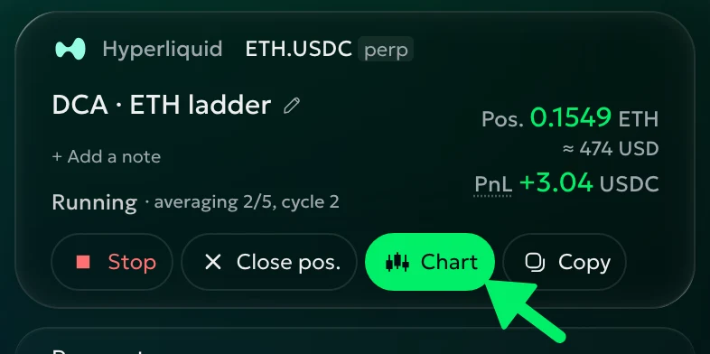
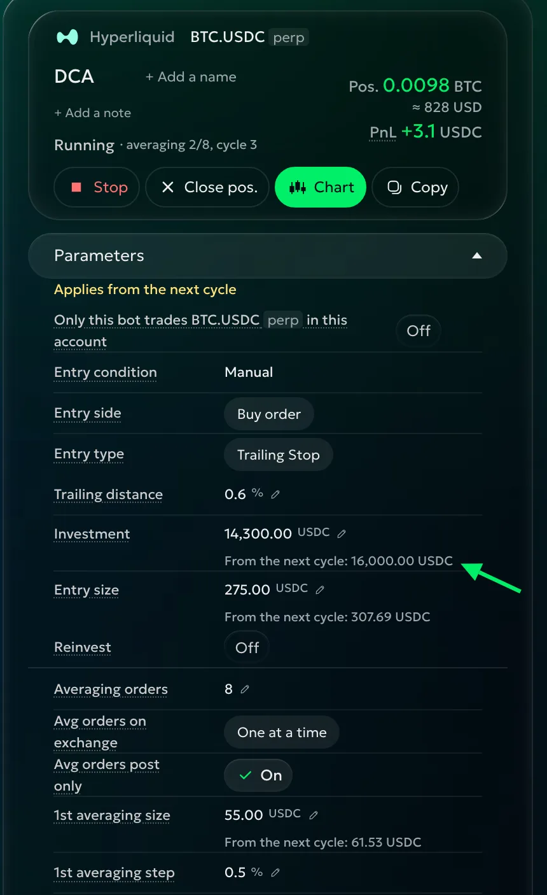
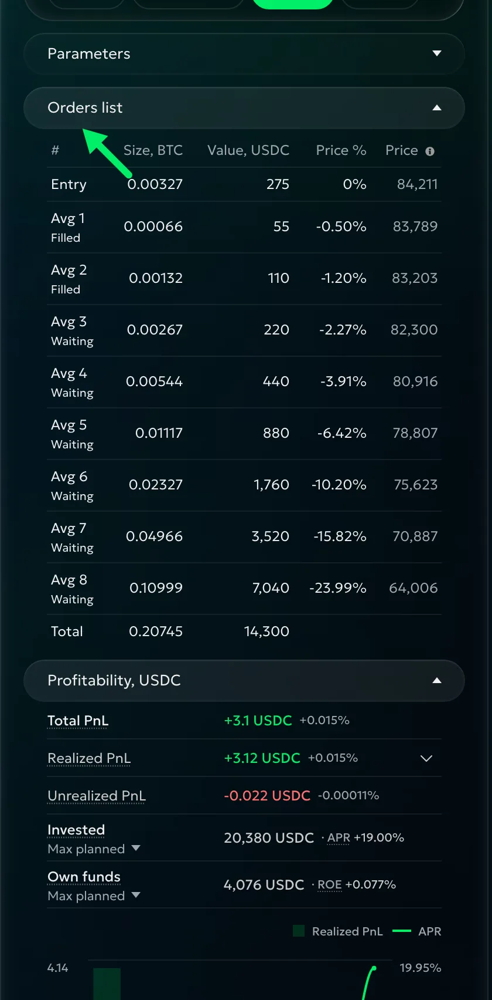
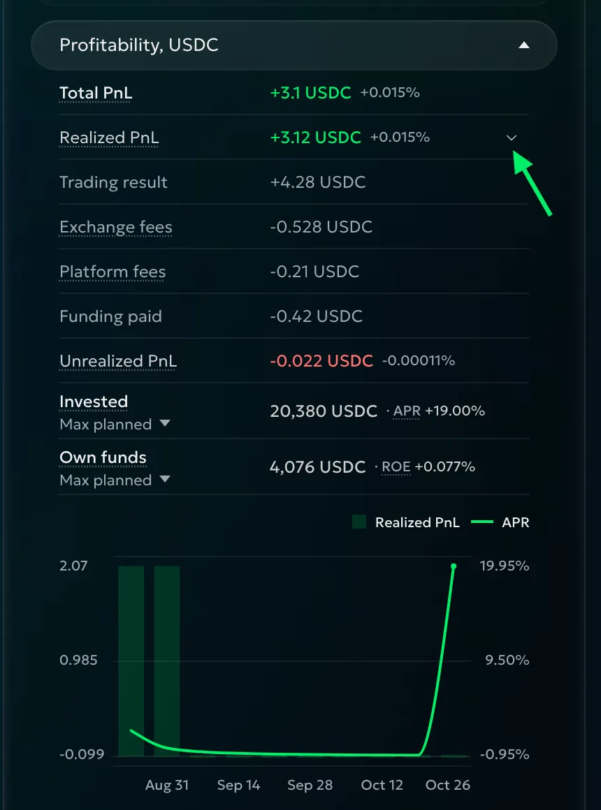
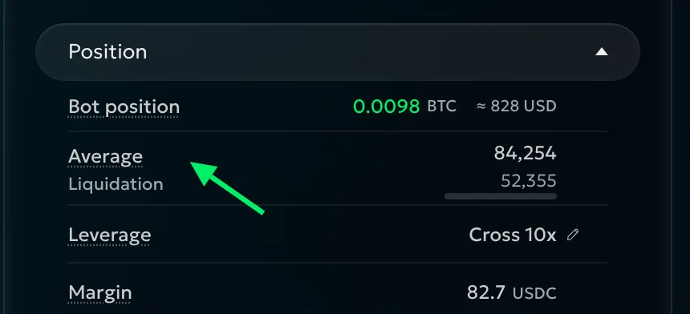
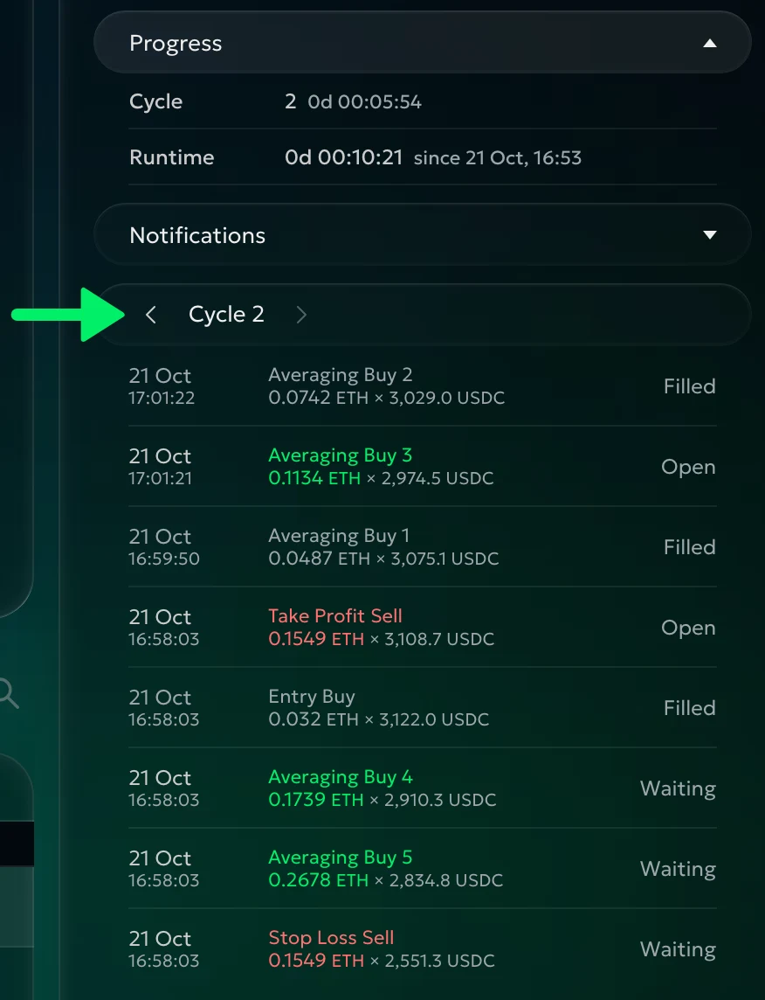
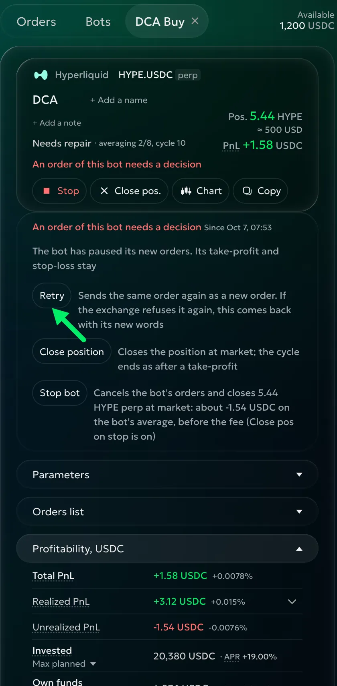

# Running the bot

<!-- Base: the 2026-10-21 running-page rewrite. The published old running page is video-only: https://docs.goodcrypto.app/dex-trading-spot/bots/dca-bot/running-the-bot. -->

## The Bots list

On **Trade**, open **Bots** under the chart and choose **DCA**:

| Column | What it shows |
|---|---|
| Status dot and **Time** | Point at the dot for status. Time is creation while active, ending when done. |
| **Instrument** | Pair and account. |
| **Bot** | Your name for the DCA bot. |
| **Progress** | **avg 2/8** means two of eight averaging orders filled; **cycle 3** is the current cycle. Failed orders appear in red. |
| **Position** | Coin amount and dollar value. |
| **R · U · APR** | Realized PnL, unrealized PnL and yearly rate so far. |

Click a heading to sort, or a row for details. Row actions include **Stop**, **Chart** and **Fix failed**. **Stop all** stops the running bots the filtered list shows, after confirmation.

## The bot's details

The details open in the right column, from the top down.

### The header

The header names the account, pair and bot, with status, cycle, position and total PnL. Use **+ Add a name** or **+ Add a note** to help identify it. **What happened?** explains an error or a problem needing attention.

- **Stop** cancels all the bot's orders, including Take Profit and Stop Loss. With **Close pos. on stop** on, it also closes the position; otherwise you keep it.
- **Close pos.** closes at market and ends the cycle. Another cycle needs **Repeat after** with **TP** selected, subject to Run, cooldown and entry conditions.
- **Chart** shows the bot on the chart.
- **Fix failed** sends failed averaging orders again at their prices.
- **Start now** starts a scheduled bot's entry process immediately.
- **Copy** fills the form with these settings. Change what you like and press Launch to start another bot.

### Parameters

Open **Parameters** to edit settings. Confirm with ✓ or Enter; × or Escape cancels.

**Close pos. on stop**, **Repeat after**, **Cooldown**, **TP from**, **Run**, **finish the cycle** and **Only this bot trades BTC.USDC perp in this account** apply at once; the checkbox names your chosen instrument. Other changes apply next cycle while one is open. For example, changing Entry size from 100 to 150 leaves this cycle's entry unchanged. The pending value appears below the running value. See [Features & setup](dca-setup.md) for field meanings.

**Move to break even** fixes this cycle's **Take Profit** at a price that covers the position's cost and fees already paid. It excludes the closing fee. Later averaging does not move this fixed price.

A stopped bot allows only its name and note to change. Use Copy to prepare another trading plan.

### Orders list

This is the planned ladder for the selected cycle: entry, averaging orders, Stop Loss and Take Profit, with size, value, distance and price. Failed orders are red; below-minimum orders are grey. Use it to check which averaging levels remain before your stop.

### Profitability

**Total PnL** combines **Realized PnL** and **Unreal. PnL**: +20 realized and −30 unrealized means −10 total, before closing fees. Open Realized PnL to see trading result, exchange fees, platform fees and funding. Unrealized values the open position at the last traded price.

**Invested** is the bot's investment; **Own funds**, on perpetuals, is your own money backing it. Choose a base:

- **Max planned** — the largest planned entry-and-averaging total of a cycle so far.
- **Max reached** — the most funds used at one time.
- **Average** — the funds used on average over running time.

PnL percentages use Max planned. **APR** projects the realized return over a year; **ROE** shows realized return on your own funds. Neither promises future earnings. The chart shows realized PnL bars and an APR line; historical APR is estimated, and older history may show only the current point.

With quote Investment and Reinvest, **incl. … reinvested** shows profit included in this cycle's sizes, or a negative amount after losses. Account-percent sizing has no separate line.

### Position

**Bot position** is this bot's share. For example, it may hold 0.1 ETH within your account's 1 ETH. **Account position** shows the whole position when it differs. **Average** is the account's average on perpetuals, the bot's on spot.

**Liquidation** is the exchange's liquidation price. **Leverage** and **Margin** belong to the account position. Changing leverage affects that whole position and resizes unfilled account-percent averaging orders; the bot's position and exits keep their sizes.

### Progress, Notifications and the cycle's orders

**Progress** shows the cycle and runtime. Use the cycle arrows to review another cycle's orders. Click an order for its fills, fees and times; **Show more** opens more activity. **Show funding** includes funding payments. Liquidation and auto-deleveraging appear as **Liquidation** and **ADL** in red. An open order of a stopped or errored bot offers **Cancel**; Cancel all leaves bot orders alone.

## What goodcryptoX tells you

Choose **Stop/error**, **TP/SL** and **Entry/avg. orders** in Notifications; From level 0 includes entry. Messages report later fills, automatic changes and stops. Errors and problems needing your decision arrive regardless of these switches.

## When the bot needs you

**Needs repair** names the problem and offers actions such as **Retry**, **Close position** or **Stop bot**. The bot takes no new risk while existing exits keep working. Read what each choice will do before confirming.

With Only this bot trades on, an unexpected position difference may need a decision: **Exchange is right** accepts the exchange position; **Bot is right** keeps the bot's count. A notice about other resting orders offers **Accept** or **Stop bot**; the bot keeps running meanwhile.

A failed averaging order does not stop the bot; use **Fix failed** to retry it. When the bot ends, **Copy** prepares another.
