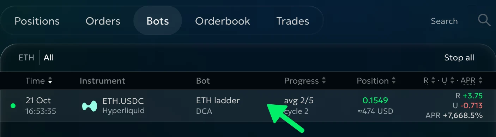
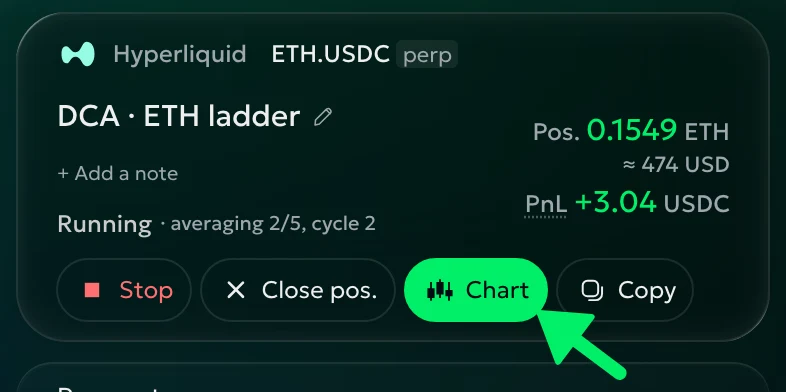
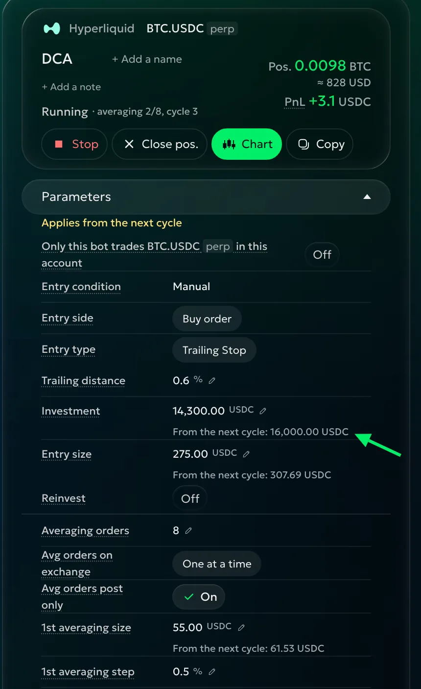
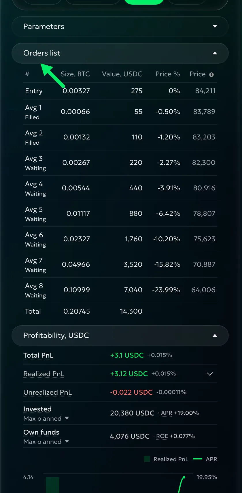
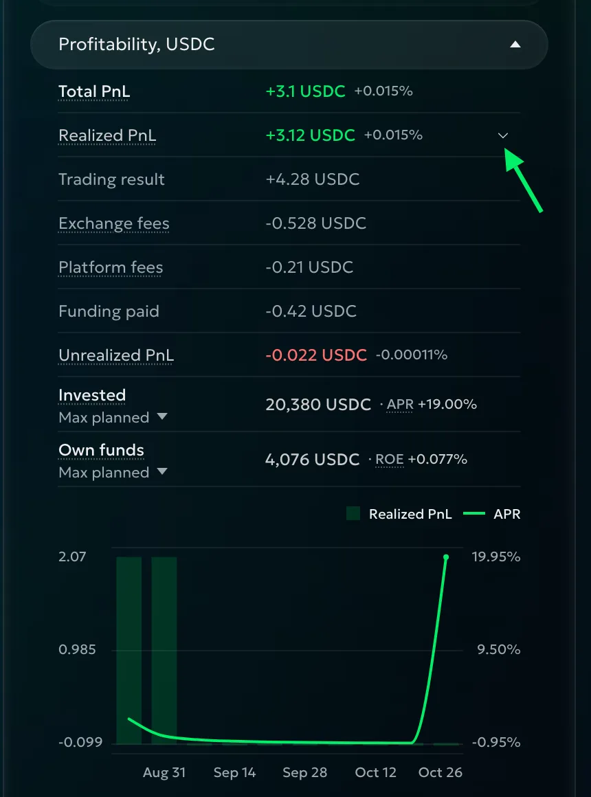
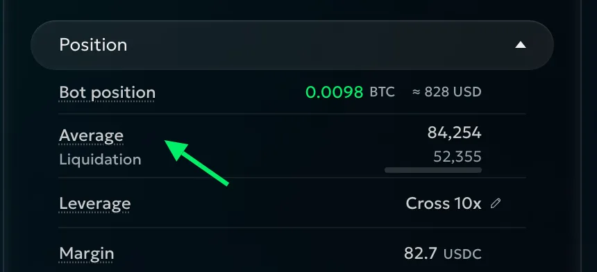
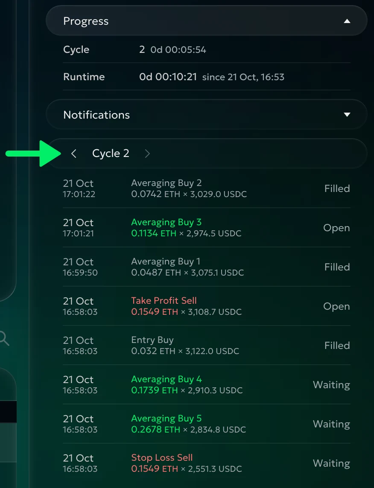
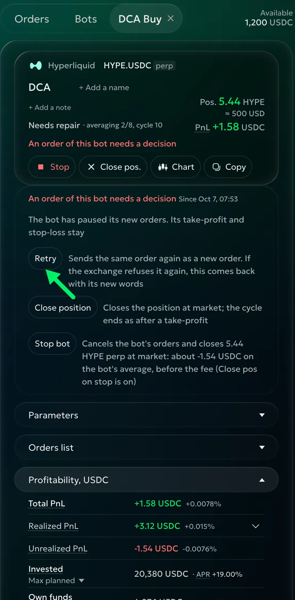

# Running the bot

<!-- Base: the 2026-10-21 running-page rewrite. The published old running page is video-only: https://docs.goodcrypto.app/dex-trading-spot/bots/dca-bot/running-the-bot. -->

Once goodcryptoX's DCA bot runs, you follow it in the Bots list on the Trade page and in its details: position, orders, profitability and progress. You can change its settings while it runs, stop it, or copy it to start another.

## The Bots list

On **Trade**, open **Bots** under the chart and choose **DCA**:

<figure><figcaption></figcaption></figure>

| Column | What it shows |
|---|---|
| Status dot and **Time** | Point at the dot for status. Time is creation while active, ending when done. |
| **Instrument** | Pair and account. |
| **Bot** | Your name for the DCA bot. |
| **Progress** | **avg 2/8** means two of eight averaging orders filled; **cycle 3** is the current cycle. Failed orders appear in red. |
| **Position** | Coin amount and dollar value. |
| **R · U · APR** | Realized PnL, unrealized PnL and yearly rate so far. |

Click a heading to sort, or a row for details. Row actions include **Stop**, **Chart** and **Fix failed**. **Stop all** stops the running bots the filtered list shows, after confirmation, and says how many stopped and how many are stopping. A bot whose order's cancel the exchange never answered reads "An order of this bot needs a decision" while it stops: **Retry** on its item sends that cancel again; **Refresh** on the order's details asks the exchange about it.

## The bot's details

The details open in the right column, from the top down.

### The header

<figure><figcaption></figcaption></figure>

The header names the account, pair and bot, with status, cycle, position and total PnL. Use **+ Add a name** or **+ Add a note** to help identify it. **What happened?** explains an error or a problem needing attention.

- **Stop** cancels all the bot's orders, including Take Profit and Stop Loss. With **Close pos. on stop** on, it also closes the position; otherwise you keep it.
- **Close pos.** closes at market and ends the cycle. Another cycle needs **Repeat after** with **TP** selected, subject to Run, cooldown and entry conditions.
- **Chart** shows the bot on the chart.
- **Fix failed** sends failed averaging orders again at their prices.
- **Start now** starts a scheduled bot's entry process immediately.
- **Copy** fills the form with these settings. Change what you like and press Launch to start another bot.

### Parameters

<figure><figcaption></figcaption></figure>

Open **Parameters** to edit settings. Confirm with ✓ or Enter; × or Escape cancels.

**Close pos. on stop**, **Repeat after**, **Cooldown**, **TP from**, **Run**, **finish the cycle** and **Only this bot trades BTC.USDC perp in this account** apply at once; the checkbox names your chosen instrument. Other changes apply next cycle while one is open. For example, changing Entry size from 100 to 150 leaves this cycle's entry unchanged. The pending value appears below the running value. See [Features & setup](dca-setup.md) for field meanings.

**Move to break even** fixes this cycle's **Take Profit** at a price that covers the position's cost and fees already paid. It excludes the closing fee. Later averaging does not move this fixed price.

A stopped bot allows only its name and note to change. Use Copy to prepare another trading plan.

### Orders list

<figure><figcaption></figcaption></figure>

This is the planned ladder for the selected cycle: entry, averaging orders, Stop Loss and Take Profit, with size, value, distance and price. Failed orders are red; below-minimum orders are grey. Use it to check which averaging levels remain before your stop.

### Profitability

<figure><figcaption></figcaption></figure>

**Total PnL** combines **Realized PnL** and **Unreal. PnL**: +20 realized and −30 unrealized means −10 total, before closing fees. Open Realized PnL to see trading result, exchange fees, platform fees and funding. Unrealized values the open position at the last traded price.

**Invested** is the bot's investment; **Own funds**, on perpetuals, is your own money backing it. Choose a base:

- **Max planned** — the largest planned entry-and-averaging total of a cycle so far.
- **Max reached** — the most funds used at one time.
- **Average** — the funds used on average over running time.

PnL percentages use Max planned. **APR** projects the realized return over a year; **ROE** shows realized return on your own funds. Neither promises future earnings. The chart shows realized PnL bars and an APR line; historical APR is estimated, and older history may show only the current point.

With quote Investment and Reinvest, **incl. … reinvested** shows profit included in this cycle's sizes, or a negative amount after losses. Account-percent sizing has no separate line.

### Position

**Bot position** is this bot's share. For example, it may hold 0.1 ETH within your account's 1 ETH. **Account position** shows the whole position when it differs. **Average** is the account's average on perpetuals, the bot's on spot.

<figure><figcaption></figcaption></figure>

**Liquidation** is the exchange's liquidation price. **Leverage** and **Margin** belong to the account position. Changing leverage affects that whole position and resizes unfilled account-percent averaging orders; the bot's position and exits keep their sizes.

### Averaging before liquidation

**No avg order before liquidation** means there is no remaining averaging order between the current price and the account position's liquidation price. An averaging level beyond liquidation cannot help before the exchange liquidates the position. Compare the remaining ladder, Stop Loss and liquidation price; the warning does not promise that an order before liquidation will prevent it.

### Progress, Notifications and the cycle's orders

<figure><figcaption></figcaption></figure>

**Progress** shows the cycle and runtime. Use the cycle arrows to review another cycle's orders. Click an order for its fills, fees and times; **Show more** opens more activity. **Show funding** includes funding payments. Liquidation and auto-deleveraging appear as **Liquidation** and **ADL** in red. An open order of a stopped or errored bot offers **Cancel**; Cancel all leaves bot orders alone.

## What goodcryptoX tells you

Choose **Stop/error**, **TP/SL** and **Entry/avg orders** in Notifications; From level 0 includes entry. Messages report later fills, automatic changes and stops. Errors and problems needing your decision arrive regardless of these switches.

## When the bot needs you

<figure><figcaption></figcaption></figure>

**Needs repair** names the problem and offers actions such as **Retry**, **Close position** or **Stop bot**. The bot takes no new risk while existing exits keep working. Read what each choice will do before confirming.

With Only this bot trades on, an unexpected position difference may need a decision: **Exchange is right** accepts the exchange position; **Bot is right** keeps the bot's count. A notice about other resting orders offers **Accept** or **Stop bot**; the bot keeps running meanwhile.

A failed averaging order does not stop the bot; use **Fix failed** to retry it. When the bot ends, **Copy** prepares another.

### Accepting the exchange position

**Exchange is right** previews the position the bot will count: size, average price and realized PnL. A zero position has no average price; its realized PnL still remains. Read these figures before accepting.

If the known trades do not explain the whole difference, the preview also shows a **Correction**. This changes the bot's count without inventing a trade or profit: the correction itself has zero PnL. The preview can show a remaining position or zero, with or without a correction.

### A refused sale

The choices depend on why the exchange refused the sale. **Retry** sends the displayed size again at market. If fewer coins are available than the bot counted, **Exchange is right** sells what is available to the bot; the cycle ends if nothing remains.

If the rest is below the exchange's minimum, accepting it removes that rest from the bot's count as a zero-PnL **Correction**. The coins stay in your account and the cycle ends as that exit would have ended it.

When your other orders hold the coins the bot needs to sell, **Cancel that order** cancels enough of those orders and retries the sale. Review the orders named before choosing it.

### Matching the account to the bot

**Make the exchange match the bot** cancels every other order resting on the coin in this account, your own included, and buys or sells at market to restore the position the bot counts. Before confirming, read the side, size, target position, approximate cost, maximum cost and estimated fee. Only the fee affects the bot's profit; the repair trade does not become strategy profit.

A thin-orderbook warning means the price may move more than 25%. The cost is an estimate, not a promised fill. This choice changes the account, so it can affect trading outside this bot too.

## Questions

### Can I change a running bot?

Yes: open **Parameters** and edit a setting. Some apply at once; the others apply from the next cycle while one is open.

### What happens when I stop the bot?

**Stop** cancels all the bot's orders, including Take Profit and Stop Loss. With **Close pos. on stop** on, it also closes the position; otherwise you keep it.

### What if an averaging order fails?

The bot keeps running; **Fix failed** sends failed averaging orders again at their prices.

### Is funding included in the bot's result?

Yes: on perpetuals, funding paid or received is included in the bot's result. Open **Realized PnL** to see it beside the trading result and fees.
