# Features & setup

<!-- Base: the 2026-10-21 rewrite of https://docs.goodcrypto.app/dex-trading-spot/bots/dca-bot/features-and-setup. Current DCA pictures retained where applicable; replacement captures are listed in DOCS-STYLE-BOTS-HANDBACK.md. -->

First, connect your exchange account in **Settings › Exchanges**. On **Trade**, choose your account and pair, then select **Bots** and **DCA** in the right column. The bot's PnL is in the pair's quote currency, such as USDC.

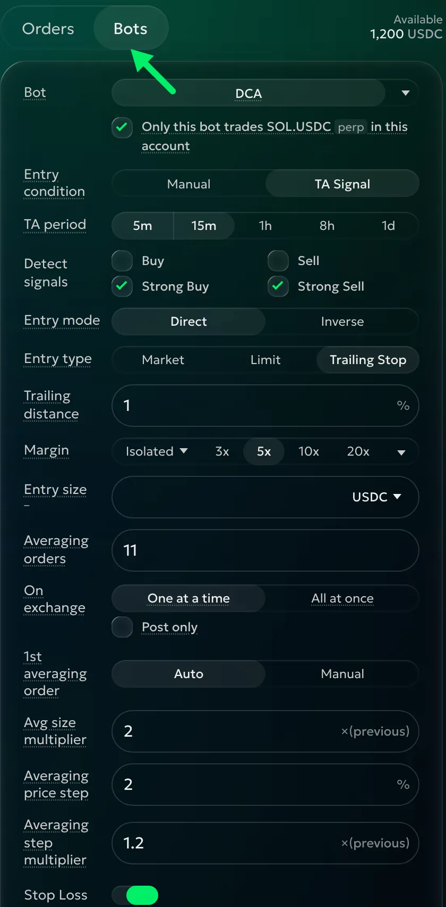

Tick **Only this bot trades BTC.USDC perp in this account** if you intend this bot to be the only trader of that instrument there. The instrument name changes with your pair. This choice does not prevent other trading; see [Running the bot](dca-running.md#when-the-bot-needs-you) if a position needs review.

Choose when to enter:

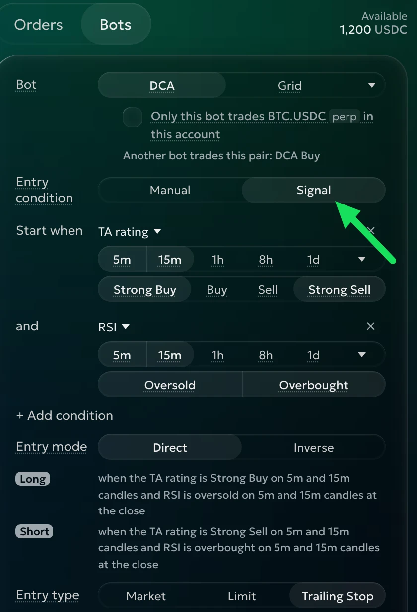

**Entry condition** — **Manual** starts each cycle after its start time and cooldown. **Signal** waits for your **Start when** conditions. Choose TA rating, RSI, MACD, Bollinger bands or Price move; use **+ Add condition** to combine them.

**Start when** — choose the state and candle intervals for each indicator. Every condition must agree on every selected interval: Buy on 5m AND 15m needs both. Buy includes Strong Buy; Sell includes Strong Sell. Select only the intervals you want the bot to wait for. The candle menu offers more intervals; all your selected intervals must agree, including those outside the visible strip. Check all your selections before launching.



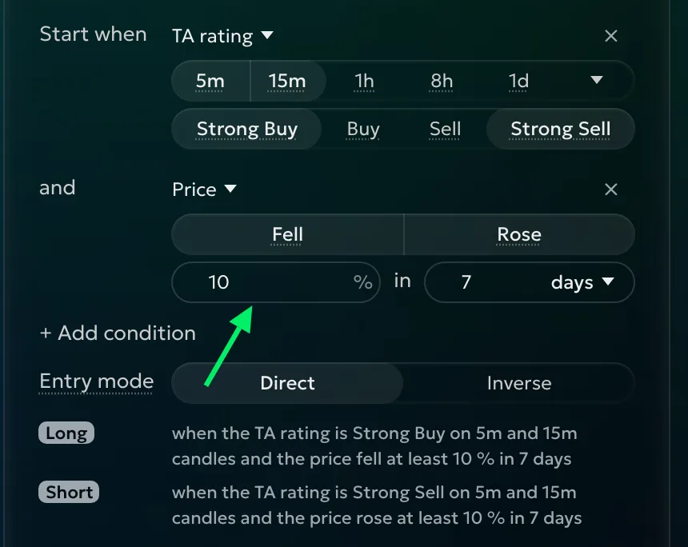

**Entry side**, with Manual, chooses a **Buy order** or **Sell order**. On spot, Sell needs coins you own.

**Entry mode**, with Signal: **Direct** buys on buy-side agreement and sells on sell-side agreement; **Inverse** reverses those sides. Mixed readings, or both sides agreeing together, wait. Check the Long and Short lines (Buy and Sell on spot). The bot holds one position at a time.

Next, choose how to enter:

**Entry type** — **Market** enters at market when the cycle starts. **Limit** waits at your **Limit distance**: with price 100 and a 5% distance, a Buy limit is 95. Each new cycle measures from its starting market price. Choose Limit when you want to wait for a better price.

**Trailing Stop**, the default, follows a falling price and buys on a rebound by your **Trailing distance**. Starting at 100, a fall to 90 with a 10% distance gives a trigger of 99. A Sell entry works the other way round. Averaging orders are always Limit orders.

**Margin**, on perpetuals, chooses margin mode and leverage where supported. Check [Margin and liquidation](dca.md#margin-and-liquidation) before using leverage.

**Investment** — the planned total of your entry and averaging orders. Orders of 100, 200 and 400 total 700. Doubling Investment doubles their sizes while keeping the ladder's shape. Choose **% of account** to use a share of your account value, including unrealized PnL: it targets Approx. margin on perpetuals and the orders' total on spot.

**Entry size** — the first order's value in the quote currency, or quantity in the coin. Averaging orders use the same unit. We suggest sticking with the quote currency for **Entry size**, unless you want a fixed coin amount at each level. Typing Entry size returns Investment to the quote currency.

**Reinvest** — adds realized profit after fees and funding to future cycles; losses reduce them. With 700 invested and 70 profit, the next planned cycle is 770. With % of account, Reinvest stays on because account value already includes the result. Review **Orders list** after changing sizes.

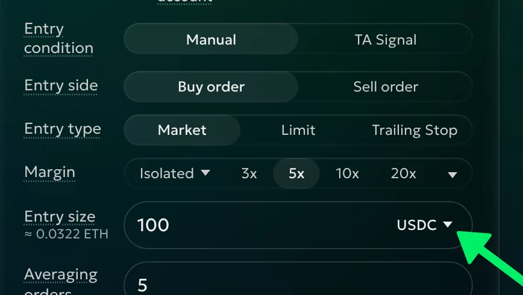

Now set the averaging ladder:

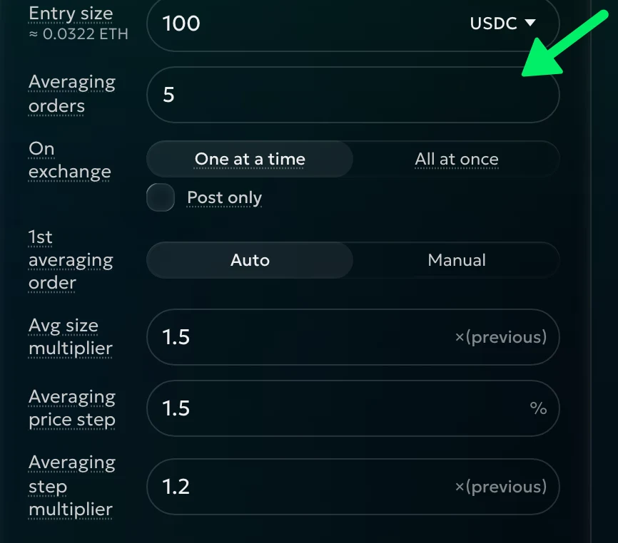

**Averaging orders** — the number of additional orders, from 0 to 100. Buy averaging orders go below entry; Sell averaging orders go above it. Choose the count for the price range you want to cover.

**On exchange** — **One at a time**, the default, activates each averaging order at the previous planned price, even if the previous order has not filled. **All at once** places the limits after entry begins filling. Distant orders may wait for the exchange to accept their prices. **Post only** can refuse an order that would fill immediately.

**1st averaging order** — **Auto** applies your size multiplier and price step from the first averaging order. Choose **Manual** to give that first order its own settings:

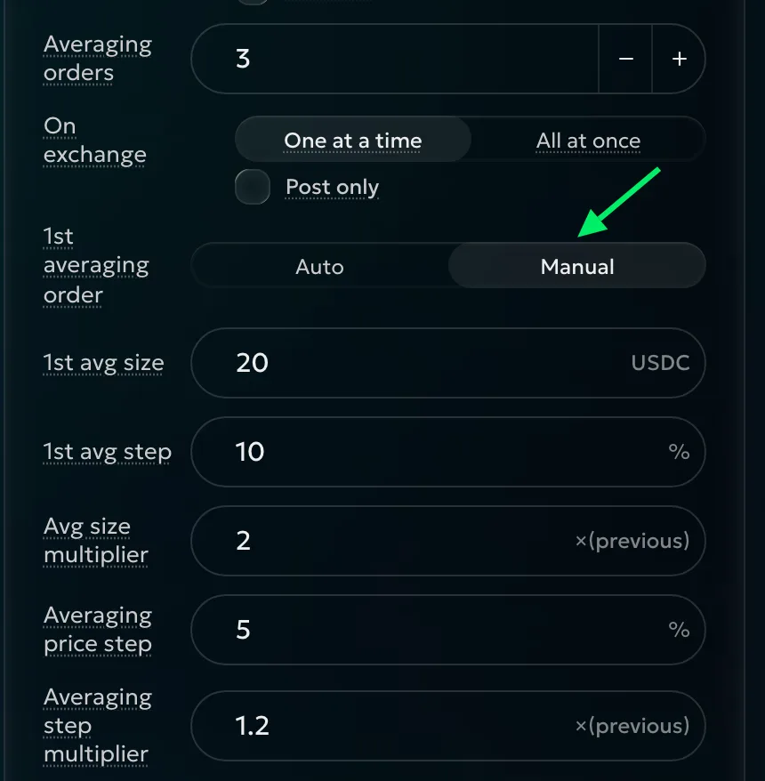

**1st avg size** sets the first averaging order's value or coin amount. For example, enter 20 in your selected unit. Use it when the first addition should differ from the rest of the sequence.

**1st avg step** sets the first averaging order's distance from entry. For a Buy entry at 100, 10% places it at 90; later gaps begin at your **Averaging price step**, for example 5%. Check the preview to see both distances.

**Avg size multiplier** — how much each order grows from the previous one. At 1, sizes stay equal; at 2, each doubles. In Auto, the first averaging size is your entry size times this multiplier. Choose larger multipliers only with the whole ladder's total in mind.

**Averaging price step** — the basic percentage gap between averaging orders.

**Averaging step multiplier** — widens or narrows later gaps. With a 2.5% price step and multiplier 1, every gap is 2.5%. At multiplier 2, the first order is 2.5% below entry, the second 2.5% below the first, the third 5% below the second, and the fourth 10% below the third. Check the ladder rather than assuming every gap doubles from entry.

Next, choose your exits. Both are optional:

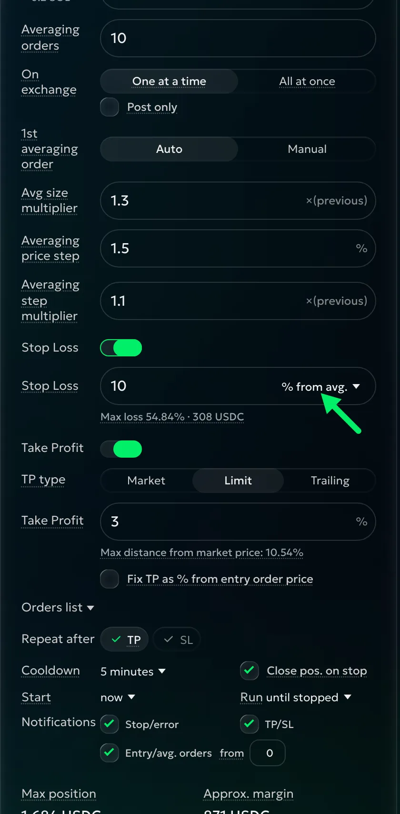

**Stop Loss** — the percentage distance from the last planned averaging order, or entry when there are none. For a Buy ladder ending at 80, a 5% stop is 76. It closes the bot's position and cancels averaging orders and Take Profit. The menu also offers **Max loss, %**, an estimated loss if all planned orders fill and the stop closes at its planned price. This loss is a share of margin on perpetuals, or funds on spot. The line below shows the other reading and the loss in money. Choose the distance for where you want to exit, then review its estimated loss.

> Max loss is an estimate, not a guaranteed limit. Gaps and fees can make the loss larger; on perpetuals, liquidation can come first.

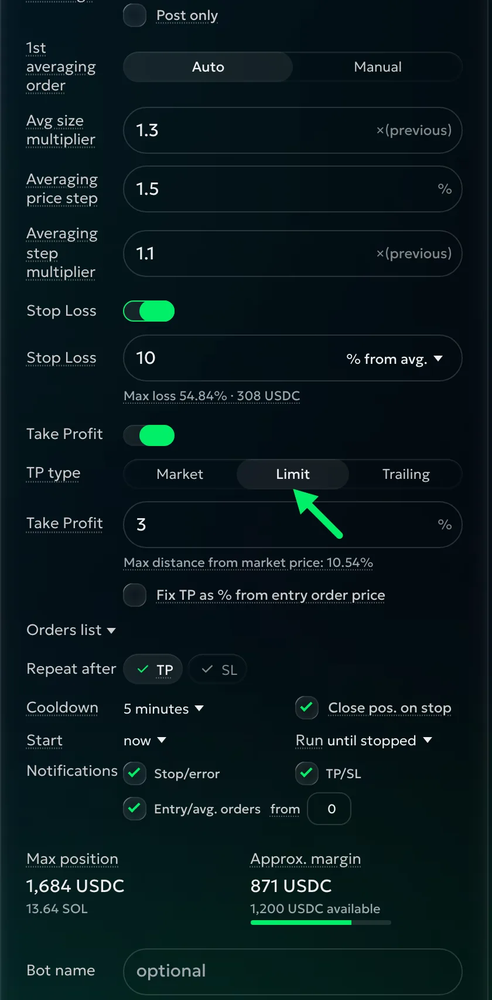

**Take Profit** — the distance from your average entry, 3% by default. An average of 95 gives a target of 97.85. It follows averaging fills unless fixed to entry or moved to break even.

- **Limit** rests on the exchange and fills at its price or better.
- **Market** closes at market when price reaches the target.
- **Trailing** starts following at **Trailing start**. It follows a favourable move at **Trailing distance** and closes at market on a reversal. Once trailing begins, averaging orders and Stop Loss are canceled.

**Fix TP as % from entry order price** keeps the target tied to entry. Buying at 20,000 with 50% sets 30,000, however low you average. Choose it when that original price remains your target.

**Max distance from market price** shows how far the target would be from price after all averaging fills.

> A Limit Take Profit works while goodcryptoX is off. Market and Trailing Take Profit, and Stop Loss, need goodcryptoX running. On spot, a Limit Take Profit must be canceled before Stop Loss sells, which can worsen the stop's fill price.

Press **Orders list** to review the entry, averaging orders, Stop Loss and Take Profit, with size, value, distance and price. **Total** is the whole ladder. An averaging order under the exchange minimum says “not sent”: the bot skips it.

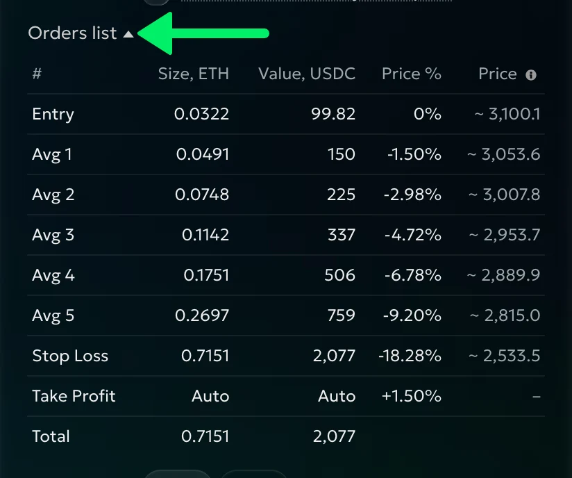

The chart draws the same ladder:

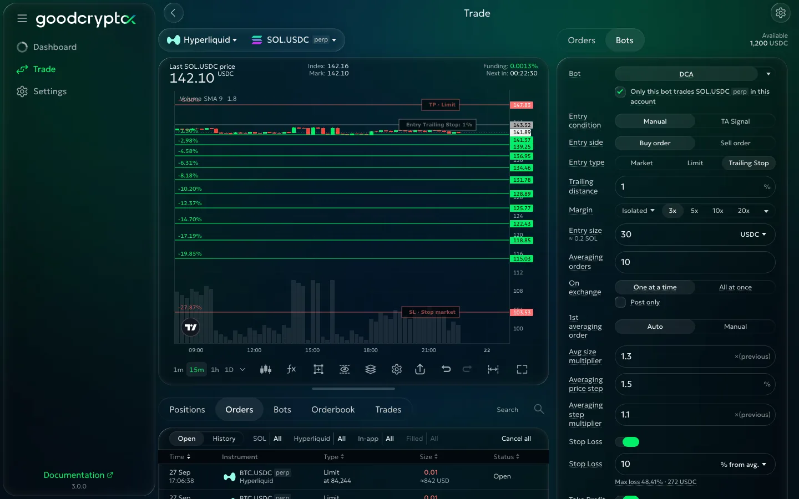

Then choose what happens after a cycle:

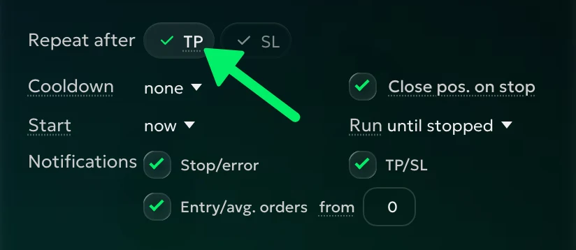

**Repeat after** — choose **TP** and **SL** separately. For example, repeat after TP and stop after SL. Closing the position yourself follows the TP choice; with Take Profit off, that choice reads **Close pos.**

**Cooldown** — the wait before another cycle. Five minutes lets the bot wait after an exit before starting again.

**Close pos. on stop** — on by default. Your Stop, an error or the end of a timed run also closes the position at market. Off leaves it yours to manage.

**Start** — now, after a delay or at your chosen time. Signal and order-price conditions still need to be met.

**Run** — until stopped, for days or for cycles. With days, **finish the cycle** lets the last cycle reach its exit; unticked, the bot stops when the days end. Choose one cycle for a single pass through the plan.

**Notifications** — choose **Stop/error**, **TP/SL** and **Entry/avg. orders**, with **From level** 0 including entry.

Finally, check the funds:

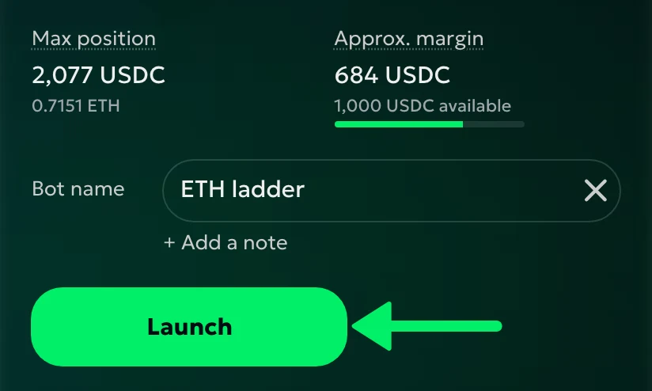

**Max position** is what the bot holds after entry and all averaging orders fill. On spot, **Funds needed** shows the coins or quote currency needed for the ladder. On perpetuals, check **Approx. margin** and **Approx. liquidation** before launching; see [Margin and liquidation](dca.md#margin-and-liquidation). Check the warning against your intended stop and averaging range.

Add a **Bot name** and **Note** if you like. Review the description under **Launch**, then launch. A trading warning offers **Launch anyway**; check the named issue first, since the exchange may refuse the order.

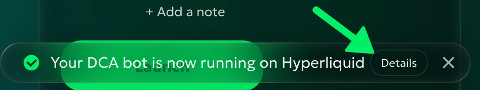

Open **Details** or find the bot in **Bots**. Check the position and working orders there before leaving the bot to trade. A delayed start waits for its time; Signal then waits for its conditions. If you have no answer after Launch, check **Bots** before trying again. Continue with [Running the bot](dca-running.md).
