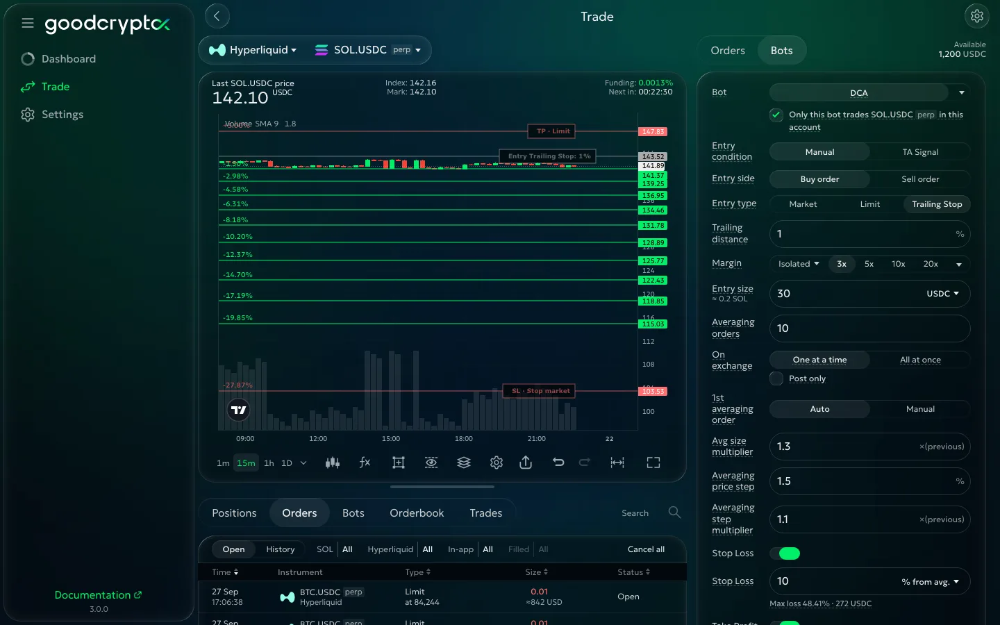

# DCA bot

<!-- Base: https://docs.goodcrypto.app/dex-trading-spot/bots/dca-bot and the 2026-10-21 rewrite; facts checked against integrated 3.1 (D2b/D2c and DOCS-AUDIT-3.1). -->

<figure><figcaption></figcaption></figure>

DCA stands for dollar-cost averaging. A DCA bot in goodcryptoX opens a position on your chosen exchange, then adds to it at set prices if the market moves against you. Buying lower reduces your average entry price; on a short, selling higher raises it.

## Trading bots

A trading bot places orders automatically according to the rules and parameters you choose. Choose the account, pair and strategy in the Bots form, review the planned orders, then launch. You can follow its orders and result in the Bots list.

## How DCA works

For example, buying equal amounts of a coin at 100 and 90 gives you an average entry of 95. A 3% take-profit target is then 97.85, before fees. You need a smaller rebound to reach that target than you would after buying only at 100.

You choose the entry, the averaging orders and the exits. The entry can start manually or wait for your technical signals. As averaging orders fill, the bot adjusts the size of its Take Profit and Stop Loss to the position; Take Profit normally follows the new average entry, while Stop Loss stays at its planned distance from the last averaging level. After Take Profit or Stop Loss, the bot can stop or repeat with the same settings. This gives you several ways to use it:

1. **SAFETY NET**\
   Enter positions knowing that should the market move against you, you'll buy more at a lower price and your enabled TP target will follow the new average unless fixed to entry or moved to breakeven. All without you lifting a finger.
2. **VOLATILITY SCALPER**\
   Run the bot on volatile coins on repeat, covering 50%+ price range with averaging orders. A size multiplier of 2 makes successive orders grow: 10, 20, 40, 80 in your chosen unit. This puts more money into the position as price moves against you. Choose the sizes with the full sequence in mind, rather than only the first order.
3. **SCALE ORDER**\
   If your entry strategy involves placing multiple orders on several levels, use the bot to do that for you. If you want to keep that position, turn **Take Profit** off, untick **Close pos. on stop**, and stop the bot once you hold the amount you wanted. You then manage the position yourself.
4. **MULTIPLE TAKE PROFITS**\
   If you want to place multiple Take Profits for coins you hold on spot, start the bot with a **Sell order** on that pair. The bot's entry and averaging orders will act as your Take Profit levels. Turn **Take Profit** and **Stop Loss** off and untick **Close pos. on stop** so the bot does not buy the coins back.
5. **BTFD**\
   Buy the f\*ing dip! Accumulate ETH, BTC, SOL and other top coins automatically taking advantage of the market dips. Trend is your friend: if you believe that the coin will ultimately go up, then the lower it goes the more you want to buy it. DCA bot is the perfect tool for it. You can leave the purchased coins in your account by using the same [exit choices](dca-setup.md) as for a scale order.

> Averaging increases your position while price moves against you. A rebound may never reach your target; a continued move can cause a large loss.

Find trading ideas and share your experience in our [DCA Telegram channel](https://t.me/+EFAh0cdHrXw0OTNh).

## Spot and perpetuals

On spot, you buy the coin itself. A Sell order needs coins you already hold, including enough for the planned selling ladder. There is no leverage or liquidation.

On perpetuals, you can open longs or shorts and choose margin mode and leverage where supported. Funding paid or received is included in the bot's result. Check the funds in [Features & setup](dca-setup.md).

Choose your investment and whether to reinvest profits in [Features & setup](dca-setup.md). You can also wait for your chosen signals before each cycle.

You can change settings and monitor your position in [Running the bot](dca-running.md).

## Margin and liquidation

**Approx. margin** is what your account needs for the bot to reach its stop loss, fees included: the most it needs at any moment of the cycle. With no stop loss, it is what the account needs for the bot to fill its last averaging order. The loss at the stop is not added on top of the orders' margin, because it comes out of that same money.

Here is how it works out. A bot puts in 617 USDT: an entry and one averaging order, with its stop loss 15% below the averaging order. At the stop it has lost about 154 USDT, fees included. On **Cross** at 10x, the exchange also keeps about 11 USDT back so the position is not liquidated, so Approx. margin is about 165 USDT. At 3x the exchange locks a third of the orders' value as soon as they are placed, about 206 USDT, so Approx. margin is 206 USDT, more than the loss at the stop. Exchanges differ a little in what they hold, so the same bot shows slightly different figures on each.

On **Isolated**, Approx. margin is the margin the bot puts into the position: what the exchange takes when the orders are placed. At 10x that is about 62 USDT, too little for a 154 USDT loss. The position is liquidated before the last averaging order, and the yellow warning says so and offers 3x, where Approx. margin is about 206 USDT and the bot reaches its stop. With **% of account**, the bot is sized so that Approx. margin is that share of your account. Leverage also brings liquidation risk: the position can be liquidated before your averaging orders or stop help.

Check **Est. liquidation** before launching. Use the lower leverage offered by the warning, or move your stop before liquidation. Cross is another choice where supported. The bot never adds margin by itself. These figures are estimates; fees, funding, gaps and other positions can change the outcome. On Cross, Est. liquidation assumes every order fills and nothing else in your account changes.

## Questions

### What happens if the price keeps falling?

The bot buys at each averaging order down to the last, then a Stop Loss, if you set one, closes the position; with leverage, liquidation can come first. A rebound may never reach your target, and a continued move can cause a large loss.

### Can a DCA bot run on a short?

Yes: on perpetuals it can open longs or shorts. On a short, it adds by selling higher, which raises your average entry price.

### Does the DCA bot work on spot?

Yes: on spot you buy the coin itself, with no leverage or liquidation. A Sell order needs coins you already hold.
