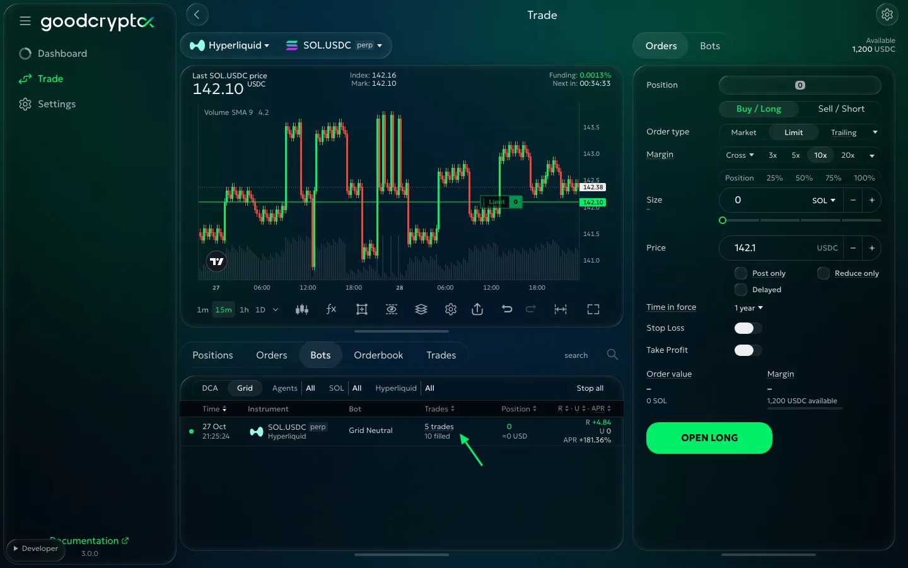
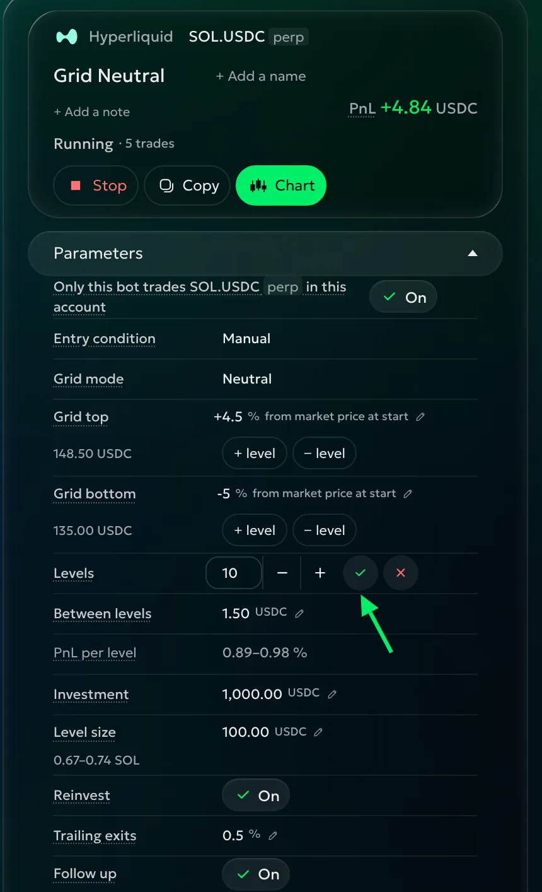
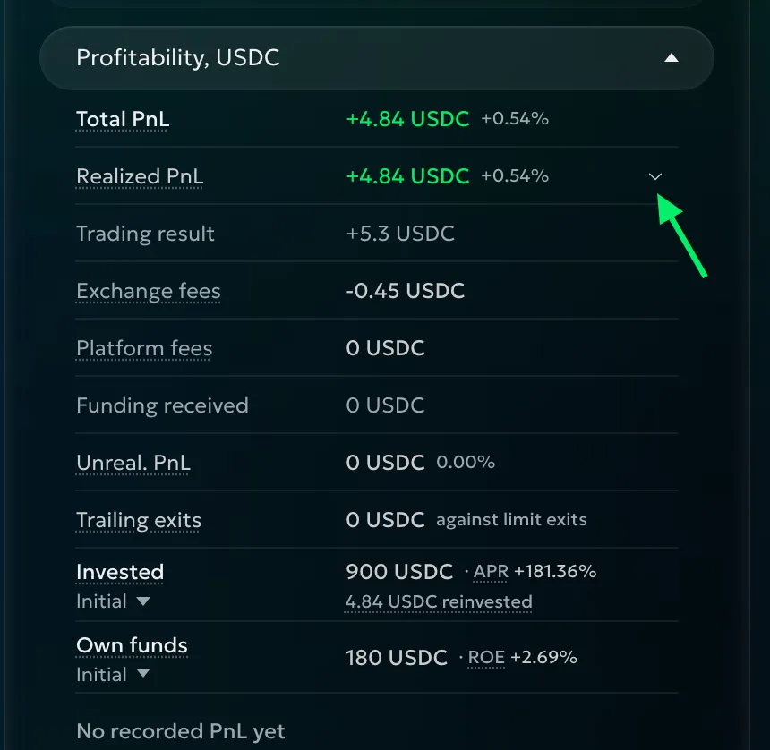
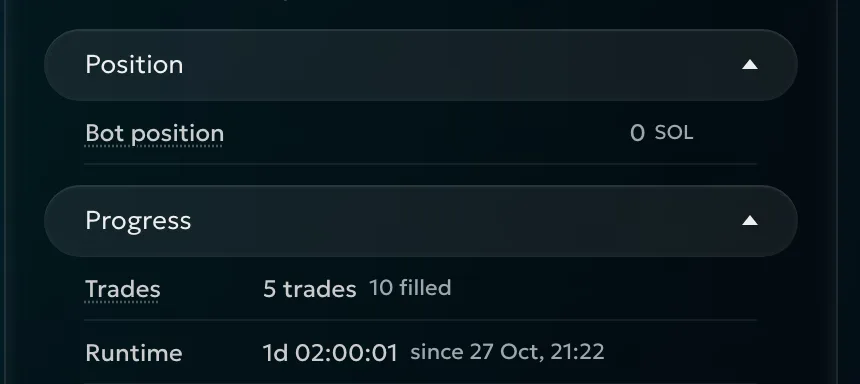
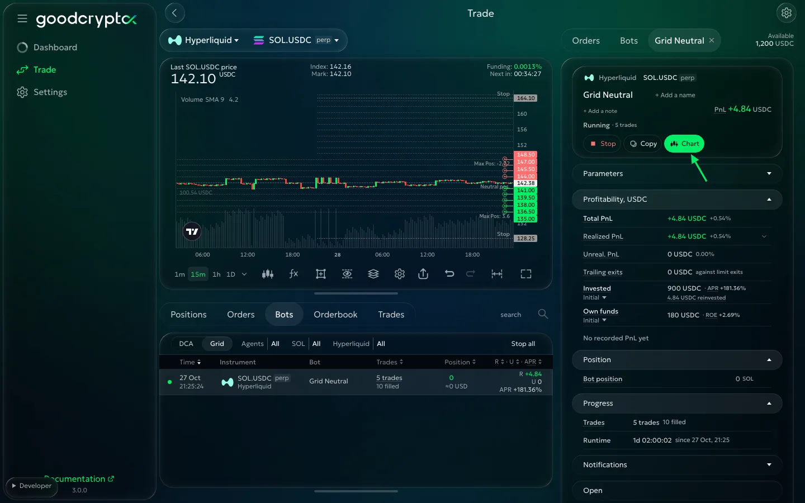
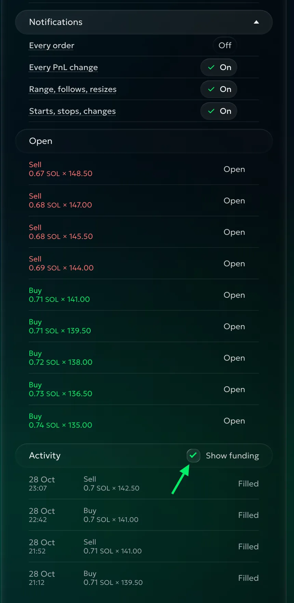
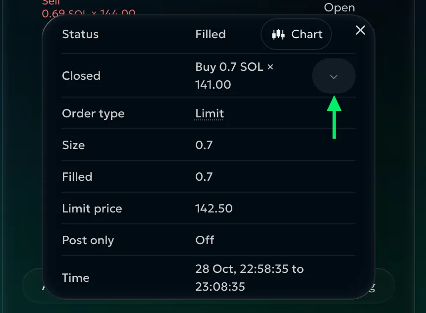

# Running a Grid

<!-- Source: the monitoring and FAQ sections of https://docs.goodcrypto.app/perp-dexs/bots/grid-bot, rewritten for the 3.1 details page. No old funding, stop or spot-mode assumptions are carried over. -->

On **Trade**, open **Bots**, choose **Grid**, then click your bot. The row shows its mode, position, realized and unrealized PnL, and APR. **Trades** counts completed round trips; the filled-order count below it also includes openings. Click a heading to sort.

The details show your account, pair, bot name, status, position and total PnL. Edit the name or note here to make this grid easier to recognise. Work down through Parameters, Profitability, Position, Progress, Notifications, Open and Activity.

## Change a setting

Open **Parameters**, choose a setting and edit it. Confirm with ✓ or Enter; × or Escape cancels. Use [Grid setup](grid-setup.md) for the meaning of each field.

You can change the range, levels, sizing, Follow, trailing exits and stops while the grid runs. For example, changing **Grid top** from 110 to 115 changes the upper bound. Check **Grid bottom**, **Levels**, **Between levels** and **PnL per level** together before saving: a new bound changes the trading range and may change the gaps or exposure.

The **+ level** and **− level** controls add or remove a level at that edge. Confirm the proposed change with the tick, or cancel with the cross. Review the new funds requirement before adding levels.

**Entry condition** and **Grid mode** record how the grid started. While waiting, you can edit the entry price or signal conditions. Once it starts, use the live settings to adjust the trading plan.

Changes take effect immediately. A price stop or PnL target already reached can stop the bot as soon as you save; read the warning first. Changing **Max drawdown** starts its peak from total PnL at that time.

With Follow on, review **Up to** or **Down to** as well as the range. Without a Follow limit, that direction has no price stop. Turning Follow off leaves the grid trading in its current range.

## Profitability

**Total PnL** is **Realized PnL** plus **Unreal. PnL**. If you have +20 realized and −30 unrealized, the total is −10 before closing fees. Open Realized PnL for trading result, exchange fees, platform fees and funding. Profit kept in the coin appears separately.

**Trailing exits** shows what completed trailing exits earned compared with Limit exits at their levels, after fees. +4 means four more in the quote currency; a negative figure means trailing earned less.

Choose a base under **Invested** or **Own funds**:

- **Initial** — investment when the grid started.
- **Current** — what it is set to use now.
- **Average** — funds used on average over running time.

Own funds is your own money backing the bot, on perpetuals. **APR** projects the realized return over a year; **ROE** shows realized return on your own funds. PnL percentages use Initial. The chart shows realized PnL bars and an APR line. Treat APR as a comparison, not promised earnings.

The bot's result covers its trades; your exchange's position figures cover the account position. Compare total results and the position still open when assessing performance.

Reinvest or account sizing can change future openings while older orders keep their sizes. The reinvested line shows profit included in current quote-sized openings, including losses; it is absent with % of account.

## Position and Progress

**Bot position** is this grid's share: it could hold 0.1 ETH within your account's 1 ETH. **Account position** shows the whole size when it differs. **Average** is the account's average entry on perpetuals, the bot's on spot.

Check **Liquidation**, **Leverage** and **Margin** on perpetuals. A leverage change affects the whole position and resizes unfilled account-percent openings; positions and closing orders keep their sizes.

**Progress** shows trades, filled orders, runtime and start or ending time. It also names a price or signal the grid is waiting for.

## The trading chart

Press **Chart** to see the grid on the price chart and fit its range, stops and open orders into view.

- Level lines mark the prices in the range.
- Buy and sell order lines use their side's colours.
- Fills mark where orders traded; filled order lines end at those points.
- A trailing exit shows its moving trigger.
- Stops and Follow limits show where the plan can end or move.

A size label shows a level whose size changed. Use it to see differences after Reinvest, account sizing or an edit. Watch the range's edges as well as completed trades: a growing position there may matter more than frequent small profits.

## Orders and notifications

**Open** shows active orders and names levels below the exchange minimum. Use **Show all** to see the rest. **Activity** shows filled orders; **Show funding** includes the bot's funding payments and **Show more** opens more history.

A row can read **Sell 1 SOL × 101.00 · +0.91 USDC**. Open its order card for fills, fees and times. **Closed** or **Closed by** links the paired orders; open one to inspect the other half of the trade. Liquidation and auto-deleveraging appear as **Liquidation** and **ADL** in red.

Choose your four notification switches here. **Stop** offers the position-close choice. **Copy** fills a new form without launching. A finished grid keeps Copy and Chart; close a remaining position from **Positions**.

## What goodcryptoX tells you

Use **Every order**, **Every PnL change**, **Range, follows, resizes** and **Starts, stops, changes** to choose routine messages. Automatic fills, Follow moves and stops can reach you on Telegram. Errors and problems needing a decision always arrive.

## When the bot needs you

A failed level does not stop the whole grid; the other levels keep trading. Read the problem and the action offered before retrying it.

If the bot needs a decision about its position, its status says so. Existing exits keep working while it takes no new risk. A notice about other resting orders alone leaves it running.

## FAQ

### Which Grid mode should I choose?

Use Neutral on perpetuals when you want to trade a range without an initial directional position. Long expresses a bullish view; Short a bearish one. Both can build more exposure when price moves against them. Spot has one mode and trades coins you own or buy. Review the [mode examples](grid.md#grid-mode) and the maximum Position before choosing sizes.

### Should I use more levels or wider gaps?

With the same **Investment**, more **levels** make smaller orders with tighter gaps. Fewer levels give larger orders and wider gaps. A tighter grid needs a smaller price move to complete a trade, but leaves less room for fees. Compare **PnL per level** after fees, and make sure the orders meet the exchange minimum. [Grid setup](grid-setup.md#levels-and-between-levels) shows price and percentage spacing examples.

### What happens when price leaves the range?

With Follow off, the grid adds no opening levels beyond its bounds and holds the position it accumulated. Trading can resume when price returns; a trailing exit can still fill outside the range. Follow lets the range move, up to your chosen limit or without a limit. It can realise a loss, so review the estimated loss before turning it on.

### Can the bot lose money while completed trades show a profit?

Yes. The open position can lose more than completed round trips earned. Look at **Total PnL**, which includes unrealized PnL, rather than only trade count or Realized PnL. On perpetuals, liquidation can close the position before your outer levels or stop. Lower leverage and a suitable stop can reduce that risk; check the [margin estimate](grid.md#margin-and-liquidation) before launching.

### Does Take profit count the open position?

Yes. **Take profit**, **Stop loss** and **Max drawdown** all use total PnL, including the open position. With **Stop in Neutral position**, Take profit needs its target and a flat bot position at the same time. Hitting the target once does not reserve it for a later flat moment. Stop loss and Max drawdown close immediately when triggered. See [When to stop](grid-setup.md#when-to-stop).

### Will Stop leave me holding a position?

Check the position-close choice when you stop. **Close position on stop** decides whether price stops and errors also close the remaining position at market. If it is off, stopping cancels the grid's orders and leaves the position for you to manage. PnL stops close the position themselves. After the grid finishes, inspect **Positions** for any remaining exposure before starting a replacement.

### Is funding included in the result?

Yes. On perpetuals, funding paid or received is included in **Realized PnL**. Open that figure to see Funding beside trading result, exchange fees and platform fees. Use **Show funding** in **Activity** to inspect the payments alongside trades. Funding can change the result even when no round trip has just completed; include it when comparing a long-running grid with a shorter one.

### Can I use coins I already hold on spot?

Yes. **Use them** lets free coins replace part of the grid's starting purchase. Check **You hold**, the purchase and **Funds needed** before launching. Spot has no short mode or leverage. **Profit in the coin** can retain earnings in the coin; those coins appear separately from quote PnL. The bot can still sell and buy within the range, so choose it for ongoing trading.

### Do fees matter with a small gap?

Yes. PnL per level previews the return after exchange and platform fees; a narrow gap can leave little after those fees. **Trailing exits** close at market, and their actual result depends on the fill. The Trailing exits figure compares completed exits with Limit exits after fees. Review both the expected gap in setup and the fees on actual order cards as the grid runs.

### Do the stops work if goodcryptoX is off?

Keep goodcryptoX running for the grid to react to price, move its range, manage trailing exits and apply its stop rules. Orders already resting on the exchange can still fill while the app is off. Those fills can change the position you hold. If you want to end the strategy before shutting down, use **Stop** and review its position-close choice and result first.
