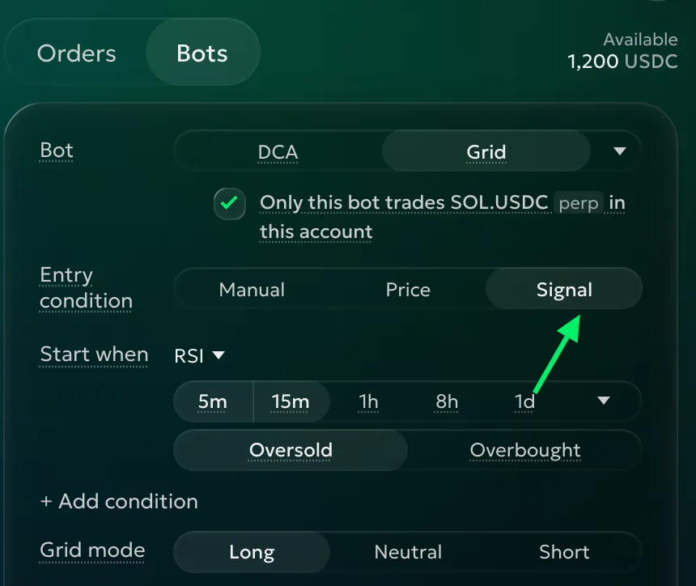
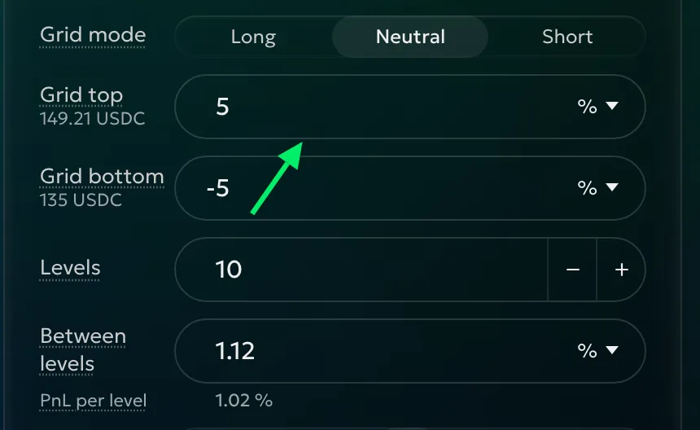
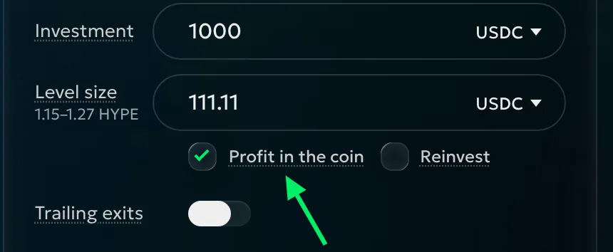
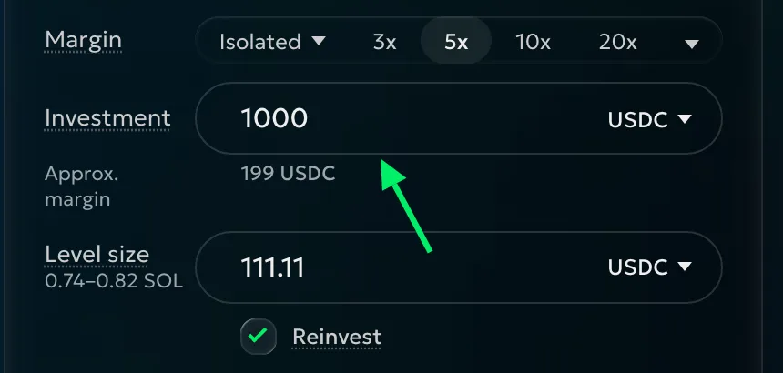
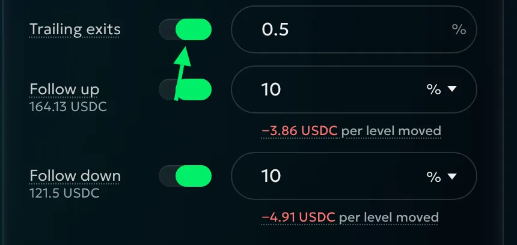
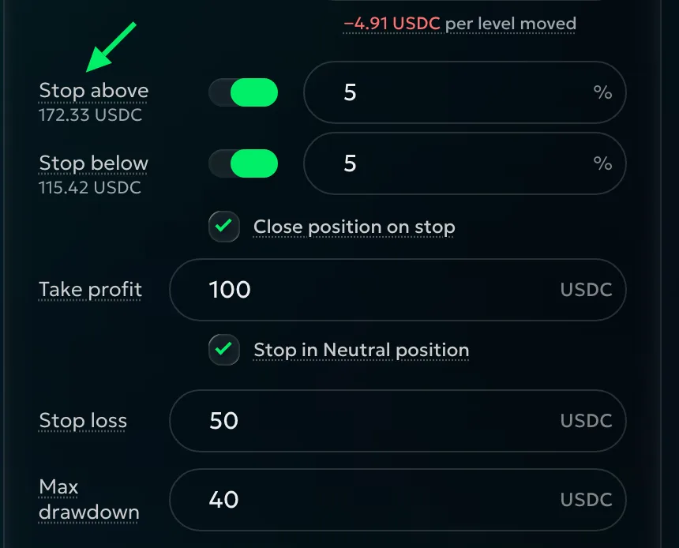
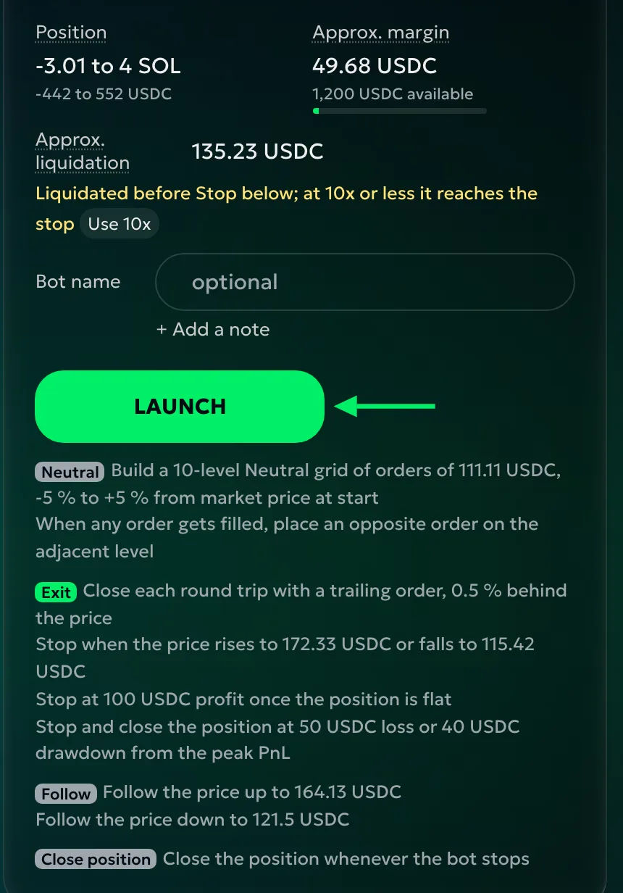
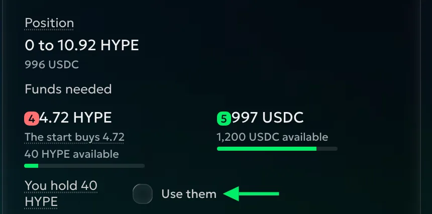

# Grid setup

<!-- Source: the setup section of https://docs.goodcrypto.app/perp-dexs/bots/grid-bot, adapted to the 3.1 form. Current dark picture requests are in DOCS-STYLE-BOTS-HANDBACK.md. -->

On **Trade**, choose your account and pair, select **Bots**, then **Grid**. Work down the form and check the chart as you go.

Tick **Only this bot trades BTC.USDC perp in this account** if you intend only this bot to trade that instrument there. The instrument changes with your pair. It does not prevent trades elsewhere; [Running a Grid](grid-running.md#when-the-bot-needs-you) explains what to do if the position needs review.

## Entry condition

**Manual** starts the grid when you launch it. Choose it when you want the grid to begin trading at the current market.

**Price** waits for a price in the quote currency. If the market is 100 and you enter 95, the grid waits for 95 before placing orders. Use this to start in a range below or above the current market without watching it yourself.

**Signal** waits for **Start when** conditions. Choose RSI, MACD, Bollinger bands, Price move or TA rating; **+ Add condition** combines them. Every condition must agree on every selected interval: choosing 5m and 15m means both must agree. Pick states of the same side.



## Grid mode

On perpetuals, choose **Neutral**, **Long** or **Short** for your market view. Neutral starts flat. Long and Short can open an initial position; they can also start partly filled or flat. Review [Grid mode](grid.md#grid-mode) before choosing.

After selecting a signal, check **Grid mode**. Any mode can wait for either signal side. Spot has one mode and can also wait for either side.

## Grid top and Grid bottom

**Grid top** and **Grid bottom** define your range. Set prices in the quote currency, or percentages from the starting price. At 100, a range of +2% and −2% gives 98–102. Those are the initial percentage settings; choose the range for the market you want to trade.

For example, a Price entry of 95 with a ±2% range gives 93.10–96.90. Use prices instead if you want the bounds to stay at specific chart levels regardless of the starting market.

With Manual, percentages use the launch price. With Price, they use your entry price. With Signal, they use the price when the signal starts the grid. Prices entered directly stay as typed.

Look at the chart for the range where price has been trading. You can type the bounds or drag them on the chart. You don't need to capture every possible move. A wide range spreads the same investment further; a narrow range can be left behind quickly. Check the levels across the whole range before continuing.

## Levels and Between levels

**Levels** is the number of prices in your range, from 2 to 100. Type a count or use **− / +**. With fixed Investment, more levels mean smaller orders and tighter gaps; fewer levels mean larger orders and wider gaps.

**Between levels** chooses the gap. In the quote currency, prices have equal steps: five levels from 80 to 100 are 80, 85, 90, 95, 100. In %, they have equal percentage gaps: 10% gives 100, 110, 121.

Choose % for consistent percentage gaps, or the quote currency for fixed price gaps. Review **PnL per level** after fees. Tight spacing can leave very little profit per completed trade; the final result depends on actual fills.

## Margin, Investment and Level size

**Margin**, on perpetuals, chooses margin mode and leverage where supported. Check [Margin and liquidation](grid.md#margin-and-liquidation) before launching.

**Investment** is the planned orders' total in the quote currency. Changing it changes Level size. Choose **% of account** to use a share of account value, including unrealized PnL. That share targets Approx. margin on perpetuals, the orders' total on spot.

**Level size** sets each opening's quote value or coin quantity. At 100 USDC per level, price 100 buys 1 coin and price 80 buys 1.25. Coin sizing keeps the planned quantity equal. Typing Level size returns Investment to the quote currency.

**Profit in the coin**, on spot, keeps profit in the coin by selling less. A profit of 0.001 BTC stays as BTC. Choose it when you want to accumulate the coin.

**Reinvest** increases future openings with profit; losses make them smaller. Resting openings keep their sizes until they trade. With % of account it stays on: account value already includes the result. Check the preview after changing sizing. A closing order keeps its opening's quantity unless Profit in the coin reduces it. Review the coin amount as well as its quote value before choosing your unit. Choose quote sizing if you want each planned opening to spend the same amount, or coin sizing if the quantity matters more to you.

## Trailing exits and Follow

**Trailing exits** replaces each Limit closing target with a trail, off by default. **Trailing distance** sets the reversal that closes it at market. A selling trail starting at 100, rising to 110 and reversing 1% triggers at 108.90, before fill fees and slippage. Leave room for the trail: a distance as large as the smallest after-fee PnL per level can give back the expected gain.

**Follow up** and **Follow down** move the range when price leaves it. Long and spot follow up by default, Short follows down, Neutral neither. The number of levels stays the same.

**Up to** limits following above Grid top; **Down to** limits it below Grid bottom. Choose a price or percentage: top 100 with Up to 10% gives 110. The limit stays at that price as the grid moves. Empty means no limit; switching Follow off keeps the current range. At a limit, trading continues in the last range. For example, reaching Up to 110 does not close the position or cancel the grid. Use a stop if you want a price to end the strategy.

> Following against your grid's direction can close a level at a loss; either direction can do so on Neutral. Review the estimated loss and funds needed, especially with coin sizing at higher prices.

## When to stop

**Stop above** and **Stop below** stop at a percentage beyond Grid top or bottom. With Follow, the distance is beyond Up to or Down to: Up to 150 plus Stop above 5% gives 157.50. That stop stays fixed while the grid follows. A direction following without a limit has no price stop; set its Follow limit first. Check the stop price on the chart. Set the stop for the point where you want the trading plan to end, and check that liquidation would not come first.

**Close position on stop** decides whether a price stop, your Stop or an error also closes the position at market. Unticked, the remaining position stays yours to manage.

**Take profit** stops and closes when total PnL reaches your target. It includes the open position: +120 realized and −30 unrealized is +90 total, so a target of 100 has not been met.

**Stop loss** stops and closes when total PnL reaches your loss limit. For example, +20 realized and −70 unrealized reaches a loss of 50. Use it with the open position's risk in mind, not just profits from completed trades.

**Max drawdown** stops and closes after a fall from peak total PnL since you set it. Peak 300 followed by 250 is a drawdown of 50. Use drawdown when you want the exit to follow the result as it improves, rather than stay at one fixed loss amount.

**Stop in Neutral position** makes Take profit wait for the target and a flat bot position at the same time. Without a target, Long, Short and spot stop at their first flat moment with nonzero total PnL; Neutral needs a target. Other account positions and coins kept as profit do not prevent a flat bot position.

> Stop loss and Max drawdown close immediately when triggered, regardless of the Neutral choice. Market closing fees and price changes can take the final result past your limit.

## Notify me

Choose **Every order**, **Every PnL change**, **Range, follows, resizes** and **Starts, stops, changes**. Every order is off initially; the other three are on. Use Every PnL change if you want results from completed round trips without a message for every opening fill.

Actions you take yourself send no message when their result is there at once. Later events and automatic changes do. Errors and problems needing your decision arrive regardless of the switches. You can change the switches while the grid runs. Set up [Telegram](../telegram.md) to receive alerts there.

## Check the funds and launch

**Position** is the maximum possible exposure the grid can build. On perpetuals, check it alongside **Approx. margin** and **Approx. liquidation**, including the [margin warning](grid.md#margin-and-liquidation).

On spot, **Funds needed** shows coins and quote currency, with the starting purchase. **You hold** and **Use them** let free coins replace part of that purchase. Starting fees are included. Review both currencies before launching.

Levels below the exchange minimum are not placed. Increase Investment or use fewer levels if needed; the warning still offers **Launch anyway**.

Add a **Bot name** and **Note**, review the summary under **Launch**, then launch. Manual starts now; Price and Signal wait. Open the bot to [monitor it and change settings](grid-running.md).
