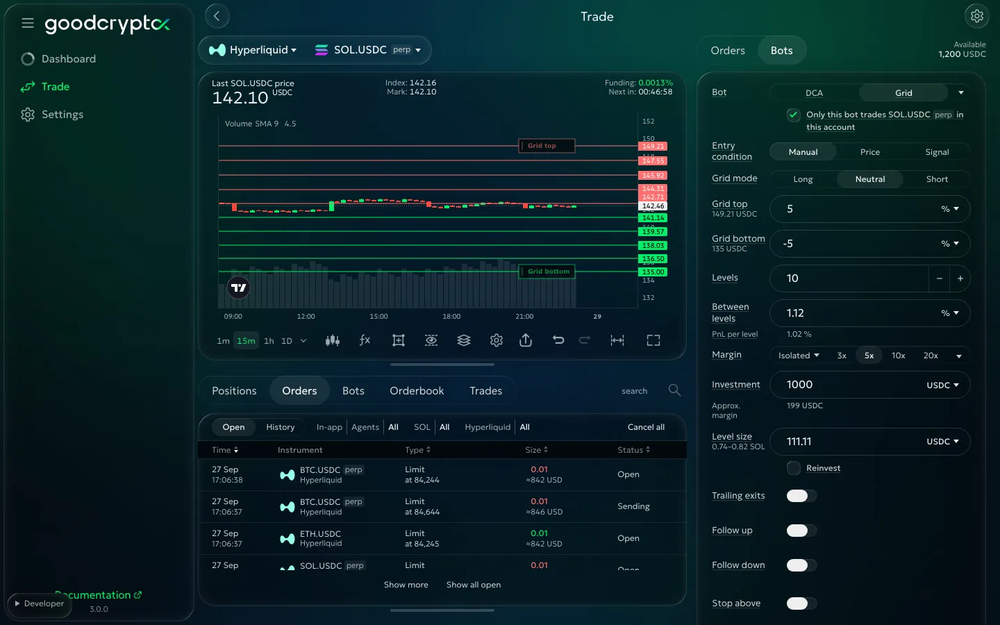

# Grid bot

<!-- Source: https://docs.goodcrypto.app/perp-dexs/bots/grid-bot. The old introduction, cycle and modes are the base; D2b/D2c and DOCS-AUDIT-3.1 govern the 3.1 facts. -->

A Grid bot buys and sells at set prices within your chosen range. You choose the range, the levels and the amount to trade; the bot repeats those trades as price moves back and forth.

## Why use Grid Bot?

Markets rarely move in straight lines. Even during strong trends, price constantly oscillates: moving up, pulling back, bouncing, consolidating, and repeating.

Suppose BTC starts at $80,000, rises to $95,000, falls to $82,000, recovers to $91,000, drops to $85,000 and finally returns to $80,000. Holding BTC throughout leaves you where you started, before fees. A grid gives you a way to trade the moves along that journey.

On a fall, it buys at your lower levels. On a recovery, it sells against those purchases. Each completed pair can earn a small realized profit after fees. You do not have to choose a new entry and exit for every swing: the bot keeps trading within the plan you gave it.

You can use this approach when you expect a sideways market, or combine it with a directional view on perpetuals. The important choice is the range in which you expect price to keep moving. A wider range gives the bot more room; a narrow range concentrates its trading around fewer prices.

> Completed trades can earn money while the position still held loses more. A profitable series of round trips does not guarantee an overall profit.

### Best market conditions

On perpetuals, **Neutral** lets you trade those swings without opening an initial directional position. Look for a range you are willing to trade throughout, including its edges.

A volatile trend can suit **Long** when your view is bullish, or **Short** when it is bearish. You still need swings within the range to complete grid trades. A price that keeps moving one way can build exposure on the losing side or leave the range behind.

Before choosing a range, decide which position you are willing to keep if price leaves it. Choose the range and mode together. If your plan depends on price returning, consider what you will do if it does not. A sustained move outside the range can outweigh the profits already earned.

### Common use cases

- **Trade a sideways market.** You expect price to move between support and resistance, but have no strong view on its next direction. A Neutral perpetual grid places buys below the market and sells above it. Review the exposure at both edges before launching.
- **Trade a directional view.** You expect an upward trend with pullbacks. A Long grid can sell parts of its position as price rises, then buy on declines. Short does the reverse for a falling market. Choose the direction for the position you are willing to hold when price moves against you.
- **Accumulate spot coins through swings.** A spot grid buys coins and sells against those purchases as price moves through its range. **Profit in the coin** lets you keep profit in the coin. It still trades in both directions; use the [DCA bot](dca.md) if your plan is a ladder of purchases to keep.
- **Put coins you already hold to work.** On spot, **Use them** lets free coins replace part of the grid's starting purchase. Upper selling levels can sell those coins as price rises, while lower levels buy. This is an ongoing trading plan: consider whether you want the bot buying again after a sale.

## How Grid trading works

Your grid has an upper price, a lower price, a number of levels and an amount for each level. The bot spaces those levels across the range. In Neutral mode, buy orders sit below the market and sell orders above it, with one level empty to leave room for the next move.

An opening buy has its closing sell target one level higher. An opening sell has its closing buy target one level lower. Together, the opening and closing orders are a **round trip**. With Limit exits, reaching the next level can complete the pair; with Trailing exits, it starts a trail instead.

For example, buying 0.01 BTC at 79,000 and selling it at 81,000 earns 20 in the quote currency before fees. The actual result depends on the fills and trading fees. More levels give you more closely spaced opportunities, with a smaller price gap for each trade.

With Follow off, no new opening levels are added outside your range. A trailing exit can still fill beyond it. The bot keeps its accumulated position and waits for price to return. If price stays outside, you continue holding that exposure. Check your stop choices before launching, especially with leverage.

## Grid mode

On perpetuals, **Grid mode** offers **Neutral**, **Long** and **Short**. The choice changes the position you start with and the exposure you can build as price crosses the range. Choose the mode for your market view, then check the maximum position in setup.

### Neutral Grid

Neutral is the default. It starts flat, with buys below the market and sells above it. A fall builds a long position; a rise builds a short. Price returning through the range gives the bot opportunities to close those trades.

If price breaks below the range, you can be left long. Above it, you can be left short. Only one side's openings fill on that move, so exposure can be smaller than a comparable Long or Short grid moving against you. Use Neutral when you have no strong directional view and are prepared for either outcome.

### Long Grid

Long can start with a long position to supply selling targets above the market. A full starting fill is not assured; depending on the range, it can also start partly filled or flat.

As price rises, the bot sells parts of that position: for example, 0.01 BTC at a time. If price falls, it buys more and the long grows. Choose Long for a bullish view, with enough funds for the lower buying levels.

### Short Grid

Short can start with a short position to supply buying targets below the market. A full starting fill is not assured; depending on the range, it can also start partly filled or flat.

As price falls, the bot buys back parts of the short: for example, 0.01 BTC at a time. If price rises, it sells more and the short grows. Choose Short for a bearish view, with the upper selling levels in mind.

### Spot Grid

Spot has one grid mode. You own the coins it buys; it cannot open a short and uses no leverage. It can buy coins at the start for upper selling levels, or use free coins you already hold. Check **Use them** and the starting purchase in [Grid setup](grid-setup.md#check-the-funds-and-launch).

## Follow the price

Follow lets the grid move with price beyond its original range. Following against the grid's direction can close a level at a loss. Choose directions and limits in [Grid setup](grid-setup.md#trailing-exits-and-follow), with enough funds for the range you allow it to reach.

## Starting on a signal

You can wait for chosen signals before the grid starts. No grid orders are placed while it waits; choose the conditions and check your mode in [Grid setup](grid-setup.md#entry-condition).

Choose a value or coin amount for each level, your investment and whether to reinvest in [Grid setup](grid-setup.md). After launching, use [Running a Grid](grid-running.md) to monitor results, change settings and find answers to common questions.

## Margin and liquidation

**Approx. margin** shows the funds needed to back your grid. Orders worth 1,000 at 5x need 200 in order margin, before fees and losses. Leverage can bring liquidation before price reaches the grid's edge or stop.

Check **Approx. liquidation** and the warning before launching. Use the offered lower leverage, move your stop before liquidation, or consider Cross where supported. The bot never adds margin by itself. These are estimates: fees, funding, gaps and other positions can change the outcome. Reaching the range's edge gives no protection against a further move.
