# Set up goodcryptoX on a server

A rented server runs goodcryptoX day and night. You set it up from any computer, or from your phone alone; start here, or start on your Mac and move it here later in one file.

Any provider works. We recommend Hostinger for now: by far the easiest to set up that we found, and cost-effective too. The steps below show Hostinger screen by screen; the same steps work on any cloud provider, AWS, DigitalOcean, Google Cloud, Azure or any other.

**[Open Hostinger](https://www.hostinger.com?REFERRALCODE=HBDNPMHGJLZB)**

[Hostinger](https://www.hostinger.com?REFERRALCODE=HBDNPMHGJLZB): through this link you get 20 % off your first purchase, and goodcryptoX gets a share of it.

You are free to go to Hostinger without the link, or to use any other provider.

## Rent a server

What you do: create your Hostinger account, rent the server, install goodcryptoX on it, then connect the browser on your computer and your phone to it. Here is how, step by step.

As Hostinger's screens looked in October 2026:

**1. Sign up.** No card is asked for until you pay, a few screens later.

**2. VPS › Set up VPS**

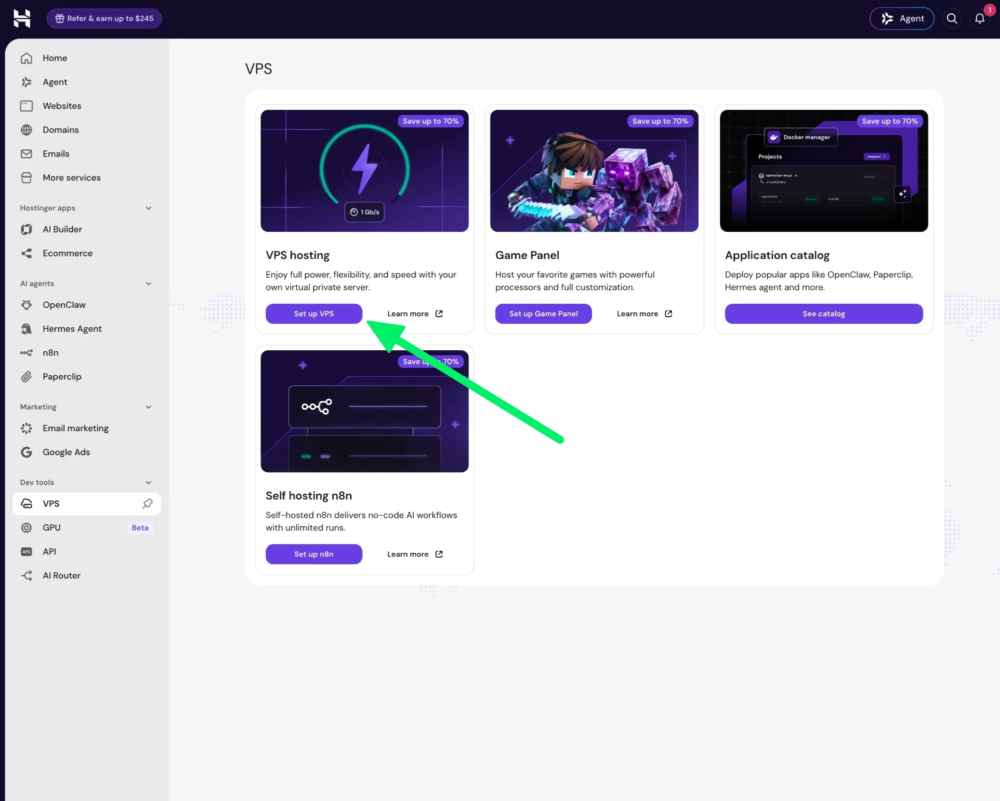

**3. Location.** Choose the city nearest you, then **Next**.

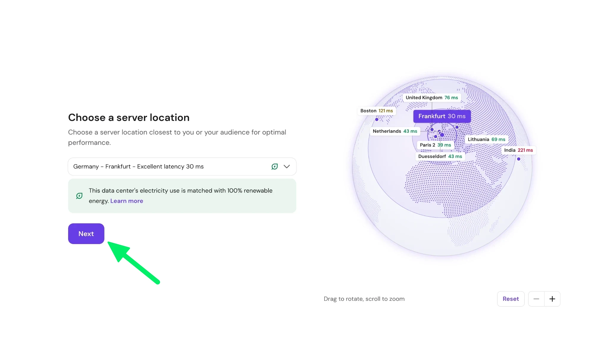

**4. What to install.** Open **Applications**, or search for "Docker".

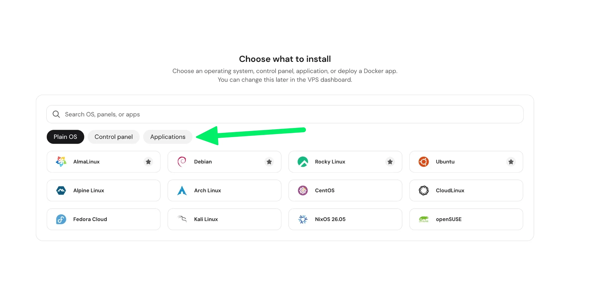

Pick the plain **Docker** tile, not Docker and Traefik, Docker Registry or Dockge.

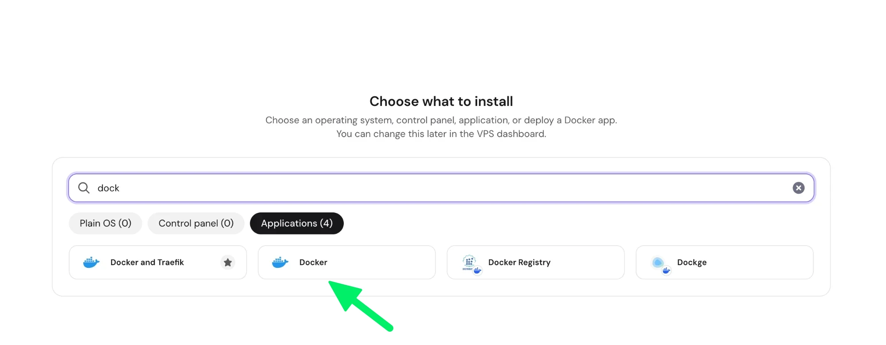

Its card says "Installed in Ubuntu 24.04": press **Select**.

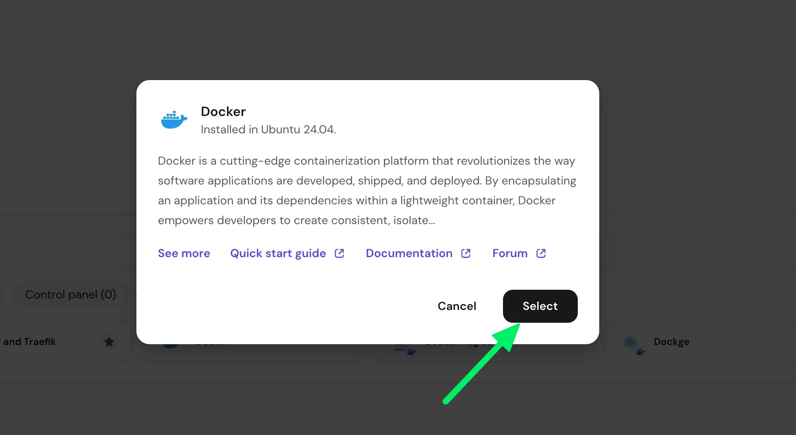

**5. Root password.** Press **Generate** and keep the password in your password manager: it opens your server. Skip the SSH key.

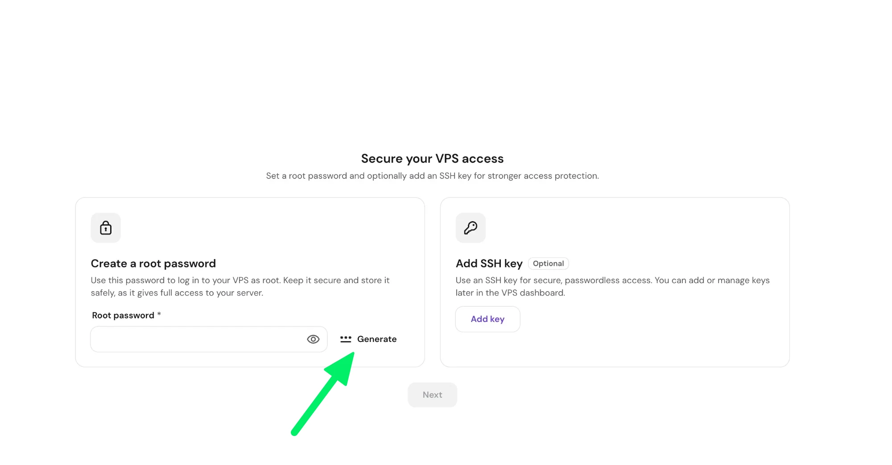

**6. Additional features.** Leave both boxes empty, then **Next**.

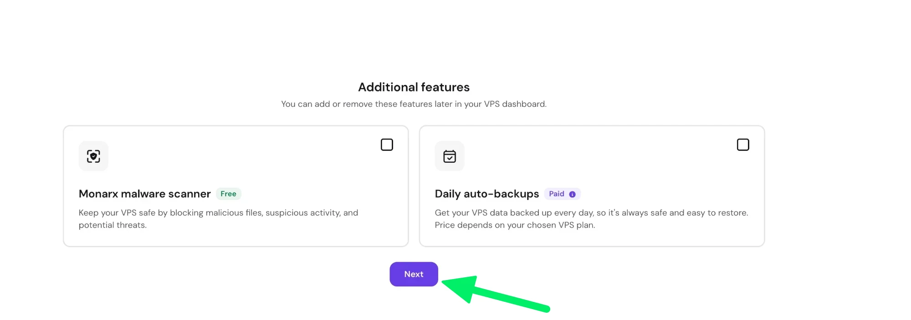

**7. Plan.** KVM 1 is enough for goodcryptoX: press its **Select**.

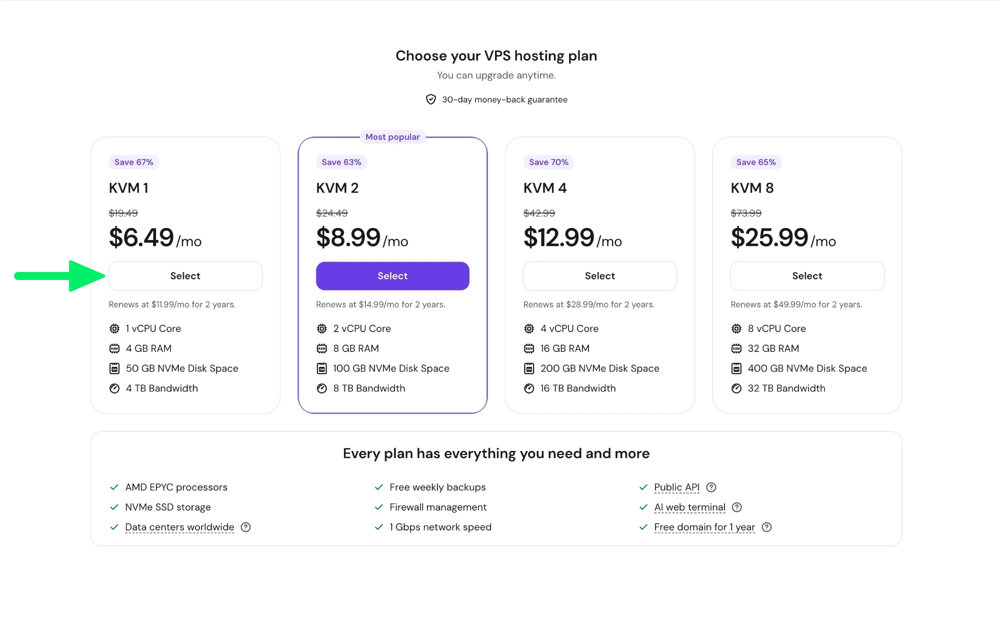

**8. Billing period.** The price is your choice. On 18 October 2026, KVM 1 cost $6.49 a month on 24 months, $6.99 on 12 months and $9.99 on 1 month, tax on top; prices change, so read the shape of the deal:

- The low price is for the first term only, paid up front.
- After it, 12 and 24 months renew at the regular price ($11.99 a month that day), 1 month at the full price ($19.49 a month).
- You can change the period later, at the regular price, never the introductory one.
- Testing first? Take 1 month. Keeping it? Take 12 or 24 months from the start. A 1-month server that proves itself: rent a new one on 12 or 24 months, [move goodcryptoX there](moving.md#from-one-server-to-another), and cancel the old one before it renews.
- A new purchase has a 30-day money-back guarantee.

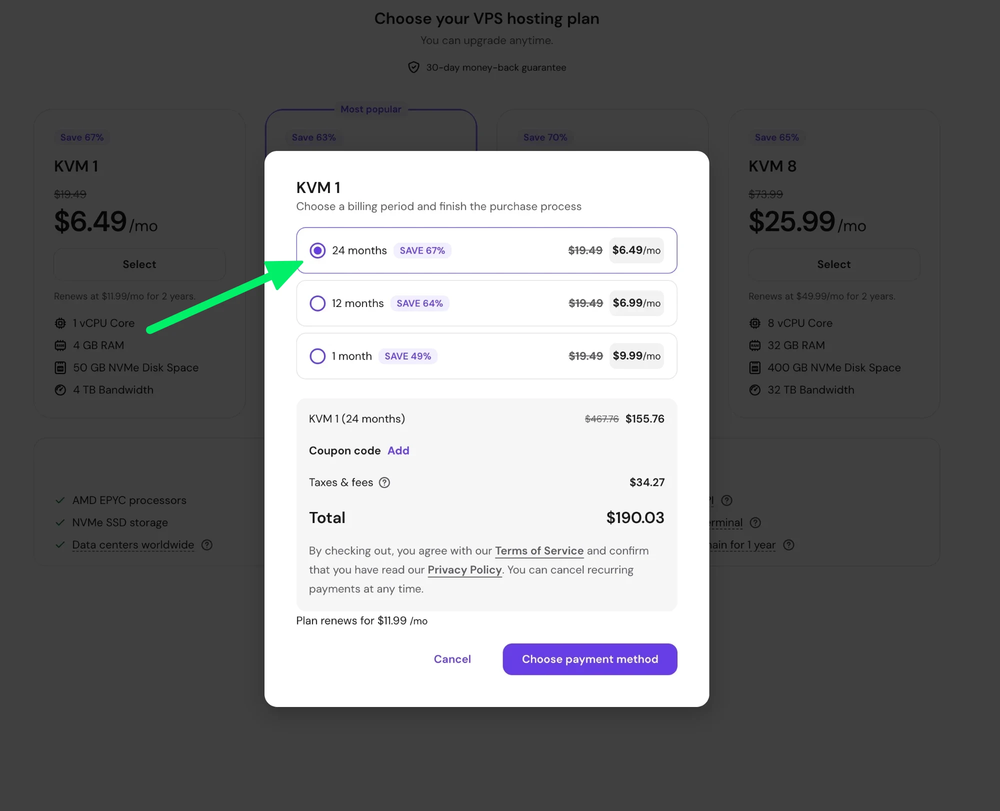

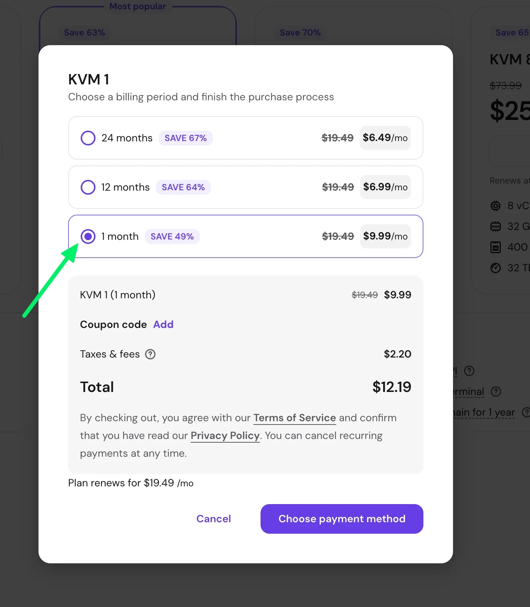

**9. Pay.** Hostinger sets up your server in about 5 minutes and sends an e-mail when it is ready.

**10. Ready.** Press **Manage VPS**. Skip the free domain: goodcryptoX does not need one.

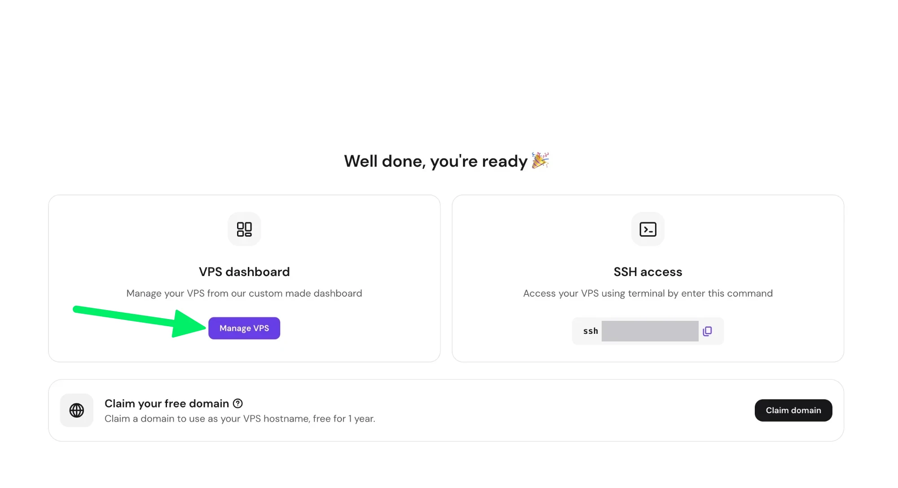

**11. Overview.** A short survey opens: press **Skip**. Then press **Docker manager** on the Docker card.

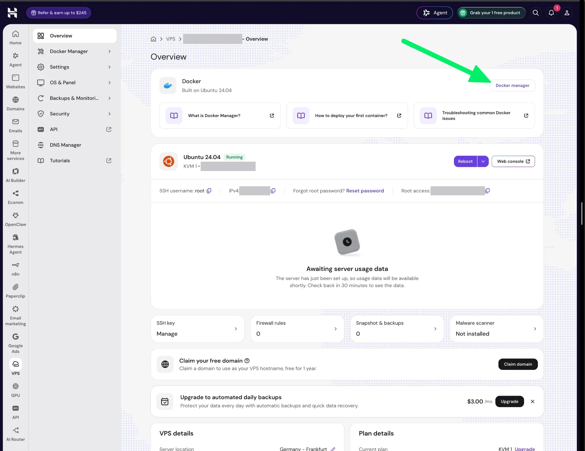

<details>
<summary>On another provider</summary>

Rent a small server with Ubuntu and Docker, 2 GB of memory or more, in a region near you. Many providers offer Ubuntu with Docker ready to install.

</details>

## Start goodcryptoX

**12. Compose › Compose from URL**

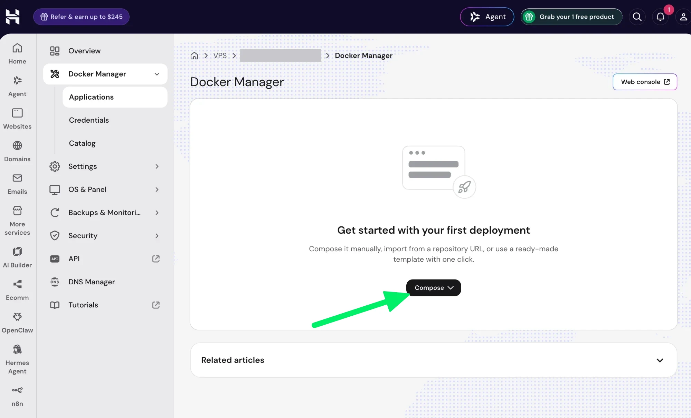

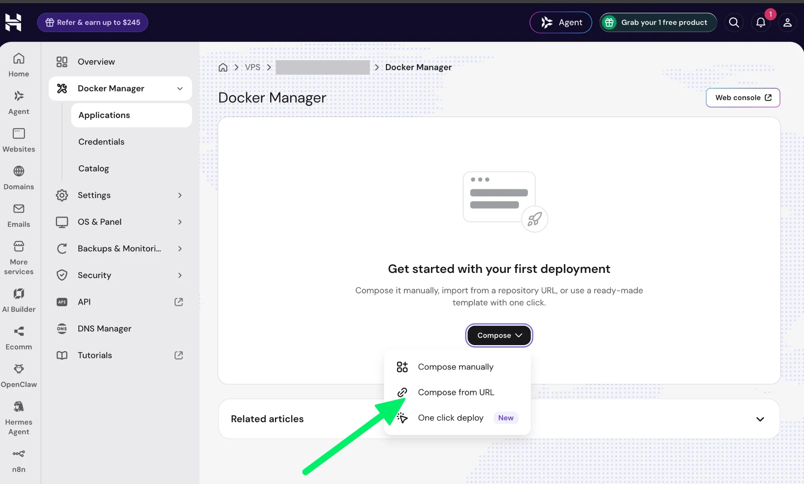

**13. The link and the name.** Paste this link (goodcryptoX's latest release on GitHub), name the application `gcx` and press **Deploy**.

```
https://github.com/GoodCryptoApp/gcx/releases/latest/download/compose.yaml
```

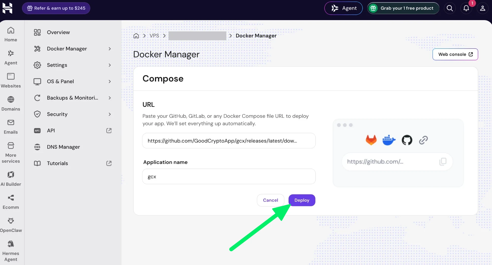

**14. Running.** Within a minute or two, `gcx` shows **Running**. Close the HTTPS banner: goodcryptoX does not need it.

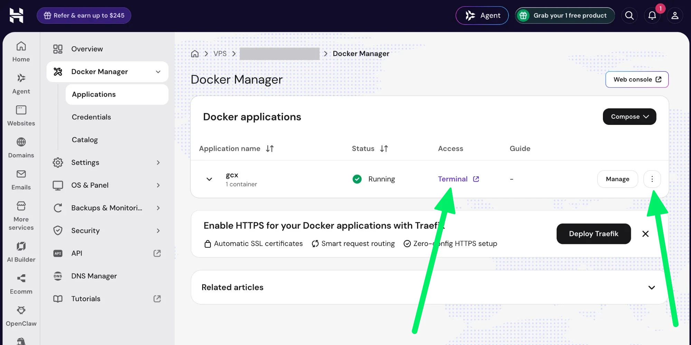

<details>
<summary>If this does not work</summary>

Two other ways.

The file's text. On Hostinger, choose **Compose › Compose manually** and paste it into the **.yaml editor** tab, with the name `gcx`. In another Docker panel, create the project by hand and paste it.

```yaml
services:
  gcx:
    image: ghcr.io/goodcryptoapp/gcx:latest
    container_name: gcx
    network_mode: host
    init: true
    restart: unless-stopped
    stop_grace_period: 60s
    volumes: [gcx-data:/data, gcx-secret:/secret]
  updater:
    image: ghcr.io/goodcryptoapp/gcx:latest
    container_name: gcx-updater
    entrypoint: [gcx, updater]
    user: "0:0"
    network_mode: none
    init: true
    restart: unless-stopped
    volumes: [/var/run/docker.sock:/var/run/docker.sock, /root/.docker:/docker:ro, gcx-data:/data]
volumes:
  gcx-data: {name: gcx-data}
  gcx-secret: {name: gcx-secret}
```

A terminal. Open your provider's web console, or `ssh root@<your server's address>` from your computer, and run this line on the server (with `sudo` before each `docker` where it needs it); the log follows in the same window:

```
curl -fsSLo compose.yaml https://github.com/GoodCryptoApp/gcx/releases/latest/download/compose.yaml && docker compose up -d && docker logs -f gcx
```

</details>

## Sign in

**15. The logs.** On the `gcx` row, open the **⋮** menu (the arrow at the row's right in the picture above) and press **View logs**, then the **Logs** tab.

**16. The link.** At the first start the log's first lines show a link: select it and copy it.

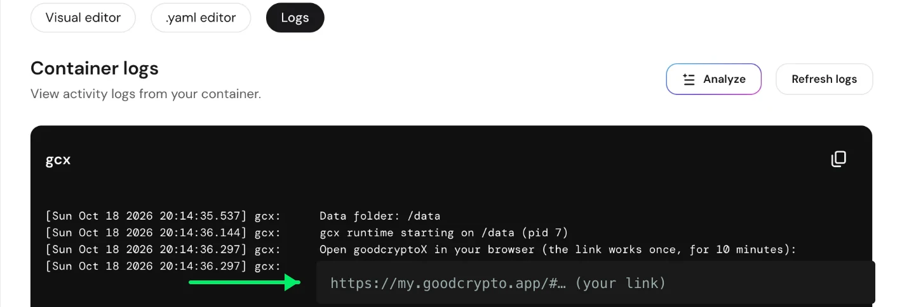

**17. Open it.** Paste the link into the browser on your computer and create a passkey with Touch ID, Face ID or your computer's own unlock. goodcryptoX opens at my.goodcrypto.app, and from now on that address is the way in on this device. A passkey saved in iCloud or Google works on your other devices in the same account; any other device is added from Settings › Devices › **Add a device**. Your phone comes next, from the panel: Settings › Devices › **Add a device** shows a QR code that scans ([Add a phone or another computer](#add-a-phone-or-another-computer)).

The link works once: it dies the moment a device uses it. It also expires after 10 minutes; for a fresh one, press **Restart** in the row's menu. The link is a key: never share it or paste it anywhere else.

The same device opens the panel from its bookmark or home-screen icon and signs in with Face ID or Touch ID, no link, no code. That is the passkey the pairing created. **Set up goodcryptoX** on the Dashboard walks you through the rest: your exchange accounts, then your Telegram bot.

<details>
<summary>What my.goodcrypto.app relies on</summary>

Your server keeps one outgoing connection to goodcryptoX's relay, and my.goodcrypto.app reaches your server through it: over the internet, not by a direct call. Everything that passes is sealed between your browser and your server; the relay forwards it and can read or keep none of it. The one thing it means: if our relay is ever gone, this address stops working. goodcryptoX itself keeps running and trading on your server. The way in then is the tunnel in the fold below; it needs nothing of ours.

</details>

<details>
<summary>If this does not work</summary>

To scan a code with your phone instead, or for a fresh link another way: open the container's terminal (on Hostinger, **Terminal** on the `gcx` row) and run `gcx pair` (elsewhere `docker exec gcx gcx pair`); a terminal draws the code so that it scans.

Or reach goodcryptoX through a tunnel instead. On your computer, open Terminal (PowerShell on Windows) and run this line with your server's address (on Hostinger, after **IPv4** on the Overview):

```
ssh -N -L 8128:127.0.0.1:8128 root@<your server's address>
```

Answer `yes` the first time, then enter the server's password (on Hostinger, the root password from step 5). Nothing more appears, which is right: keep the window open while you use goodcryptoX. Then run `gcx open --print` in the container's terminal (elsewhere `docker exec gcx gcx open --print`) and open the link it prints in your browser within 60 seconds. goodcryptoX opens at `http://gcx.localhost:8128`. If the log names a port other than 8128, use that number on both sides of the line and in the address.

</details>

## Add a phone or another computer

Once your phone is added, no computer is needed: you can run everything from it.

A new phone or computer is added from a device that is already in: Settings › Devices › **Add a device** ([Phone access](../phone.md)).

Every device lost is the only case that goes back to the server: on Hostinger, **Terminal** on the `gcx` row, then `gcx pair` for a fresh link (elsewhere `docker exec gcx gcx pair`). That is the recovery; no e-mail reset, since there is no account with us.

## Updates and backups

goodcryptoX keeps itself up to date on the server: a new version installs by itself at a quiet moment, as on a Mac, finishing what it is doing first. Settings › General › Installation shows the version, and its **Update** button installs a new one at once if you do not want to wait.

<details>
<summary>If this does not work</summary>

On Hostinger, choose **Update** in the `gcx` row's menu; elsewhere, run `docker compose pull && docker compose up -d` in the folder of `compose.yaml`.

</details>

goodcryptoX keeps your data in two Docker volumes, `gcx-data` and `gcx-secret`. Back them up together: `gcx-data` alone cannot open your keys.
