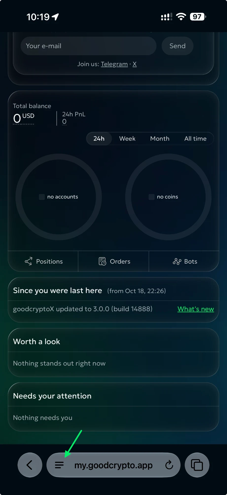
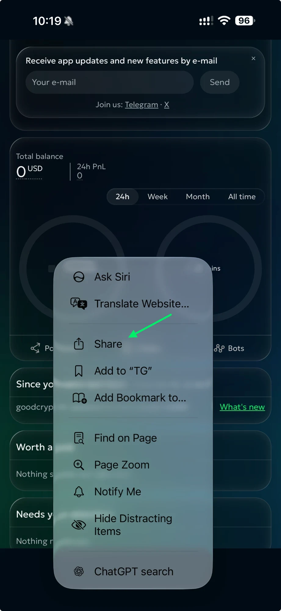
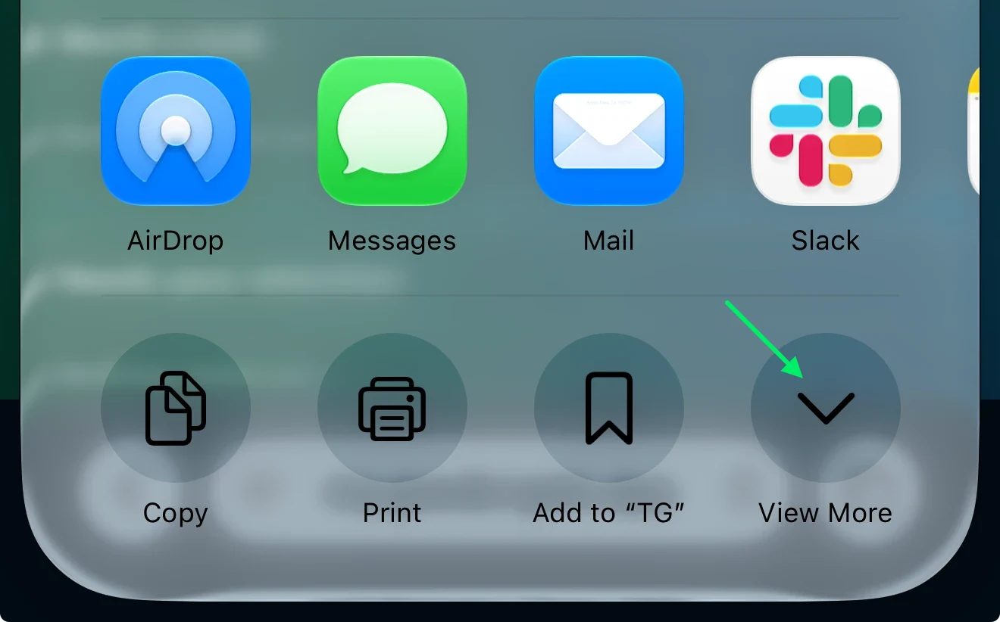
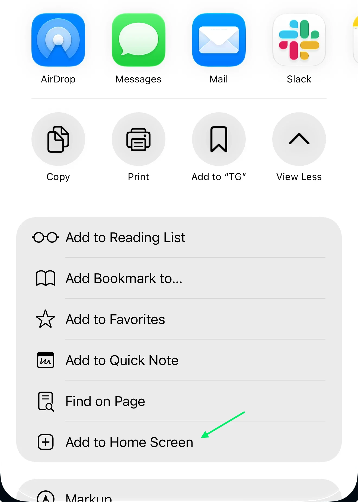
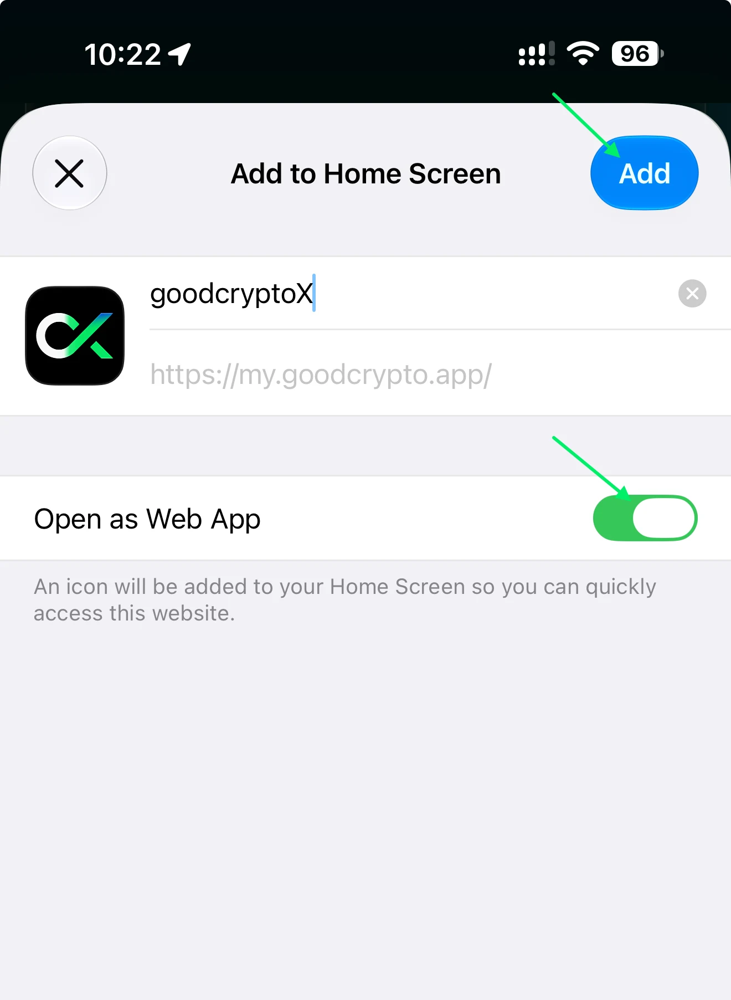
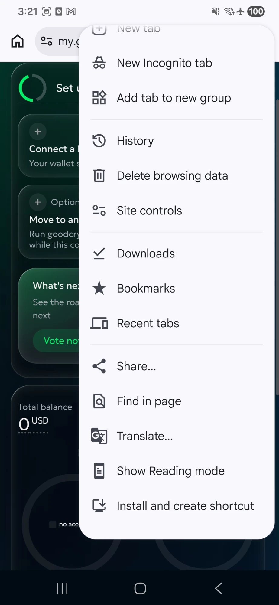
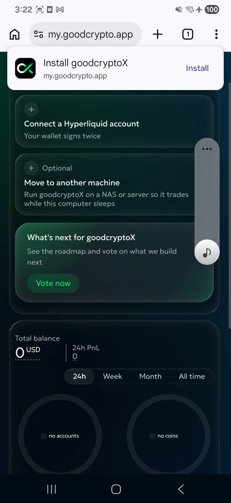

# Phone access

goodcryptoX does not run on your phone. It runs on your Mac, NAS or server, and your phone connects to it: it sees and does everything. Your other computers connect the same way.

## Pair a device

On a device that is already in, open Settings › Devices › **Add a device**. It shows a QR code, and under it the same link with **Copy**. Scan the code with your phone's camera, or open the link on the other device, and confirm once with Face ID, Touch ID or the device's own unlock.

From then on, the device opens goodcryptoX at my.goodcrypto.app, from its bookmark or home-screen icon, and signs in the same way, no link, no code.

The link works once: it dies the moment a device uses it. It also expires after 10 minutes; for a fresh one, press **Add a device** again. On a server, the first device comes from the link in its log ([Sign in](install/server.md#sign-in)).

A passkey saved in iCloud or Google already works on your other devices in the same account, so a new iPhone on the same Apple ID often needs nothing at all; such a device has the rights of the one whose passkey it shares.

## The shortest way

- **A Mac, then your phone.** [Set up on your Mac](install/mac.md), then on the Mac open Settings › Devices › **Add a device** and scan the code with your phone.
- **A server, then only your phone.** [Set up on a server](install/server.md) and add your phone. Once your phone is added, no computer is needed: you can run everything from it.
- **A server, with your Mac and your phone.** Open the server's first link on the Mac, then add the phone from the Mac. If the phone came first, open my.goodcrypto.app on the Mac: a passkey from iCloud signs you in; if not, press **Add a device** on the phone and open its link on the Mac.
- **Another computer.** **Add a device** on a device that is in, **Copy**, and open the link on the new computer.

## Each device is a key

Each device in the list has a switch: **Can trade** does everything you can; **Read-only** only looks. Give a shared or borrowed phone Read-only. Removing a device is a row in the same Settings list; it stops within a second.

There is no other limit. Your keys never leave the machine goodcryptoX runs on.

## On the home screen

goodcryptoX is not an app from a store. Saved to your home screen, it opens and feels like one, full screen, with no browser bar. After the phone sleeps, it comes back by itself.

On an iPhone, step by step

**1.** Open my.goodcrypto.app in Safari and press the three lines at the left of the address bar.

**2.** Press **Share**.

**3.** Press **View More**.

**4.** Press **Add to Home Screen**.

**5.** Leave **Open as Web App** on, keep the name **goodcryptoX**, and press **Add**.

The icon then works from your home screen, even from the dock, just like the old goodcryptoX app.

On Android, press **Install** on the card goodcryptoX shows you at the top of the Dashboard: the browser opens its install sheet at once. Close the card with its cross and it waits in Settings › General, until you install or close it there too.

If you do not see the card, or you closed it, use the browser's menu: open it (the three dots) and press **Install and create shortcut**. The first time, the menu may say **Add to Home screen** instead; that works too.

When Chrome offers **Install goodcryptoX** at the top of the page by itself, press **Install**: it is the same thing.

On some phones (Samsung among them) the installed goodcryptoX lands in the apps list, not on the home screen: hold its icon there and choose **Add to Home screen**.
