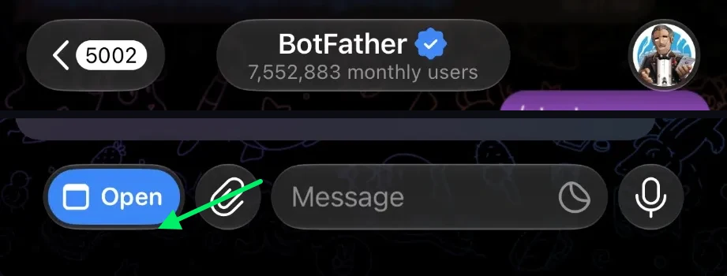
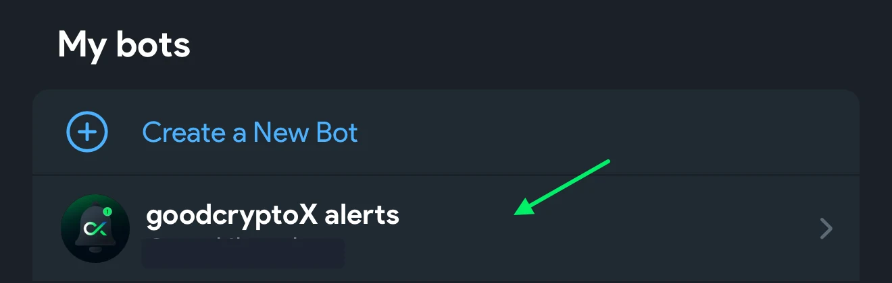
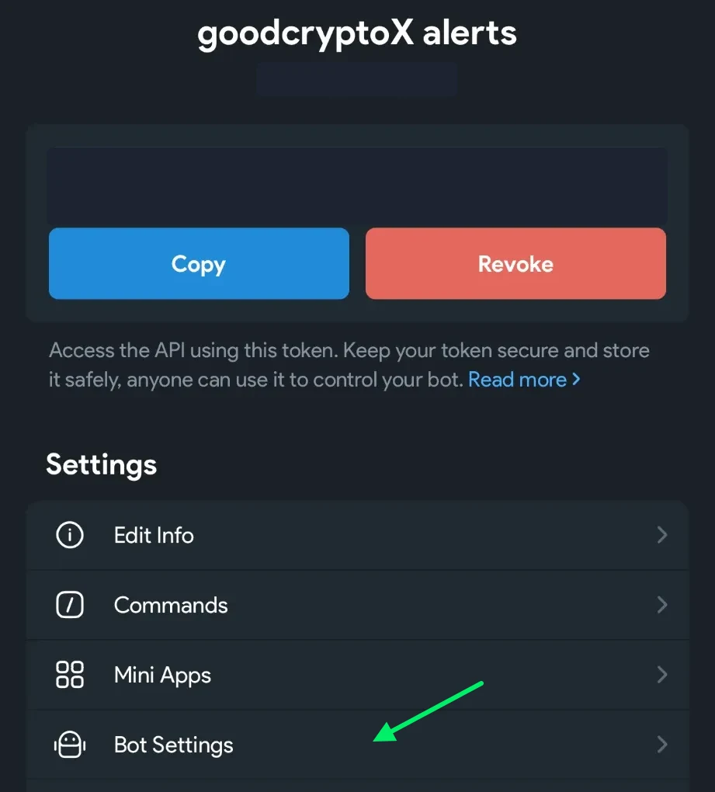
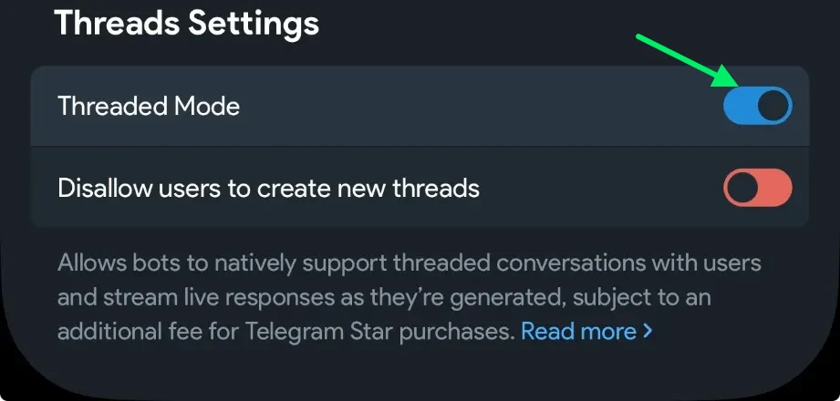
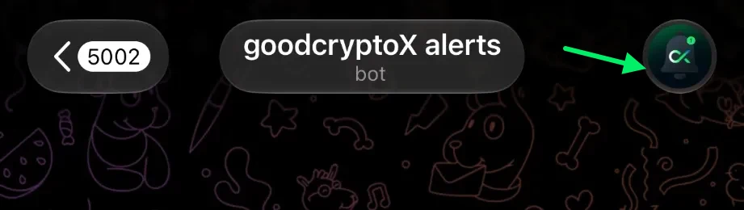
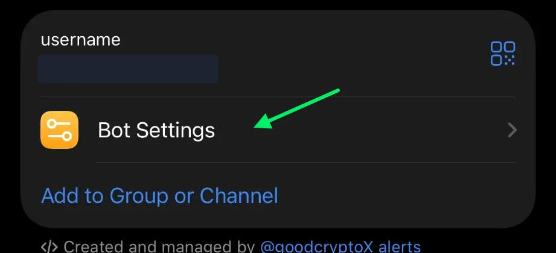
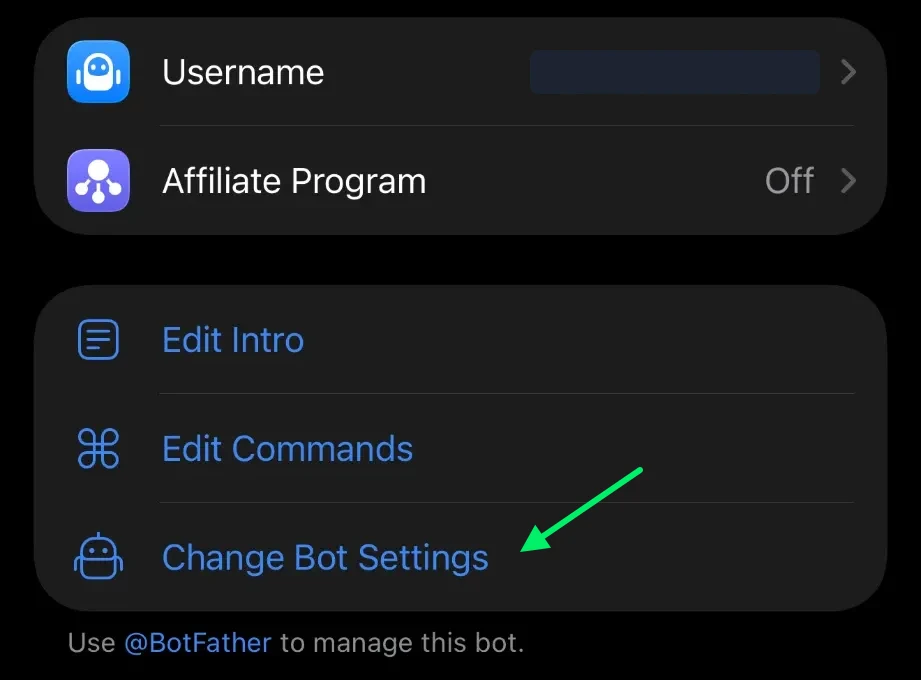

# Telegram alerts

For some people this is all they need. goodcryptoX sends its alerts through a Telegram bot that is yours, with buttons under them to act right there. goodcryptoX talks to Telegram directly; nothing you are told passes through a server of ours.

## Connect

From your computer or your phone, the same steps:

1. Open **Settings › Alerts** and press **Create my Telegram bot**. Telegram opens.
2. Telegram shows your new bot with its name filled in. Confirm it.
3. Press **Start** in your bot's chat. Your bot writes "Your goodcryptoX is now linked to this Telegram chat" and the alerts arrive there. If it stays silent, press **Open your bot** in Settings › Alerts, then **Start**.

You do not set the bot's picture: it appears by itself when you come back from Telegram.

With your own bot from BotFather

If you want no server of ours anywhere, create the bot yourself.

1. In Telegram, start a chat with **@BotFather** and send `/newbot`.
2. Send a name for the bot, then a username ending in `bot`.
3. BotFather answers with a token. Copy it.
4. In **Settings › Alerts**, press **Enter your bot's token**, paste it and press **Connect**.
5. Press **Open your bot**, then **Start** in its chat.

If this does not work

- Telegram did not open: press **Create my Telegram bot** again. It opens the same link and starts nothing new; after ten minutes, a press starts a new set-up.
- The bot answers "To link a chat, press Open your bot in Settings › Alerts": do that, and press **Start** in the chat that opens.
- Anything else: Settings › Alerts says what happened and what to press.

## Open your bot

Whichever way you got the bot, until a chat is linked goodcryptoX shows **Open your bot**. It opens your bot's chat in Telegram; press **Start**, and the alerts arrive there.

## Turn on topics

Optional. With topics, each kind of alert arrives in its own topic of your bot's chat: **Orders**, **Bots** and **Account**. Only BotFather can turn them on:

**1.** In Telegram, open **BotFather** and press **Open** at the bottom (not the buttons in its chat).

**2.** Under My bots, tap your bot.

**3.** Press **Bot Settings**.

**4.** Under Threads Settings, turn **Threaded Mode** on.

Come back to **Settings › Alerts**: goodcryptoX makes the topics and sorts your alerts into them.

The long way works too: in your bot's chat, tap its picture, then **Bot Settings**, then **Change Bot Settings**, which opens BotFather; then steps 3 and 4.

## Disconnect

Press **Disconnect** in Settings › Alerts. Your chat is told, and nothing more is sent. The bot itself stays yours in Telegram; delete it in BotFather if you no longer want it.

## What you get

Everything below is on at first. Each is a switch in Settings › Alerts:

- **Orders from goodcryptoX**: the fill and the trigger of your manual orders.
- **External orders**: a fill of an order you placed with the exchange's own app or another tool, sent with "(external)" in its title.
- **Bot stop or error**, **Take profit / stop loss** and **Entry and averaging orders**: what every new bot starts with. Change a bot's own alerts in its form or its details.

With no switch, you always get what needs you, a reminder every hour while a position is left without its stop-loss, and one message after goodcryptoX was away, with what happened meanwhile.

## Shortcut buttons

Under an alert about one of your bots or orders sit the buttons that fit it:

- **Your order filled** (a buy, or a sell on perpetuals): **TP +5 %**, **TP & SL 5 %** or **TP & SL 10 %** add a take-profit, or a take-profit and a stop-loss, to it.
- **A bot is running**: **Stop bot**, and **Close position** while it holds one.
- **A bot's averaging order failed**: **Stop bot** and **Retry order**.
- **A bot ended**: **Relaunch** starts a new one with its settings, and **Close position** if its position is still open.
- **A bot or an order needs you**: the same answers as on its page, such as **Retry**, **Exchange is right** or **Cancel order**.
- **The hourly reminder**: its item's buttons, and **Silence** to stop the reminders.

Each button does what the same button in the panel does. Two switches in Settings › Alerts, under Telegram, both on at first:

- **Shortcut buttons**: off, the alerts come without them.
- **Confirm before acting**: a button first says what it is about to do, and acts only after you press **Confirm**.

If someone else can use your phone or your Telegram, turn the shortcut buttons off.

## What comes next

We will keep adding to Telegram: the goal is that most of what the app does can be done from Telegram too.
