# Connect Binance

goodcryptoX trades your Binance account, Spot, USD-M and COIN-M futures, by hand and with the [DCA](../bots/dca.md) and [Grid](../bots/grid.md) bots, through an API key kept on your machine. Choose one of three ways below. goodcryptoX never withdraws.

## Connect your Binance account

Open **Settings › Exchanges › Binance**. With no account yet, **Add Binance account** is open; with accounts, press it under them. There are three ways to connect:

* **Self-generated API key:** trades from any IP address. The first choice if you are not sure.
* **Sign in with Binance:** fewest steps, but trades only from a fixed IP address.
* **System-generated API key:** trades only from the fixed IP addresses you listed on Binance.

Not sure if your IP address is fixed? Read [Is my IP address fixed?](#is-my-ip-address-fixed). Activate the Binance Futures account before you make a key for futures: a key made earlier cannot trade futures, so make a new one after activating.

## Self-generated API key

You make the key on Binance with goodcryptoX's public key. It trades from any IP address.

**1.** On Binance, open **Account** in the menu on the left, then **API Management**. From any other Binance page, press your profile icon at the top right, then **API Management**.

<figure>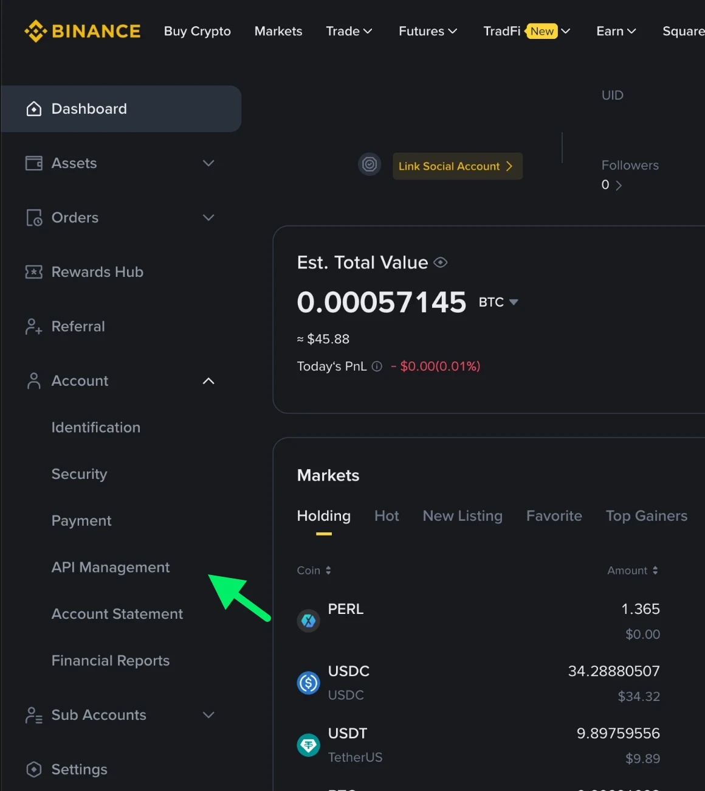<figcaption></figcaption></figure>

**2.** Press **Create API**.

<figure>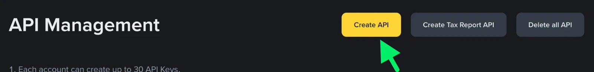<figcaption></figcaption></figure>

**3.** Choose **Self-generated** and press **Next**.

<figure>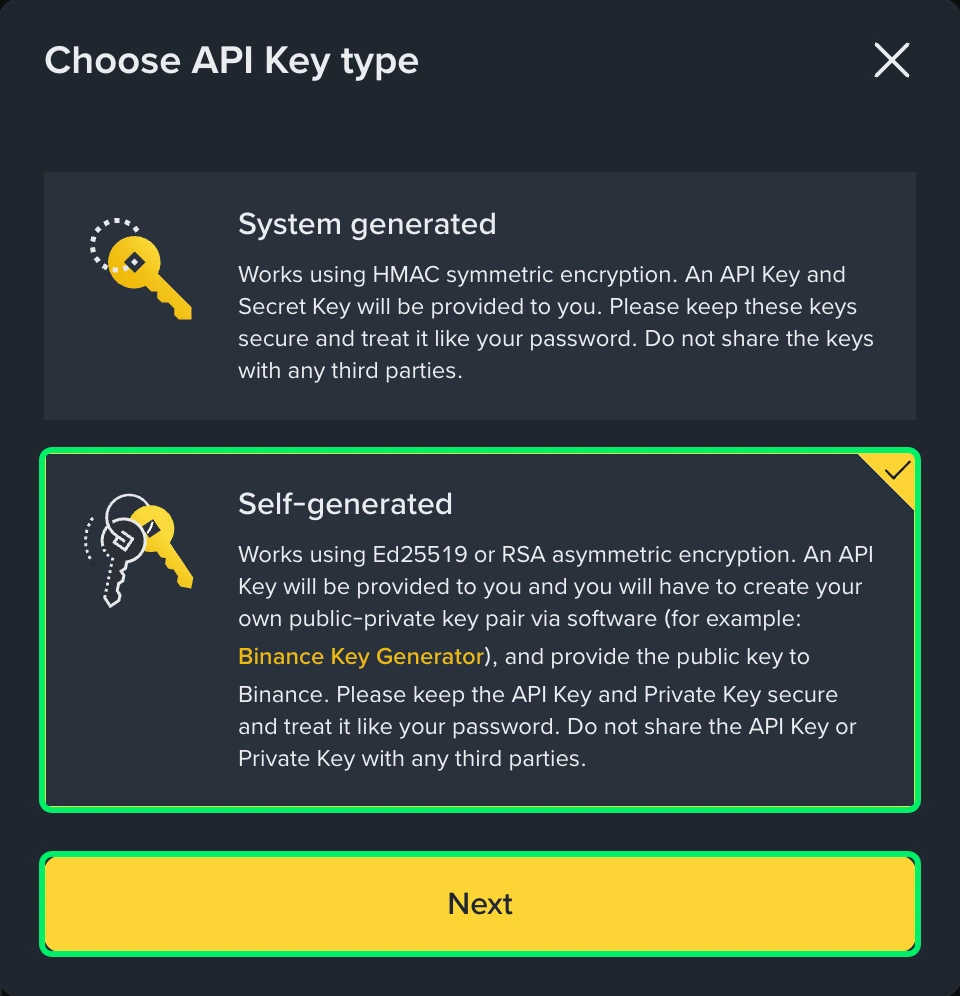<figcaption></figcaption></figure>

**4.** In goodcryptoX, open **Settings › Exchanges › Binance**, choose **Self-generated API key** and press **Copy** under the public key. On Binance, paste it into **Your public key** and press **Next**.

<figure>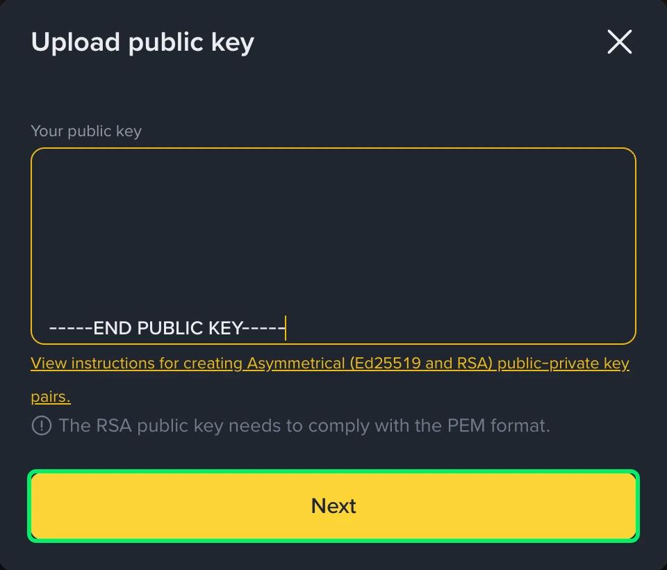<figcaption></figcaption></figure>

**5.** Give the key a name, for example `gcx`, and press **Next**.

<figure>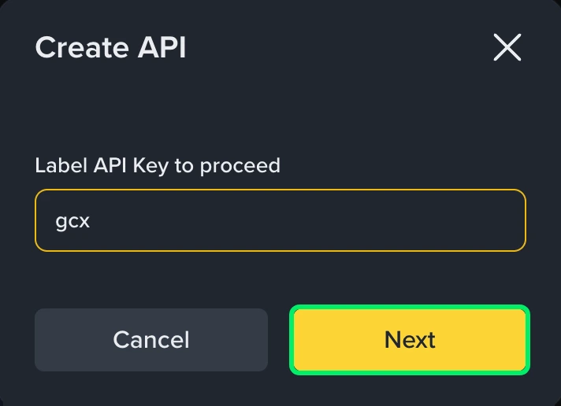<figcaption></figcaption></figure>

**6.** Binance asks you to verify yourself, with your passkey or two-factor code.

**7.** Binance shows the key. Its **API Key** is the one goodcryptoX needs, and **Copy** copies it whole. Before you copy it, press **Edit restrictions** at the top right: Binance makes the key read-only, and goodcryptoX needs it to trade.

<figure>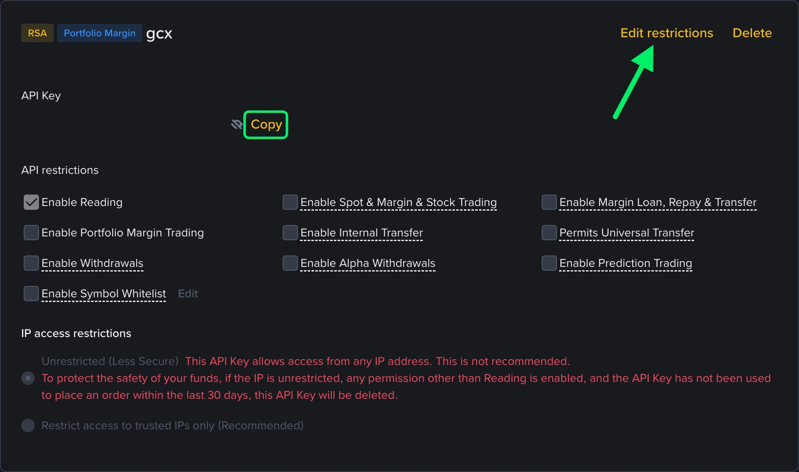<figcaption></figcaption></figure>

**8.** Tick **Enable Spot & Margin & Stock Trading** for spot and **Enable Futures** for futures. On a Portfolio Margin account the second box is **Enable Portfolio Margin Trading**, not **Enable Futures**. Never tick **Enable Withdrawals**: goodcryptoX never needs it.

<figure>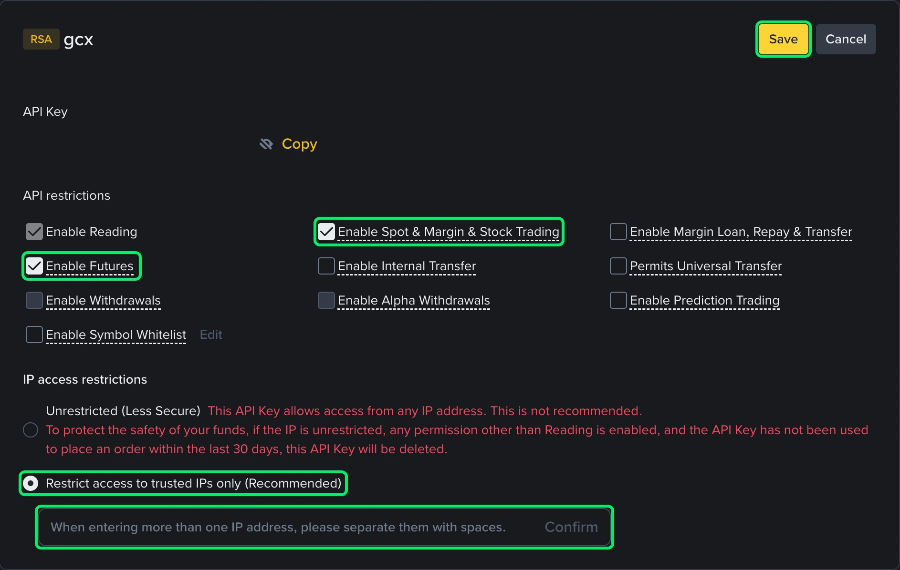<figcaption></figcaption></figure>

**9.** Choose where the key can trade from.

* **With a fixed IP address,** choose **Restrict access to trusted IPs only** and add the address, then press **Confirm**. For several addresses, separate them with spaces, as Binance's own hint says.
* **Without one,** leave **Unrestricted (Less Secure)**.

<figure>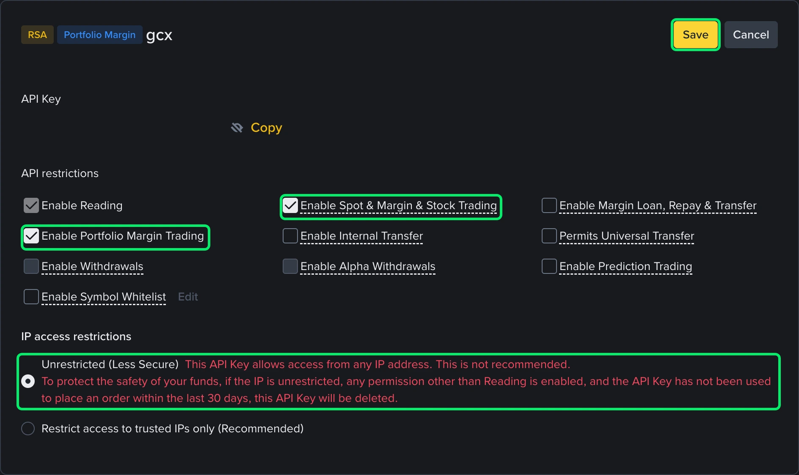<figcaption></figcaption></figure>

Binance puts a red warning under **Unrestricted (Less Secure)**: "To protect the safety of your funds, if the IP is unrestricted, any permission other than Reading is enabled, and the API Key has not been used to place an order within the last 30 days, this API Key will be deleted." So a key with no IP address needs an order from it at least every 30 days. Trade from goodcryptoX with it in that time, or add an IP address.

**10.** Press **Save** and verify yourself again. Press **Copy** beside the key's **API Key**, paste it into goodcryptoX's **API key** field and press **Save and validate**. goodcryptoX reads what the key can do and says what is missing, spot or futures trading for example.

## System-generated API key

Binance makes the key and a secret to go with it. A key made this way can trade only from the IP addresses you list, so use it when your IP address is fixed. In goodcryptoX, choose **System-generated API key** and answer the question about your IP address: goodcryptoX shows the address to add, with a copy button.

**1.** On Binance, open **Account**, then **API Management**, and press **Create API**, as in steps 1 and 2 above.

**2.** Choose **System generated** and press **Next**.

<figure>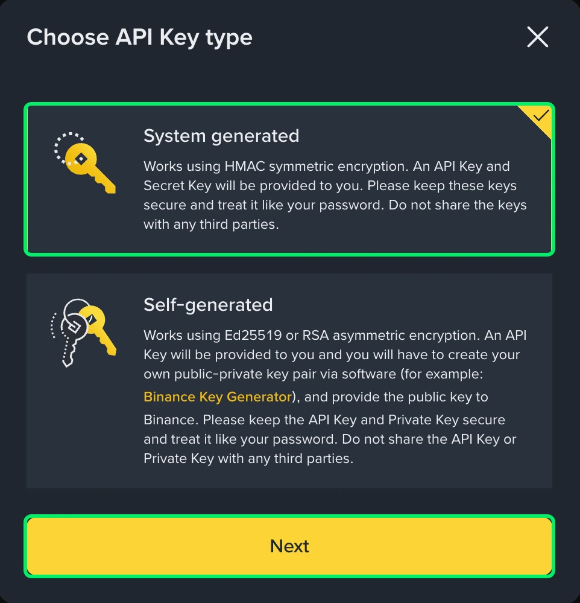<figcaption></figcaption></figure>

**3.** Give the key a name and press **Next**, then verify yourself.

**4.** Binance shows the **Secret Key** once, when it makes the key. Copy it now into goodcryptoX's **API secret** field, and the **API Key** into its **API key** field. Binance makes the key read-only: press **Edit restrictions**.

**5.** Tick **Enable Spot & Margin & Stock Trading** and **Enable Futures** (**Enable Portfolio Margin Trading** on a Portfolio Margin account). Choose **Restrict access to trusted IPs only**, paste the IP addresses goodcryptoX shows, separated by spaces if there are several, and press **Confirm**, then **Save**. Verify yourself again.

<figure>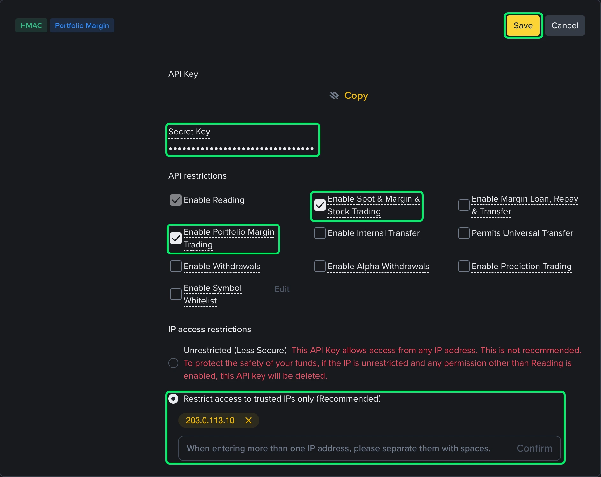<figcaption></figcaption></figure>

Binance's warning for this key: "To protect the safety of your funds, if the IP is unrestricted and any permission other than Reading is enabled, this API key will be deleted." Unlike a self-generated key, there are no 30 days. So add the IP addresses before you tick trading.

**6.** In goodcryptoX, press **Save and validate**. A key you made yourself with an Ed25519 or RSA key can't be added here: use a self-generated API key.

## Sign in with Binance

The shortest way, with no key to copy. Choose **Sign in with Binance** and answer the question about your IP address. Answer **Yes** if it is fixed: goodcryptoX fills it in, and you can add others, separated by spaces or commas (up to 30). Name the account and press **Sign in with Binance**. goodcryptoX takes you to Binance. Approve there: Binance makes a key for goodcryptoX with the IP addresses you confirmed, and you're back in goodcryptoX with the account added. The key trades only from those addresses, so use this way when your IP address is fixed, on a server for example. Sign in with Binance works on the computer goodcryptoX runs on, at its home-network address, or on a server through its SSH tunnel; elsewhere, use a self-generated API key.

## Is my IP address fixed?

A fixed IP address is one that stays the same, so a key can list it. It is the address Binance sees from where goodcryptoX runs, which is not always the device you are reading this on. A home connection usually changes its address from time to time, when the router restarts for example. A server or VPS usually keeps its address as long as you rent it.

To check, open **Settings › Exchanges › Binance**: goodcryptoX shows the address it read. Look again in a few days and after a restart. If it never changes, it is probably fixed, and your provider can tell you for sure. [Supported exchanges](../exchanges.md#is-my-ip-address-fixed) has more ways to check.

If it is not fixed, or you are not sure, choose **Self-generated API key**: it trades from any IP address, so a changing address does not matter.

**If the address changes later,** Binance refuses a key that lists the old one. The Dashboard's **Needs your attention** row opens the account's card, which shows the address to allow. On Binance, open **API Management**, press **Edit restrictions** and add that address to the key's list, or press **Replace API key** and connect again. After Binance accepts the same key, its streams reconnect within a minute and the refusal clears when they are live.

## Trading without an IP address

Binance has a safety setting for keys with no IP address. On **API Management**, a box says: "By checking this box, all existing API Key(s) on your master account and sub-accounts will be subject to Default Security Controls." Open **Default Security Controls Details** to read them. For a key Binance made, Binance says it is "prevented from enabling trading or transfer permissions"; for any key with trading on and no IP address, it is "periodically or immediately revoked".

<figure>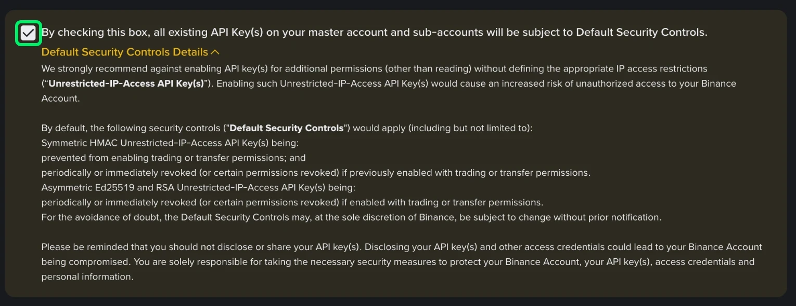<figcaption></figcaption></figure>

To switch the controls off, untick the box. Binance then asks you to confirm "I hereby instruct Binance to DEACTIVATE the Default Security Controls applied to the Unrestricted-IP-Access API Key(s) for my master account and all sub-accounts."

<figure>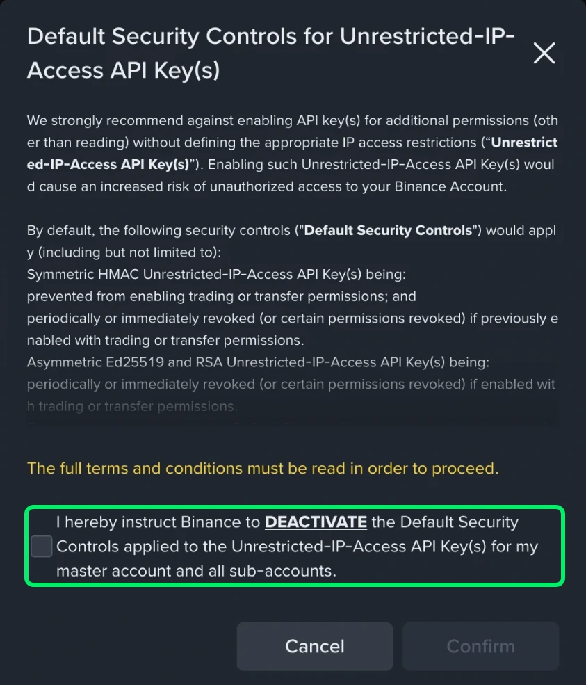<figcaption></figcaption></figure>

This makes every key on the master account and its sub-accounts less safe, so we do not recommend it. You might do it if you manage an account whose keys were given to you without an IP address. For an address that changes, a self-generated API key is the better answer.

## After you connect

**The account's card** is laid out like a Hyperliquid account's: its name with **User ID** under it and the **Exchange balance** at the right, what the key can do, **Include in portfolio**, then **Edit account** with **Rename account**, **Replace API key** and **Remove account**.

**What the key can do** is shown on the card after **Save and validate**: spot, futures, withdrawals, and whether it works only from listed addresses. goodcryptoX never withdraws; a key without withdrawals is safer. A key that can only read, or that can withdraw, is marked yellow. If you change the key's permissions on Binance, press **Check again** beside that line; goodcryptoX also reads them when it starts and when you open this page. While refused, the card shows the refusal in red, and **Replace API key** instead of capability lines.

To change the key, press **Replace API key** on the account's card and connect again. A key of another Binance account is refused there.

**Remove account** asks first. Your bots on this account stop and your orders stay on Binance as they are; untick **Keep trading history** to erase the account's history from goodcryptoX. If goodcryptoX placed the small order that keeps your key alive in the last seconds, the removal waits for it to be cancelled. goodcryptoX then deletes its copy of the key; delete the key on Binance too, under **API Management**. While the key store is locked, goodcryptoX cannot remove the account: unlock it first. You can add the same account again once it is removed.

**With a proxy.** While the proxy is on, exchanges see its address, and that is the address goodcryptoX shows and asks about. Turning the proxy on or off, or changing it, changes the address exchanges see: goodcryptoX names the accounts whose keys work only from listed addresses before it applies the change.

**Restricted location.** If Binance is unavailable from this installation’s location, change its connection or proxy location; adding an address to the key’s list does not resolve a location restriction.

## Keep your API key alive

Binance's key page says it deletes an API key that has no IP addresses and can do more than read when the key has not been used to place an order for 30 days. Binance may also delete such a key, or take its trading away, at any time under its Default Security Controls. Adding an IP address to the key on Binance is the sure way to keep it.

goodcryptoX keeps your key in use: when it has placed no order in goodcryptoX for three weeks, goodcryptoX places the smallest order Binance takes on BTC or ETH, at about half the price, and cancels it ten seconds later. It uses Spot first, then USD-M futures, never a market where you hold a position, have an order or run a bot; it needs about 5 USDT free on Spot for those seconds. Any order you or your bots place in goodcryptoX counts, so an account that trades never sees one; an order you place on Binance's own site does not use the key. If goodcryptoX can't place it, the account's card says so at once, and the Dashboard and Telegram tell you a week ahead and the day before. goodcryptoX can only do this while it runs: if it was off for more than 30 days, Binance may have deleted the key, and the account shows that Binance refused it; press **Replace API key**.

**Keep my API key alive** is ticked under the question about your IP address when you add a self-generated key, unless you answer **Yes**, or when you go on with a system-generated key without an IP address. Untick it there, or switch it off on the account's card, to stop it. A key with IP addresses, or one that can only read, needs none, and its card shows no switch.

## Pay fees in BNB

**Pay fees in BNB** on the account's card has Binance take your Spot and USD-M trading fees in BNB, at Binance's discount, while you hold BNB. It is Binance's own setting, for every order on the account, including the ones goodcryptoX places. The switch is on only when Binance has it on for both Spot and USD-M; turning it on sets both. COIN-M futures have no such setting. A key that can only read cannot change it.

When Binance takes a fee in BNB, the fill is booked at once and your bots go on, the take-profit included. The fee is counted in the order's fee, in the bot's fees and in its PnL as soon as goodcryptoX can read BNB's price.

## Several accounts and sub-accounts

Connect each Binance account or sub-account with its own key, through **Add Binance account**. Each is a separate account in goodcryptoX, with its own balances, orders and bots; removing one leaves the others trading. Create sub-accounts and move funds between them on Binance.

## Trading on Binance

* **Markets:** Spot under **Spot**; USD-M and COIN-M futures, quarterly contracts included, under **Perps**, and TradFi perpetuals there too, with a small **tradfi** tag. The first time you pick a TradFi perpetual, goodcryptoX offers Binance's agreement above the form.
* **Leverage and margin:** the form's **Margin** control sets a futures market's leverage and its margin type, cross or isolated. On an isolated position, the pencil on **Margin** in its details adds or removes margin; Binance refuses to remove more than the position can spare.
* **Hedge mode:** the cog at the end of the order form's **Position** row switches between **One-way mode** and **Hedge mode** for all the account's futures: Binance keeps one setting for USD-M and COIN-M, so switching one switches both. Binance allows the change only with no open positions or orders there. In hedge mode the Position row picks **Long** or **Short**, and the button says **Open long**, **Close long**, **Open short** or **Close short**; a DCA bot picks its side; a Grid keeps its long and short apart.
* **COIN-M sizes** default to **Contracts**; the form also takes the coin or USD.
* **Liquidations:** if Binance liquidates or auto-deleverages a position while goodcryptoX is running, the bots on it stop and you get an alert.
* **Account modes:** Classic, Multi-Assets, Portfolio Margin and Portfolio Margin Pro accounts trade; change the mode on Binance.
* **Balances** come from every Binance wallet: Spot, Funding, futures, Margin, Earn and the others Binance lists for your account.

A bStock is a token backed by a US share, traded on Binance Spot 24/7 like a coin, by hand and with the bots. A split or reinvested dividend changes your token balance without a trade. Availability depends on your Binance account. Extra tokens appear in Account position; bot sizes and entry prices stay unchanged.

## Fees

Binance's own trading fees apply as on Binance. goodcryptoX's fee, 0.03% of each trade it places, is paid with [credits](../credits.md): your first 10,000 USD of volume is free.

## If something goes wrong

| You see | What to do |
|---|---|
| "Could not sign in to Binance. Try again" | Press **Sign in with Binance** again and approve on Binance, or make a key yourself. |
| "Binance stopped the sign-in. Try again" | Press **Sign in with Binance** again. If you see it again, hover over the line (tap it on a phone) to see Binance's code and send it to us, or make a key yourself. |
| "Binance didn't accept the sign-in. Try again" | Press **Sign in with Binance** again. If you see it again, send us the code behind the line (hover over it). |
| "Binance didn't confirm your account. Try again" | Press **Sign in with Binance** again. If you see it again, send us the code behind the line (hover over it). |
| "Binance didn't create the API key. Try again, or make one yourself" | Press **Sign in with Binance** again, or make a key yourself. If it happens again, send us the code behind the line (hover over it). |
| "Binance made an API key, but goodcryptoX couldn't read it. Try again" | Press **Sign in with Binance** again. If Binance then says it didn't create the API key, delete the key named goodcryptoX in API Management on Binance and sign in again. |
| "Binance could not be reached: try again" | Press **Sign in with Binance** again in a minute. |
| "You didn't approve on Binance, so nothing was connected" | Nothing to undo. To connect the account, press **Sign in with Binance** again and approve on Binance. |
| "Sign-in expired. Try again" | Press **Sign in with Binance** again. A sign-in lasts ten minutes, and only the latest one counts. |
| "Sign in with Binance doesn't work from this address" | Use a self-generated API key, or open goodcryptoX on the computer it runs on, at its home-network address, or through the server's SSH tunnel. |
| "Binance refused this API key: check it was copied whole" | Copy the API key again from Binance, whole. |
| "Binance does not hold goodcryptoX's key under this API key: paste it there again" | On Binance, paste goodcryptoX's key into that API key again. |
| "The secret does not match this API key: copy both again" | Copy the API key and the secret again. |
| "This computer's clock is off: set the right time and try again" | Set the computer's time automatically, then press **Save and validate**. |
| "Binance is unavailable from this installation’s location. Change its connection or proxy location" | Change the installation’s connection or proxy location; adding an address to the key’s list does not resolve a location restriction. |
| "You already added this account as Binance. Adding it again counts it twice on your Dashboard" | Press **Save anyway** to add it as a second card. To give the first card a new key, use **Replace API key** on its card. |
| "This key belongs to another Binance account" | Use a key of the account you are replacing. |

## Questions

### Can goodcryptoX withdraw from my Binance account?

No. goodcryptoX never withdraws: the key Sign in with Binance makes cannot, and a self-generated API key needs only Spot and Futures ticked.

### Can I connect Binance sub-accounts?

Yes: each with its own key, through **Add Binance account**. Each is its own account in goodcryptoX.

### Does goodcryptoX charge a fee on Binance?

0.03% of each trade it places, paid with credits, after your first 10,000 USD of volume, which is free ([Credits](../credits.md)).
