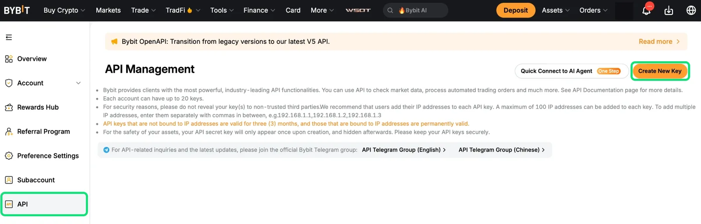
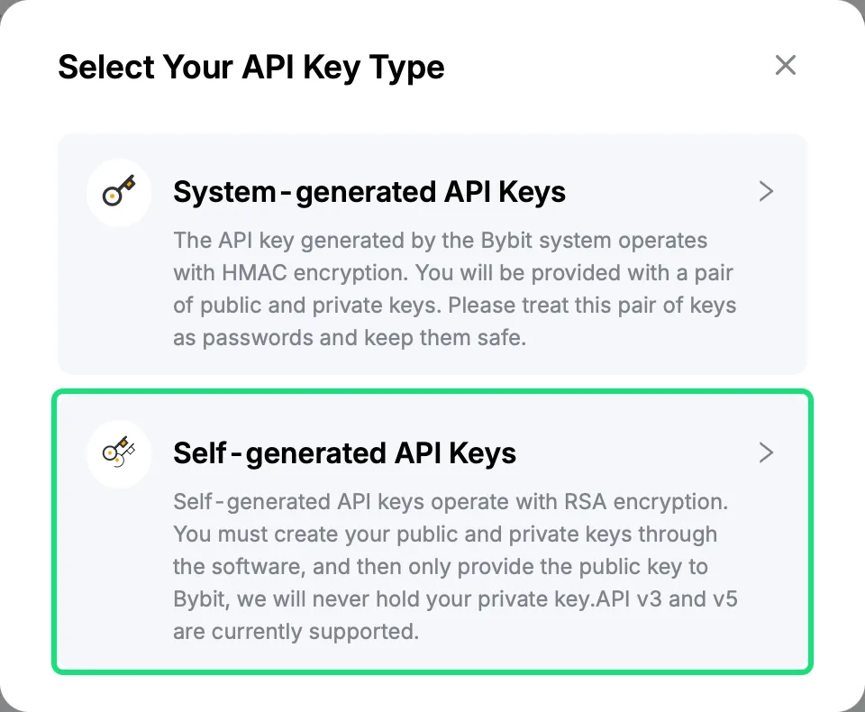
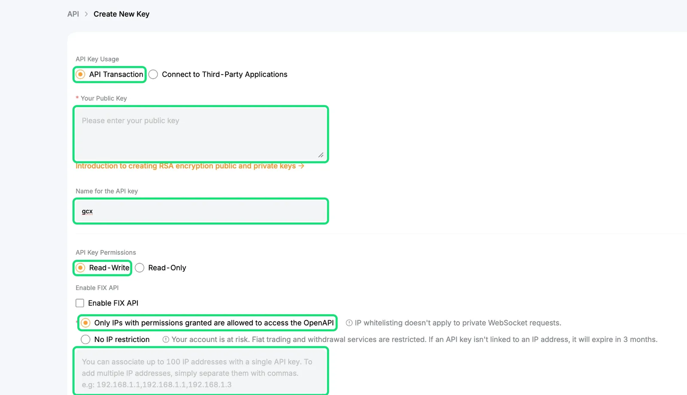
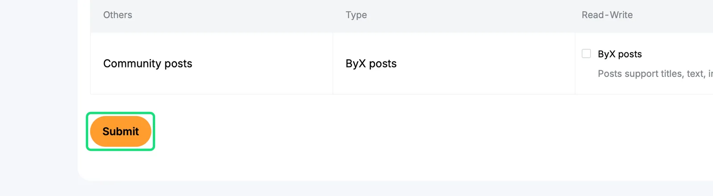
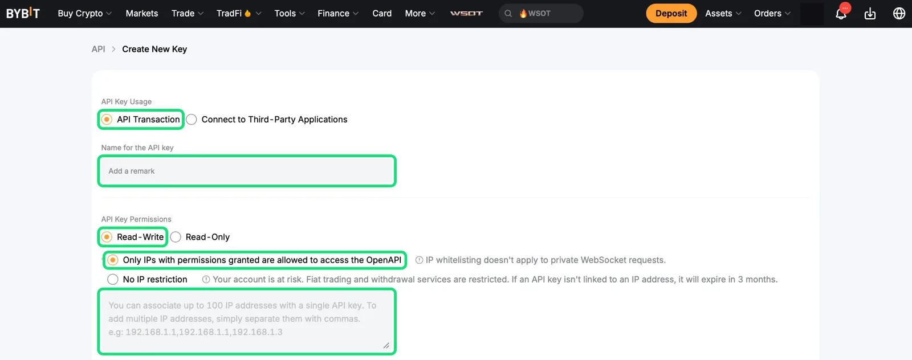
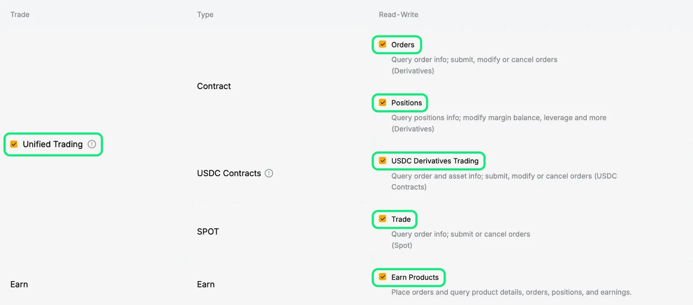
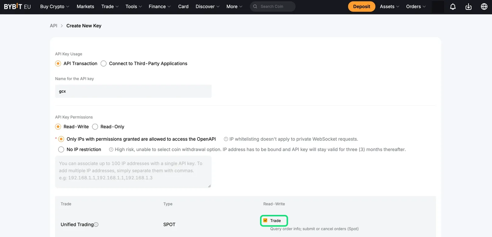

# Connect Bybit

With goodcryptoX, you can trade on Bybit manually or with the [DCA](../bots/dca.md) and [Grid](../bots/grid.md) bots: spot, USDT and USDC futures, and coin-margined inverse futures. You can also see your balances, positions and orders. Bybit EU supports spot only.

## Connect your Bybit account

Choose **Bybit** or **Bybit EU** in goodcryptoX to match where your account is registered. The steps below are Bybit's; [Bybit EU](#bybit-eu) works the same way. Paste only the API key and secret Bybit shows: a wallet's recovery phrase or private key pasted into an API key, API secret or account name field is emptied at once and never sent.

We recommend a **Self-generated API key**: goodcryptoX makes the key on your computer and only its public part goes to Bybit. A **System-generated API key** works too. If you're not sure whether your IP address is fixed, choose Not sure. You can connect without a whitelisted IP address, but the key ends after 90 days and goodcryptoX reminds you before then. [How to check your IP address](#is-my-ip-address-fixed).

## Self-generated API key

Only your public key goes to Bybit; goodcryptoX keeps the private key on your computer.

**1.** In goodcryptoX, open **Settings › Exchanges › Bybit** or **Bybit EU** and choose **Self-generated API key**. If you have accounts there already, press **Add Bybit account** or **Add Bybit EU account** first.

**2.** goodcryptoX shows your IP address above the question. Answer [**Is your IP address fixed?**](#is-my-ip-address-fixed) and press **Copy** under the public key.

**3.** On Bybit or Bybit EU, open `API` in your account's menu on the left and press `Create New Key`.

<figure><figcaption></figcaption></figure>

**4.** Choose `Self-generated API Keys`.

<figure><figcaption></figcaption></figure>

**5.** Choose `API Transaction`, not `Connect to Third-Party Applications`: that option is for apps hosted on a company's servers and ties the key to them. Paste the public key into `Your Public Key` and name the key, for example `gcx`.

**6.** Choose `Read-Write` to trade, or `Read-Only` to only track the account. Leave `Enable FIX API` unticked.

**7.** If your IP address is fixed, choose `Only IPs with permissions granted are allowed to access the OpenAPI` and paste the address goodcryptoX shows. Otherwise, choose `No IP restriction`; the key ends after 90 days.

<figure><figcaption></figcaption></figure>

**8.** Tick **Unified Trading**: one box ticks all the [permissions](#which-permissions) you need.

**9.** Press `Submit` at the bottom of the form and complete Bybit's security verification.

<figure><figcaption></figcaption></figure>

**10.** Copy the `API Key` Bybit shows into goodcryptoX's **API key** field, name the account and press **Save and validate**.

## System-generated API key

Bybit makes the API key and secret. The secret is shown only once.

**1.** In goodcryptoX, open **Settings › Exchanges › Bybit** or **Bybit EU** and choose **System-generated API key**. If you have accounts there already, press **Add Bybit account** or **Add Bybit EU account** first.

**2.** goodcryptoX shows your IP address above the question. Answer [**Is your IP address fixed?**](#is-my-ip-address-fixed)

**3.** On Bybit or Bybit EU, open `API` in your account's menu on the left, press `Create New Key` and choose `System-generated API Keys`.

**4.** Choose `API Transaction`, not `Connect to Third-Party Applications`, and name the key, for example `gcx`.

**5.** Choose `Read-Write` to trade, or `Read-Only` to only track the account.

**6.** If your IP address is fixed, choose `Only IPs with permissions granted are allowed to access the OpenAPI` and paste the address goodcryptoX shows. Otherwise, choose `No IP restriction`; the key ends after 90 days.

<figure><figcaption></figcaption></figure>

**7.** Tick **Unified Trading**: one box ticks all the [permissions](#which-permissions) you need. Press `Submit` at the bottom of the form and complete Bybit's security verification.

**8.** Copy `API Key` into goodcryptoX's **API key** field and `API Secret` into **API secret** before closing Bybit's key window. Name the account and press **Save and validate**.

## Which permissions?

Choose **Read-Write** to trade, then tick **Unified Trading**: that one box ticks everything goodcryptoX needs. On an account that isn't unified, tick **Orders** and **Positions** under **Contract**, **USDC Derivatives Trading** under **USDC Contracts**, and **Trade** under **SPOT**.

<figure><figcaption></figcaption></figure>

On global Bybit, also tick **Earn Products** so your Earn balances are counted in full; trading works without it.

Leave **Withdrawal**, **Account Transfer** and **Subaccount Transfer** off for trading. goodcryptoX never withdraws or transfers funds.

Your Funding wallet is counted without any extra permission. On Bybit EU it is counted only if you tick **Account Transfer** (**Subaccount Transfer** on a sub-account), which also lets the key move funds between your wallets; leave it off if you don't want that. To trade money in Funding, move it to your trading wallet on Bybit.

Bybit’s [API key guide](https://www.bybit.com/en/help-center/article/How-to-create-your-API-key/) and [EU setup guide](https://www.bybit.eu/en-EU/learn/bybit-guide/what-is-api-trading-and-how-to-set-it-up-on-bybit-eu) show the key pages.

Choose Bybit or Bybit EU to match where your account is registered. Use a key from your real account. Demo Trading and testnet keys cannot connect it.

If Bybit says the key has expired, use **Replace API key**.

## Bybit EU

Connecting a Bybit EU account is the same: both key types, the same IP choice and the same 90 days without a whitelisted IP address. Bybit EU trades spot only, so tick **Unified Trading**, which ticks **Trade** under **SPOT**.

<figure><figcaption></figcaption></figure>

## Is my IP address fixed?

It is the IP address the exchange sees from where goodcryptoX runs. A server or VPS usually keeps its address; a laptop or home connection usually changes. If you answer **Yes**, whitelist the address goodcryptoX shows for the key. With **No** or **Not sure**, either key type works without a whitelisted IP address, but expires after 90 days. Whitelisting an address removes that expiry condition. [Supported exchanges](../exchanges.md#is-my-ip-address-fixed) explains how to check.

## After you connect

**With a proxy.** While the proxy is on, exchanges see its address. Use the address goodcryptoX shows for this installation. If you change the connection or proxy, an address-bound key may need its allowed addresses updated on Bybit.

**What the key can do** appears on the saved account's card. The card shows the end date Bybit gives the key. A key with your IP address whitelisted has none. A key without withdrawal permission is safer; goodcryptoX never withdraws or transfers funds.

If you add an account you already have, goodcryptoX warns that it will count twice on your Dashboard. Press **Save anyway** to add it again. Each copy has its own orders, bots and history.

**Replace API key.** Press **Edit account**, then **Replace API key** and follow either way again, without renaming the account. Your orders, bots and history stay. If Bybit refuses the key, the card shows that refusal and Replace API key. For an IP mismatch, copy the address shown and whitelist it for the key on Bybit. If the address is missing, press Retry. When Bybit accepts the same key and its private stream is live again, the refusal clears. If Bybit is unavailable from this installation's location, change its connection or proxy location.

If a replacement check fails, your old key stays active. **Continue anyway** checks the new key again; it is used only after Bybit confirms it belongs to the same account. After changing your connection or proxy, open **Replace API key** and choose a key type to copy the current IP address.

goodcryptoX reminds you in the app, on the account card, on the Dashboard and in Telegram at 30, 7 and 1 day before the key ends, and when it expires. Press **Replace API key** on a reminder, or follow the Telegram message’s link, to open replacement for that account. The old reminders stop and the new key’s end date is read. Your running bots and orders stay. On the last day, Launch and Send warn you; **Launch anyway** and **Send anyway** remain available. The reminder shows the time left, such as “API key expires in 7 days”, then “API key expires within 24 hours” and “API key expired”.

Under **Edit account**, **Remove account** asks first: your bots stop, your orders stay on Bybit, and goodcryptoX deletes its copy of the key; untick **Keep trading history** to erase the account’s history, and delete the key on Bybit too.

If you change your API key's permissions on the exchange, press **Check again** beside the line on its card.

## Markets

| Market | Where to find it |
|---|---|
| Spot | **Spot** |
| USDT and USDC perpetuals and dated futures | **Perps** |
| Coin-margined inverse perpetuals and dated futures | **Perps** |

Bybit EU supports spot only.

Market names use the pair followed by a small tag: `BTC.USDT` on spot, `BTC.USDT perp` for a perpetual, `BTC.USDT 25/12/26` for a dated future, `BTC.USD inv` for an inverse perpetual, and `BTC.USD inv 25/12/26` for a dated inverse future. Dates follow your language. If Bybit gives no delivery day, a dated future shows `fut` (or `inv fut`). USDC contracts use their catalogue pair, such as `BTC.USDC perp`; units such as `1000PEPE` stay as Bybit names them. Long and Short have the same market name. Stock, commodity, forex and ETF perpetuals stay in **Perps**, with the `tradfi` tag. Stock tokens sit in **Spot**, with no tag. A tab that has both kinds offers **All | Crypto | TradFi** below its tabs; All shows both kinds. Choose TradFi to see them.

Use the form's **Margin** control to change a futures market's leverage, or its margin mode where it is the market's own. On a Unified Trading Account the margin mode is the whole account's; change it on Bybit.

On an isolated position, the pencil on **Margin** in its details adds or removes margin, as on Binance. Bybit decides how much you can remove. The amount is in the contract's settlement coin: USDT or USDC for linear contracts, the coin for inverse contracts. A Trade key can do the same on the accounts and markets you allow.

## Account modes and hedge mode

goodcryptoX reads classic accounts, Unified Trading Accounts 1.0 and 2.0 (including Pro), and isolated, cross and portfolio margin. Change the account's mode or margin mode on Bybit; goodcryptoX picks the change up and uses it for the orders that follow.

On a classic account, a market buy in coins is sent as what those coins cost on the Orderbook, so Bybit may buy slightly less or slightly more.

A unified trading wallet shares eligible collateral across its markets. Portfolio margin has no separate position leverage or liquidation price. On a unified account in Cross, the DCA and Grid forms show Est. liquidation, as Bybit gives each position one. Total counts owned equity once; Funding stays separate from trading funds. With % of account, DCA and Grid size their orders using your chosen leverage, including in portfolio margin. In portfolio margin, a refused leverage change is shown as a warning; the bot can still submit orders.

Inverse sizes are in USD or in the settlement coin, in steps of 1 USD: 250 USD at a price of 100,000 is 0.0025 BTC. When you leave the size field, it snaps down to what the market trades. Margin, profit and trading fees settle in the contract’s settlement coin.

In hedge mode, Long and Short are separate positions on the same market, and the market selector offers both. Your bots keep running when you switch; a bot's next opening uses the new mode. For contracts that support hedge mode, use the cog beside Position in the Trade form to choose One-way mode or Hedge mode. The change applies only to the selected contract.

### Used as collateral

On a unified account in Cross or Portfolio margin, your account's coin list on the Dashboard has a Collateral column. A coin switched on counts as collateral in your Unified Trading Account for your positions and borrowing; switched off, it doesn't. Turning a coin off doesn't sell or move it, and coins in Funding aren't affected.

- USDT, USDC and any other coin Bybit requires as collateral stay on and can't be switched off.
- A coin Bybit doesn't accept as collateral stays off and can't be switched on.
- Turn a coin's switch on or off to change its collateral setting. If Bybit refuses, the reason appears below the coin. If the change can't be confirmed, press **Refresh** to check the current setting.
- Changes you make on Bybit also appear here.

Classic accounts and isolated margin have no per-coin choice, so the column isn't there. Only you can change this setting in goodcryptoX: API keys and AI agents can read it, not change it.

## Orders awaiting confirmation

If Bybit’s answer is missing, the order shows **Unknown** and goodcryptoX keeps checking. Press **Refresh** on the order to read it again now. goodcryptoX never sends it again while the outcome is unknown.

## Sub-accounts

Connect each Bybit sub-account with its own key using **Add Bybit account**. Each is a separate account in goodcryptoX, with its own balances, orders and bots.

## Fees

Bybit's trading fees apply to manual orders and both bots; goodcryptoX reads your account's own rates.

goodcryptoX’s fee on Bybit and Bybit EU is 0.03% of each trade it places, paid with [credits](../credits.md). Your first 10,000 USD of CEX volume is free.

## Good to know

* DCA and Grid bots can start on signals using Bybit’s candles. Your connected accounts and balances appear on the Dashboard.
* Ordinary spot does not request borrowing, even when spot margin is enabled. Its balance excludes reported locked funds, futures margin, order margin and manual borrowing. Bybit makes the final decision on what an order can spend.
* The [privacy policy](../legal/privacy.md) describes how keys are kept and which Bybit services goodcryptoX contacts.

## Questions

### Which markets can I trade on Bybit EU?

Spot only, by hand or with the DCA and Grid bots. Bybit also supports USDT, USDC and inverse futures.

### Which API key type should I choose?

We recommend a self-generated key: goodcryptoX makes it and keeps its private part on your computer, so nothing secret leaves it. A system-generated key works too; you copy its API key and secret from Bybit.

### Does my key expire without a whitelisted IP address?

Yes, after 90 days (Bybit says three months), for either key type; goodcryptoX reminds you before then, and **Replace API key** takes a new one. A key with the fixed IP address of the computer running goodcryptoX doesn't expire.

### Can goodcryptoX withdraw my funds?

No. goodcryptoX never withdraws or transfers funds. Leave withdrawal permission off; transfer permissions are optional for Funding balances, as explained under [Which permissions?](#which-permissions).

### Can I connect a sub-account?

Yes, with its own API key. It has its own balances, orders and bots in goodcryptoX.
