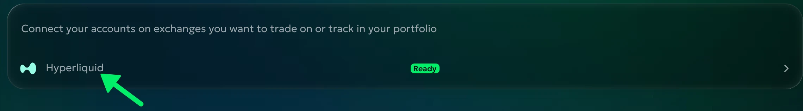
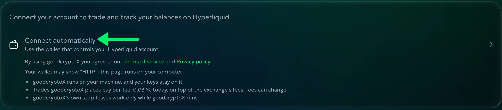
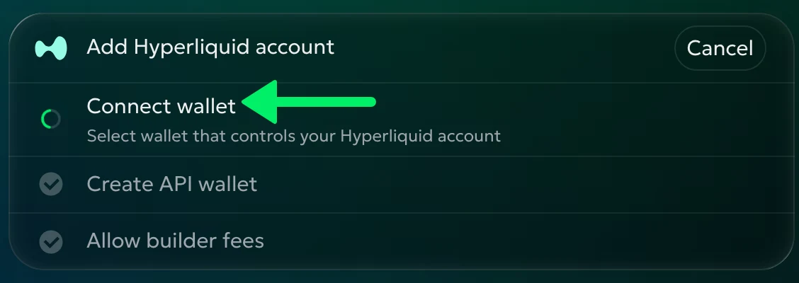
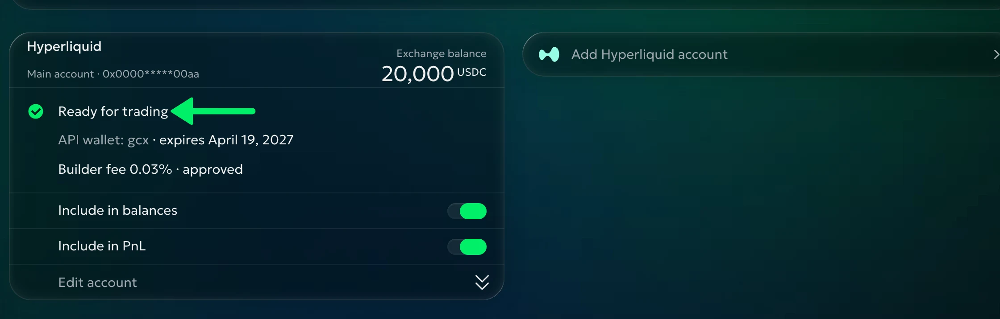
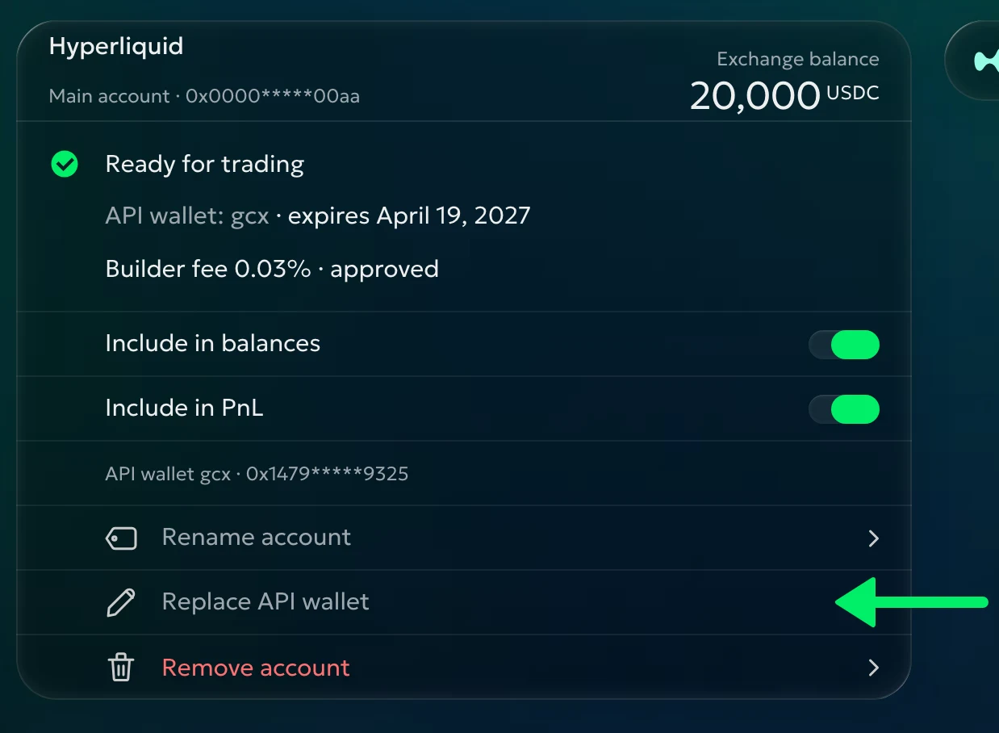

# Hyperliquid

Though fully on-chain, Hyperliquid's trading experience is closer to a centralized exchange than to an AMM DEX.

Connection works through an API wallet (Hyperliquid's version of an API key), which lets goodcryptoX place orders but never withdraw funds. goodcryptoX makes the API wallet itself and keeps it where goodcryptoX runs; your main wallet's key never reaches goodcryptoX.

No subscription is required to use any tool. Instead, a [builder fee](#builder-fees) applies to each trade goodcryptoX places for you.

goodcryptoX expands Hyperliquid's native functionality: conditional [stop orders](../trading/order-types.md) that don't freeze your balance until triggered, [trailing orders](../trading/order-types.md), and the [DCA bot](../bots/dca.md).

## How to connect

If you control your Hyperliquid account with a browser wallet (MetaMask, Rabby, Phantom and others) or with a phone wallet through WalletConnect, you can connect it to goodcryptoX in a few clicks. Signing is free: no gas.

**Tip:** if you created your Hyperliquid account using **email**, you'll need to export your wallet to MetaMask (or another wallet) first. Go to Settings in the Hyperliquid interface and select "Export email wallet".

[picture: Hyperliquid's Settings with Export email wallet, MH's hands]

**1.** In goodcryptoX go to **Settings › Exchanges › Hyperliquid**:

**2.** Click **Connect automatically** (**Add Hyperliquid account** for the next ones):

**3.** Select the wallet that controls your Hyperliquid account. Connecting signs nothing:

**4.** If your account has no referrer yet, leave **Pay 4% less on Hyperliquid fees** ticked to get our [referral discount](#referral-discount), or untick it, and press **Continue**.

**5.** We will now generate an API wallet and register it with Hyperliquid. Sign **Approve API wallet** in your wallet (no gas required). In the unlikely case you already have the maximum number of API wallets on Hyperliquid (3), we will ask which one you want to replace.

[picture: the wallet's "Approve API wallet" prompt, MH's hands]

**6.** You will then be asked to sign **Approve builder fee** to approve our [builder fee](#builder-fees) (no gas required). If you approved it before, this step is skipped.

[picture: the wallet's "Approve builder fee" prompt, MH's hands]

Once your account's card reads **Ready for trading**, you are all set! You can see your API wallet's name, which you can use to identify it in Hyperliquid's interface, and its expiration date:

Hyperliquid's API wallets expire after 180 days. We will warn you 30 days before, on the card and on Telegram. To replace it, open **Edit account** › **Replace API wallet** and sign with your wallet as when you connected; trading goes on until the new one is ready. **Edit account** also renames or removes the account; removing one account leaves the others trading.

## Sub-accounts and vaults

After your main account is connected, goodcryptoX lists its sub-accounts and the vaults you lead. Tick the ones to add and press **Add**: each becomes its own account in goodcryptoX. Nothing more is signed.

* Your main account's API wallet trades them all, and one replacement covers them all.
* **Keep some funds on the main account.** Hyperliquid removes a main account's API wallets when it holds no funds, and its sub-accounts and vaults stop trading too.
* Create sub-accounts and vaults, and move funds between them, in Hyperliquid's app.

Another main account? Press **Add Hyperliquid account** and connect its own wallet.

## If something goes wrong

| You see | What to do |
|---|---|
| "Connect the wallet that owns the Hyperliquid account" | You connected a sub-account's, a vault's or an API wallet's address. Switch your wallet to the main account and press **Try again**. |
| "Wallet not linked to Hyperliquid, or the account has < 5 USDC" | Deposit on Hyperliquid with this wallet, or switch to the wallet you deposited from. |
| "You rejected the request in wallet" | Press **Try again** and sign. |
| "Incorrect wallet connected" | Your wallet switched to another address. Press **Disconnect & retry**. |
| "Hyperliquid API wallet limit reached" | Pick an API wallet to replace in the list; it stops working. |
| The card says **Waiting for approval** | You left before signing. Press **Try again** on the card. |
| "Allow builder fees to enable trading" on the Trade page | Press **Fix** and sign the builder fee. |
| "Your API wallet for … has expired: renew it in Settings" | Press **Fix**, or **Replace API wallet**. |

## Builder fees

Hyperliquid refers to integrator-collected trading fees as **builder fees**. In this model, goodcryptoX acts as a builder, charging a trading fee on top of Hyperliquid's base fees in exchange for access to advanced orders and trading bots.

To enable builder fees, Hyperliquid requires you to explicitly authorize goodcryptoX to charge them, by signing with your wallet. This approval is required to trade with goodcryptoX, and it is asked for when you connect.

* **The fee** is 0.03% of each trade's value, Stop Losses, Take Profits and closes included. Hyperliquid charges no builder fee on spot buys.
* An approval you gave goodcryptoX before at a higher rate stands: goodcryptoX charges 0.03% whatever the approval allows.
* A [partner code](../referral-program.md) can lower the fee.

**Tip:** to check, approve or revoke a builder fee by hand, goodcryptoX's or any other builder's, use our [builder fee tool](https://goodcrypto.app/hype/builder-fees). You sign with your own wallet; no gas. Revoking goodcryptoX's stops every order it sends, stop-losses and closes included.

## Referral discount

Register your Hyperliquid account with our referral link, <https://app.hyperliquid.xyz/join/GOODCRYPTOX>, and receive a `4%` discount on Hyperliquid's fees for the trades you place outside goodcryptoX, on the first $25M of trading volume. Not for vaults or sub-accounts.

If you already have a Hyperliquid account with no referrer, goodcryptoX offers the discount when you connect (step 4). You can also enter the code yourself: go to <https://app.hyperliquid.xyz/referrals>, click "ENTER CODE" and enter `GOODCRYPTOX`.

## Good to know

* goodcryptoX keeps every connected account's orders, fills and positions up to date while it runs, including what you do in Hyperliquid's own app.
* The smallest order on Hyperliquid is 10 USDC.
* How goodcryptoX reads Hyperliquid, its limits and its maintenance windows: the [Hyperliquid reference](../reference/hyperliquid.md).
