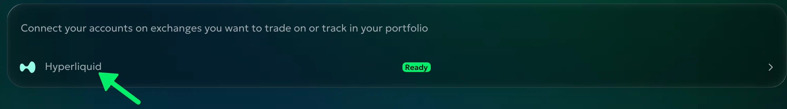
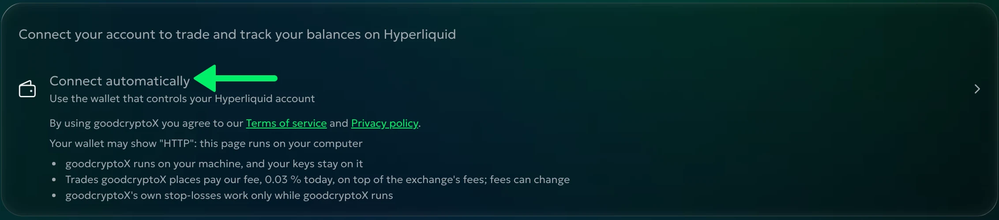
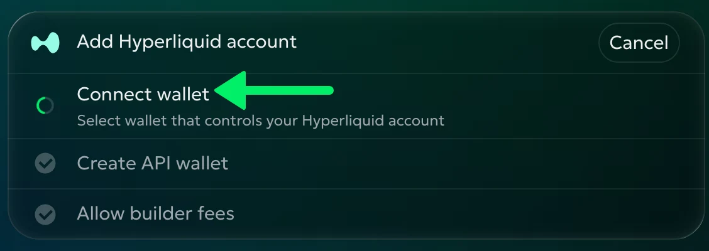
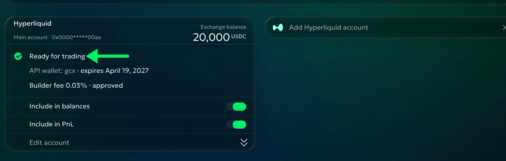
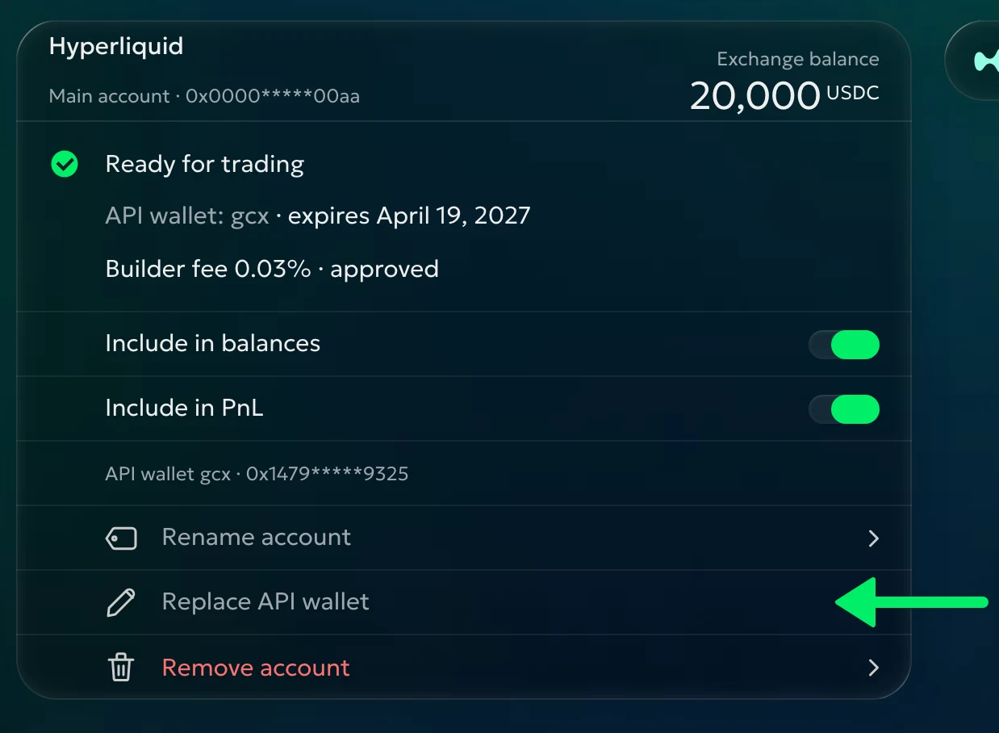

# Connect Hyperliquid

goodcryptoX trades your Hyperliquid account through an **API wallet**, Hyperliquid's version of an API key: goodcryptoX makes it on your machine, your wallet approves it once, and it can place orders but never withdraw. Your main wallet's key never reaches goodcryptoX. Connecting takes a few clicks and two free signatures, no gas.

Though fully on-chain, Hyperliquid trades like a centralized exchange, and goodcryptoX adds to it: conditional [stop orders](../trading/stop-orders.md) that don't freeze your balance until triggered, [trailing orders](../trading/trailing-stops.md), and the [DCA](../bots/dca.md) and [Grid](../bots/grid.md) bots.

## How to connect

You need the wallet that controls your Hyperliquid account: a browser wallet (MetaMask, Rabby, Phantom and others) or a phone wallet through WalletConnect.

**Tip:** if you created your Hyperliquid account with **email**, export your wallet to MetaMask (or another wallet) first: in Hyperliquid's Settings, choose "Export email wallet".

<!-- Picture placeholder: Hyperliquid's Settings with Export email wallet, MH's hands -->

**1.** In goodcryptoX, open **Settings › Exchanges › Hyperliquid**:

<figure><figcaption></figcaption></figure>

**2.** Press **Connect automatically** (**Add Hyperliquid account** for the next ones):

<figure><figcaption></figcaption></figure>

**3.** Select the wallet that controls your Hyperliquid account. Connecting signs nothing:

<figure><figcaption></figcaption></figure>

**4.** If your account has no referrer yet, leave **Pay 4% less on Hyperliquid fees** ticked to get our [referral discount](#referral-discount), or untick it, and press **Continue**.

**5.** goodcryptoX makes the API wallet. Sign **Approve API wallet** in your wallet (no gas). If your account already has the most API wallets Hyperliquid allows (3), goodcryptoX asks which one to replace.

<!-- Picture placeholder: the wallet's "Approve API wallet" prompt, MH's hands -->

**6.** Sign **Approve builder fee** to approve goodcryptoX's [builder fee](#builder-fees) (no gas). If you approved it before, this step is skipped.

<!-- Picture placeholder: the wallet's "Approve builder fee" prompt, MH's hands -->

When the account's card reads **Ready for trading**, you are set. The card shows the API wallet's name, which identifies it in Hyperliquid's own app, and its expiry date:

<figure><figcaption></figcaption></figure>

## Sub-accounts and vaults

Once your main account is connected, goodcryptoX lists its sub-accounts and the vaults you lead. Tick the ones to add and press **Add**: each becomes its own account in goodcryptoX, with its own balances, orders and bots. Nothing more is signed.

* Your main account's API wallet trades them all, and one renewal covers them all.
* **Keep some funds on the main account.** Hyperliquid removes a main account's API wallets when it holds no funds, and its sub-accounts and vaults stop trading too.
* Create sub-accounts and vaults, and move funds between them, in Hyperliquid's app.

Another main account? Press **Add Hyperliquid account** and connect its own wallet. Each account is separate: removing one leaves the others trading.

## Renew the API wallet

Hyperliquid's API wallets expire after 180 days. From 30 days before, the account's card says so, the Dashboard shows one row per API wallet with **Replace API wallet**, and reminders arrive through your alerts. Press it, or open the account's **Edit account › Replace API wallet**, and sign with your wallet as when you connected; trading goes on until the new one is ready. **Edit account** also renames or removes the account.

<figure><figcaption></figcaption></figure>

If the API wallet expires anyway, orders still go to Hyperliquid and it answers them; a DCA bot already waiting keeps waiting until you replace the wallet or press **Retry**.

## If something goes wrong

| You see | What to do |
|---|---|
| "Connect the wallet that owns the Hyperliquid account" | You connected a sub-account's, a vault's or an API wallet's address. Switch your wallet to the main account and press **Try again**. |
| "Wallet not linked to Hyperliquid, or the account has < 5 USDC" | Deposit on Hyperliquid with this wallet, or switch to the wallet you deposited from. |
| "You rejected the request in wallet" | Press **Try again** and sign. |
| "Incorrect wallet connected" | Your wallet switched to another address. Press **Disconnect & retry**. |
| "Hyperliquid API wallet limit reached" | Pick an API wallet to replace in the list; it stops working. |
| The card says **Waiting for approval** | You left before signing. Press **Try again** on the card. |
| "Allow builder fees to enable trading" on the Trade page | Press **Fix** and sign the builder fee. |

## Builder fees

Hyperliquid calls the trading fee an app collects **builder fees**. goodcryptoX is a builder: it charges a fee on top of Hyperliquid's own, in exchange for its advanced orders and trading bots, and Hyperliquid collects it from each trade. No subscription.

Hyperliquid asks you to authorize the fee once, with your wallet, when you connect (step 6).

* **The fee** is 0.03% of each trade's value, Stop Losses, Take Profits and closes included. Hyperliquid charges no builder fee on spot buys.
* An approval you gave goodcryptoX before at a higher rate stands: goodcryptoX charges 0.03% whatever the approval allows.
* A [referral code](../referral-program.md) can lower it.

**Tip:** to check, approve or revoke a builder fee by hand, goodcryptoX's or any other builder's, use our [builder fee tool](https://goodcrypto.app/hype/builder-fees). You sign with your own wallet; no gas. Revoking goodcryptoX's stops every order it sends, stop-losses and closes included.

## Referral discount

Join as our referral through <https://app.hyperliquid.xyz/join/GOODCRYPTOX> and pay `4%` less on Hyperliquid fees on trades placed outside goodcryptoX. The discount covers your first $25M traded and does not apply to vaults or sub-accounts. On orders placed through goodcryptoX, our builder code takes precedence.

If your main Hyperliquid account has no referrer yet, goodcryptoX offers the discount when you connect (step 4). You can also enter the code yourself: open <https://app.hyperliquid.xyz/referrals>, click "ENTER CODE" and enter `GOODCRYPTOX`.

## Good to know

* goodcryptoX keeps every connected account's orders, fills and positions up to date while it runs, including what you do in Hyperliquid's own app.
* The smallest order on Hyperliquid is 10 USDC.
* How goodcryptoX reads Hyperliquid, its limits and its maintenance windows: the [Hyperliquid reference](../reference/hyperliquid.md).

## Questions

### Can goodcryptoX withdraw from my Hyperliquid account?

No. The API wallet can place and cancel orders, never withdraw, and your main wallet's key never reaches goodcryptoX.

### Does connecting cost gas?

No. Both signatures, the API wallet and the builder fee, are free.

### Can I trade my sub-accounts and vaults?

Yes: after the main account, tick them in the list goodcryptoX shows. Only vaults you lead are listed.

### What happens when the API wallet expires?

It expires after 180 days. goodcryptoX reminds you from 30 days before; press **Replace API wallet** and sign once to renew it for every account under that main account.
